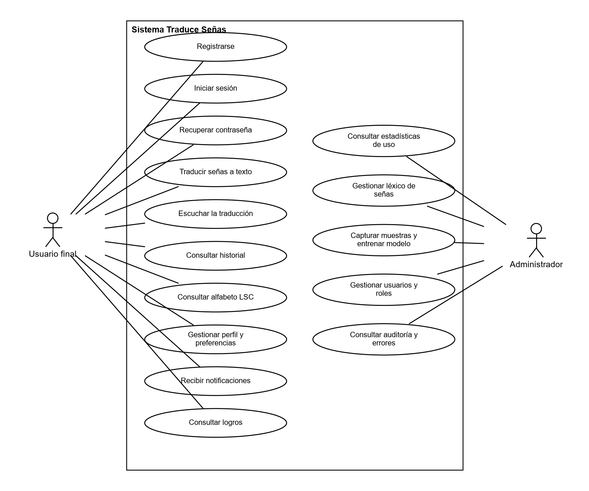

**INFORME DE ESPECIFICACIÓN DE REQUISITOS**

**PROYECTO: Traduce Señas**

**INTEGRANTES:**

**Luis Alejandro Duarte Aldana**

**Juan Mauricio Suaza Solorzano**

**Juan Camilo Fierro Esquivel**

**SERVICIO NACIONAL DE APRENDIZAJE – SENA**

**Análisis y Desarrollo De Software**

2026

**Tabla de contenido**

# Introducción

El presente informe recoge la especificación de requisitos del software Traduce Señas, desarrollado como proyecto formativo del programa Tecnólogo en Análisis y Desarrollo de Software del Servicio Nacional de Aprendizaje (SENA). Su propósito es dejar por escrito, de forma verificable y sin ambigüedades, qué debe hacer el sistema y con qué nivel de calidad, de manera que sirva como acuerdo entre el equipo de desarrollo, el instructor y los futuros usuarios.

El documento sigue la estructura recomendada por el estándar IEEE 830-1998 (Institute of Electrical and Electronics Engineers [IEEE], 1998): primero presenta el contexto del proyecto, después describe el producto de forma general y finalmente detalla los requisitos funcionales, los no funcionales y los casos de uso. Los requisitos aquí descritos son la base de los documentos de análisis, diseño, pruebas e implementación que acompañan esta entrega.

# Información general del proyecto

## Planteamiento del problema

Las personas sordas o con discapacidad auditiva enfrentan barreras persistentes para comunicarse con la población oyente. En Colombia el número de intérpretes certificados de LSC está muy por debajo de la demanda, y la disponibilidad es todavía menor en zonas rurales, entidades públicas y situaciones cotidianas no planificadas (Instituto Nacional para Sordos [INSOR], 2020). Como consecuencia, la persona sorda pierde autonomía y ve reducida su participación en la educación, el trabajo y los servicios de salud.

Frente a esta situación se identifica la necesidad de una solución tecnológica, de bajo costo y al alcance de un teléfono inteligente, que traduzca las señas a texto o voz sin requerir la presencia de un intérprete en las interacciones del día a día.

## Justificación

El proyecto promueve la inclusión social y la igualdad de oportunidades de las personas sordas, en coherencia con la Ley 982 de 2005, que reconoce la LSC y obliga a eliminar las barreras de comunicación. Además, aprovecha tecnologías de visión por computadora ya maduras, como MediaPipe Hands (Zhang et al., 2020), que permiten detectar la mano en tiempo real desde la cámara de un dispositivo común, lo que hace viable el desarrollo por un equipo pequeño.

## Objetivo general

Diseñar e implementar una aplicación móvil y web que traduzca la Lengua de Señas Colombiana a texto o audio en tiempo real, usando visión por computadora e inteligencia artificial, para reducir las barreras de comunicación que enfrentan las personas sordas en entornos cotidianos.

## Objetivos específicos

- Construir una herramienta que reconozca señas de la LSC y entregue la traducción de inmediato.

- Convertir las señas reconocidas en palabras escritas o habladas que cualquier persona oyente comprenda.

- Permitir la comunicación entre personas sordas y oyentes en situaciones como el aula, una tienda o una ventanilla de atención.

- Validar la herramienta en escenarios reales para confirmar que es precisa y útil.

- Contribuir a una sociedad más inclusiva en la que la capacidad auditiva no determine quién puede comunicarse.

## Alcance

El sistema comprende una aplicación para Android, iOS y navegador web que reconoce señas mediante la cámara y entrega la traducción en texto o audio. Incluye gestión de cuentas con roles y permisos, historial de traducciones, consulta del alfabeto en lengua de señas (con modelos 3D), notificaciones visuales, un módulo de logros, estadísticas de uso para el administrador, captura de muestras y entrenamiento del reconocimiento, traza de auditoría, registro de errores y una política de contraseñas configurable.

Queda fuera del alcance de esta versión: la traducción inversa (de texto o voz hacia señas), la cobertura completa del vocabulario de la LSC y el uso sin conexión a internet.

## Personal involucrado

**Tabla 1**

*Equipo del proyecto*

| **Nombre** | **Rol** | **Responsabilidad** | **Contacto** |
|---|---|---|---|
| Juan Mauricio Suaza Solórzano | Líder técnico, Scrum Master, analista y desarrollador | Análisis, diseño, programación del backend (lexicon y recognition) y coordinación | suazasolorzano@gmail.com |
| Luis Alejandro Duarte Aldana | Analista y desarrollador | Análisis, diseño de interfaces y programación | aleosea777@gmail.com |
| Juan Camilo Fierro Esquivel | Analista y desarrollador | Análisis, documentación de producto y programación | fierroesquiveljuancamilo@gmail.com |

*Nota.* Aprendices del programa Tecnólogo en Análisis y Desarrollo de Software del SENA.

## Definiciones, acrónimos y abreviaturas

**Tabla 2**

*Glosario del proyecto*

| **Término** | **Definición** |
|---|---|
| LSC | Lengua de Señas Colombiana, reconocida oficialmente por la Ley 982 de 2005. |
| API Gateway | Punto único de entrada al backend: enruta peticiones, valida el JWT y limita la tasa de peticiones. |
| Microservicio | Servicio pequeño e independiente, con su propia base de datos, que atiende un único dominio del negocio. |
| JWT | JSON Web Token. Credencial firmada que identifica al usuario y sus roles en cada petición. |
| MediaPipe | Biblioteca de Google que detecta la mano en la imagen y devuelve 21 puntos anatómicos (landmarks). |
| Landmark | Cada uno de los 21 puntos de la mano, con coordenadas x, y, z. |
| DTW | Dynamic Time Warping. Algoritmo que compara dos secuencias aunque tengan distinta velocidad. |
| Plantilla | Ejemplo guardado de una seña con el que se compara lo que capta la cámara. |
| Umbral | Distancia máxima aceptada para mostrar una seña como reconocida (hoy 1,1). |
| RabbitMQ | Intermediario de mensajes que transporta los eventos de dominio entre microservicios. |
| Evento de dominio | Mensaje que informa que algo ocurrió, por ejemplo «TranslationProduced». |
| RBAC | Control de acceso basado en roles (USER, ADMIN, LINGUIST). |
| Expo | Plataforma que permite compilar la misma aplicación React Native para Android, iOS y web. |
| RF / RNF | Requisito funcional / requisito no funcional. |
| CU | Caso de uso. |

# Descripción general

## Perspectiva del producto

Traduce Señas es un producto nuevo e independiente. Está pensado para ser educativo, accesible y fácil de usar, de modo que cualquier persona, incluso sin conocimientos previos, pueda interactuar con la comunidad sorda.

Técnicamente, el sistema está formado por un cliente desarrollado con React Native y Expo (que se ejecuta en Android, iOS y navegador web) y un backend de microservicios en Node.js, Express y TypeScript: un API Gateway y cinco servicios de dominio (iam, recognition, lexicon, analytics y profile), cada uno con su propia base de datos PostgreSQL, MongoDB para las muestras de entrenamiento y RabbitMQ para la comunicación asíncrona por eventos.

## Características de los usuarios

**Tabla 3**

*Perfiles de usuario*

| **Perfil** | **Formación** | **Actividades principales** |
|---|---|---|
| Usuario sordo o con hipoacusia | No requiere formación técnica | Hace las señas frente a la cámara, consulta su historial y el alfabeto, configura tema e idioma |
| Usuario oyente | No requiere conocer la LSC | Lee o escucha la traducción y aprende señas básicas con el alfabeto |
| Administrador | Tecnólogo en Análisis y Desarrollo de Software | Supervisa la precisión del reconocimiento, gestiona el léxico y los usuarios, captura muestras, consulta estadísticas y auditoría |

## Restricciones

- **Vocabulario limitado:** el reconocimiento cubre inicialmente el alfabeto y un conjunto reducido de palabras; no cubre toda la LSC.

- **Conectividad:** el registro, el inicio de sesión, el historial y las estadísticas requieren conexión a internet.

- **Hardware:** el dispositivo debe tener cámara y capacidad para procesar video en tiempo real.

- **Datos personales:** el sistema debe cumplir la Ley 1581 de 2012 y el Decreto 1377 de 2013, en especial para las muestras de video y puntos de la mano.

- **Equipo y plazo:** tres aprendices con dedicación parcial y el calendario académico del SENA.

## Suposiciones y dependencias

- Las personas sordas y oyentes están dispuestas a usar la aplicación para comunicarse.

- Se cuenta con apoyo institucional para las pruebas piloto en entornos reales.

- Se dispone de datos públicos de LSC, como el conjunto LSC-54 (Mora-Zarate et al., 2025), para construir las plantillas de reconocimiento.

- Los usuarios tienen acceso a un teléfono inteligente o a un computador con cámara.

- El sistema depende de MediaPipe Tasks Vision (detección de manos y pose), de un modelo propio en TensorFlow.js entrenado con 54 señas y de un servidor de correo SMTP. No usa Firebase: las notificaciones se entregan dentro de la aplicación y por correo (ADR-007).

# Requisitos específicos

## Requisitos comunes de las interfaces

### Interfaces de usuario

La interfaz es inclusiva, intuitiva y accesible: botones grandes (mínimo 48 × 48 dp), iconografía clara, contraste mínimo de 4,5:1 en tema claro y oscuro, y ninguna información transmitida solo por sonido. Contiene un área de video en vivo para el reconocimiento, un panel de traducción, controles de accesibilidad y una sección del alfabeto.

### Interfaces de hardware

- Cámara del dispositivo con resolución mínima de 720p.

- Altavoz o salida de audio para el modo voz.

- Conexión a internet estable.

- Procesador capaz de ejecutar inferencia de visión por computadora en tiempo real.

### Interfaces de software

- Android 9 (API 28) o superior.

- iOS 14 o superior.

- Navegadores de escritorio actualizados con soporte de WebAssembly y acceso a cámara (Chrome, Edge, Firefox).

- Servidor con Docker y Docker Compose para el backend.

### Interfaces de comunicación

- HTTPS para todas las conexiones cliente-servidor.

- API REST con intercambio de datos en formato JSON.

- Autenticación con JWT en el encabezado «Authorization: Bearer».

- Mensajería AMQP (RabbitMQ) entre microservicios, solo dentro de la red interna.

## Requisitos funcionales

La Tabla 4 resume los once requisitos funcionales del sistema y sus especificaciones (ERF). Después se presenta el catálogo detallado, que divide cada requisito en funciones atómicas y verificables, numeradas por módulo.

**Tabla 4**

*Requisitos funcionales del sistema*

| **Código** | **Requisito** | **Especificaciones** | **Prioridad** |
|---|---|---|---|
| RF1 | Gestión de usuarios | ERF1.1 Registro · ERF1.2 Inicio de sesión (propio, Google, Facebook) · ERF1.3 Recuperación de contraseña | Alta |
| RF2 | Navegación del sitio | ERF2.1 Barra de navegación visible en todos los dispositivos | Alta |
| RF3 | Traducción de lengua de señas | ERF3.1 Activación del modo traducción · ERF3.2 Conversión de señas a texto/audio | Alta |
| RF4 | Notificaciones visuales | ERF4.1 Notificaciones en pantalla | Media |
| RF5 | Gestión del perfil | ERF5.1 Ver perfil · ERF5.2 Tema claro/oscuro · ERF5.3 Cambiar contraseña · ERF5.4 Idioma · ERF5.5 Traducciones recientes | Alta |
| RF6 | Estadísticas de uso (solo administrador) | ERF6.1 Acceso a estadísticas | Media |
| RF7 | Alfabeto en lengua de señas | ERF7.1 Visualización del alfabeto | Alta |
| RF8 | Gamificación | ERF8.1 Catálogo de logros y progreso · ERF8.2 Desbloqueo y aviso de logro | Baja |
| RF9 | Auditoría interna | ERF9.1 Consulta de la traza de auditoría | Media |
| RF10 | Manejo de errores | ERF10.1 Clasificación y consulta de errores | Media |
| RF11 | Política de contraseñas | ERF11.1 Configuración de la política | Media |

*Nota.* El estado de RF8 a RF11 queda pendiente de decisión del equipo.

### Módulo de identidad (iam-service)

**Tabla 5**

*Requisitos detallados — Identidad (iam-service)*

| **ID** | **Descripción** | **Origen** | **Prioridad** |
|---|---|---|---|
| FR-001 | Registrar usuario con nombre, correo, contraseña válida y aceptación de los términos con fecha y versión; la cuenta nace INACTIVE hasta verificar el correo | RF1 | Debe |
| FR-002 | Rechazar el registro sin aceptar los términos y guardar fecha y versión aceptada | RF1 | Debe |
| FR-003 | Verificar el correo con un código de 6 dígitos | RF1 | Debe |
| FR-004 | Guardar los códigos solo como hash, con vencimiento, un solo uso y contador de intentos | RF1 | Debe |
| FR-005 | Autenticar con correo y contraseña | RF1 | Debe |
| FR-006 | Bloquear temporalmente tras intentos fallidos (1, 5 y 10 minutos) | RF1 | Debe |
| FR-008 | Registro e inicio de sesión con Google y Facebook | RF1 | Debe |
| FR-010 | Recuperar la contraseña con un código de un solo uso que vence | RF1 | Debe |
| FR-012 | Rotar los tokens de refresco y detectar su reutilización | RF1 | Debe |
| FR-014 | Eliminar la cuenta anonimizando los datos (Ley 1581 de 2012) | RF1, RF5 | Debería |
| FR-015 | El administrador lista, bloquea, restaura y desactiva cuentas | RF1, RF6 | Debería |

*Nota.* Prioridad MoSCoW (Debe, Debería, Podría). El catálogo completo tiene 79 requisitos (04-requirements/functional.md); en estas tablas se muestran los representativos de cada módulo.

### Módulo de autorización (iam-service)

**Tabla 6**

*Requisitos detallados — Autorización (iam-service)*

| **ID** | **Descripción** | **Origen** | **Prioridad** |
|---|---|---|---|
| FR-101 | Control de acceso por roles USER, ADMIN y LINGUIST | RF6 | Debe |
| FR-102 | Los permisos se asignan a roles, nunca directamente a usuarios | RF6 | Debe |
| FR-103 | Negar las funciones de administración a quien no tenga el permiso | RF6 | Debe |
| FR-104 | No permitir borrar un rol asignado a algún usuario | RF6 | Debe |

### Módulo de perfil y notificaciones (profile-service)

**Tabla 7**

*Requisitos detallados — Perfil y notificaciones (profile-service)*

| **ID** | **Descripción** | **Origen** | **Prioridad** |
|---|---|---|---|
| FR-201 | Ver y editar los datos del perfil | RF5 | Debe |
| FR-202 | Cambiar la contraseña cumpliendo la política vigente | RF5 | Debe |
| FR-203 | Elegir tema claro u oscuro | RF5 | Debería |
| FR-204 | Elegir el idioma de la interfaz (español, inglés, francés y portugués) | RF5 | Debería |
| FR-205 | Activar o desactivar todas las notificaciones con un interruptor | RF4, RF5 | Debe |
| FR-502 | Entregar notificaciones solo por canales visuales: en la app y por correo (sin push, ADR-007) | RF4 | Debe |
| FR-507 | Marcar una notificación como leída | RF4 | Debe |

### Módulo de léxico (lexicon-service)

**Tabla 8**

*Requisitos detallados — Léxico (lexicon-service)*

| **ID** | **Descripción** | **Origen** | **Prioridad** |
|---|---|---|---|
| FR-301 | Presentar el catálogo de señas organizado por categoría | RF7 | Debe |
| FR-302 | Buscar señas por nombre | RF7 | Debe |
| FR-303 | Mostrar el detalle de una seña con sus recursos multimedia | RF7 | Debe |
| FR-304 | Presentar el alfabeto (A–Z y Ñ) sin letras repetidas | RF7 | Debe |
| FR-305 | Cada seña tiene un código estable que no cambia al publicarse | RF7 | Debe |
| FR-307 | El administrador crea, edita, publica y retira señas | RF7 | Debe |
| FR-310 | Solo las señas ACTIVE son visibles para el usuario final | RF7 | Debe |

### Módulo de traducción e IA (recognition-service)

**Tabla 9**

*Requisitos detallados — Traducción e IA (recognition-service)*

| **ID** | **Descripción** | **Origen** | **Prioridad** |
|---|---|---|---|
| FR-401 | Capturar señas con la cámara y traducirlas a texto en tiempo real | RF3 | Debe |
| FR-402 | Ofrecer salida en audio, siempre acompañada del texto visible | RF3 | Debería |
| FR-403 | Registrar la confianza y la fuente (motor) de cada traducción | RF3 | Debe |
| FR-405 | Avisar visualmente cuando la seña no se reconoce, en vez de mostrar una traducción errónea | RF3 | Debe |
| FR-406 | Ver el historial propio de traducciones, de la más reciente a la más antigua | RF3, RF5 | Debe |
| FR-407 | Borrar entradas del historial (borrado lógico) | RF5 | Debería |
| FR-601 | Capturar muestras de gestos agrupadas por sesión de captura | RF3 | Debe |
| FR-602 | No guardar ninguna muestra sin consentimiento demostrable | — | Debe |
| FR-605 | Mantener un registro de modelos con sus métricas de entrenamiento | RF3 | Debe |

### Módulo de uso, logros, auditoría y configuración

**Tabla 10**

*Requisitos detallados — Uso, logros, auditoría y configuración*

| **ID** | **Descripción** | **Origen** | **Prioridad** |
|---|---|---|---|
| FR-701 | Registrar un evento cada vez que el usuario entra a una sección | RF6 | Debe |
| FR-703 | Mostrar al administrador las secciones más visitadas | RF6 | Debe |
| FR-706 | Las estadísticas son agregadas y requieren permiso | RF6 | Debe |
| FR-801 | Mantener un catálogo de logros con meta mayor que cero | RF8 | Podría |
| FR-803 | Un logro se desbloquea una sola vez por usuario | RF8 | Podría |
| FR-901 | Mantener una traza de auditoría con valores antes y después | RF9 | Debe |
| FR-904 | Clasificar los errores por tipo (validación, autenticación, permiso, base de datos, etc.) | RF10 | Debe |
| FR-905 | Configurar la política de contraseñas; solo una política activa | RF11 | Debería |

## Requisitos no funcionales

**Tabla 11**

*Requisitos no funcionales y su métrica de aceptación*

| **Código** | **Atributo** | **Requisito y métrica** |
|---|---|---|
| RNF1 | Rendimiento | Respuesta de extremo a extremo de 5 s o menos; latencia P95 < 300 ms en los servicios críticos (login, traducciones, léxico) con 50 peticiones por segundo; ≥ 15 cuadros por segundo durante la captura |
| RNF2 | Usabilidad | Interfaz sencilla; un usuario nuevo completa una traducción sin ayuda en menos de 2 minutos |
| RNF3 | Compatibilidad | Android 9+, iOS 14+ y navegadores de escritorio actualizados |
| RNF4 | Seguridad | Contraseñas con bcrypt; JWT obligatorio con secreto de 32+ caracteres; bloqueo progresivo; límite de peticiones en /api/auth; HTTPS en producción |
| RNF5 | Adaptabilidad / escalabilidad | 500 usuarios concurrentes y 5 000 registrados; cada microservicio escala por separado |
| RNF6 | Documentación | Manuales técnico, de instalación y de usuario; contratos OpenAPI de cada servicio |
| RNF7 | Tolerancia a fallos | Un fallo de un servicio no detiene a los demás; el bus de eventos se reconecta solo |
| RNF8 | Protección de datos personales | Autorización expresa con fecha y versión; derecho de supresión; muestras desvinculadas de la identidad |
| RNF9 | Accesibilidad | WCAG 2.1 nivel AA como meta; ninguna información solo por sonido; contraste 4,5:1; objetivos táctiles de 48 dp |
| RNF10 | Observabilidad | Endpoint GET /health en cada servicio; registros estructurados y errores clasificados |
| RNF11 | Mantenibilidad | Arquitectura hexagonal; cobertura de pruebas unitarias ≥ 80 %; convenciones de commits y ramas |
| RNF12 | Recuperación ante desastres | Copias de seguridad diarias de las bases de datos; restauración documentada en menos de 4 horas |

*Nota.* La accesibilidad se trata como restricción principal porque los usuarios primarios son personas sordas (World Wide Web Consortium [W3C], 2018).

# Requisitos de casos de uso

## Diagrama UML de casos de uso

**Figura 1**

*Diagrama general de casos de uso*

*Nota.* Elaboración propia.

## Caracterización de casos de uso

**Tabla 12**

*Caracterización del caso de uso CU-01 Iniciar sesión*

| **Elemento** | **Descripción** |
|---|---|
| Actores | Usuario final, Administrador |
| Requisito | RF1 / ERF1.2 |
| Precondición | La cuenta existe y está ACTIVE |
| Flujo principal | 1. El usuario abre la aplicación y elige «Iniciar sesión». 2. Ingresa correo y contraseña. 3. El sistema valida las credenciales. 4. El sistema muestra el panel principal. |
| Flujos alternos | 3a. Credenciales inválidas: muestra error y suma un intento fallido. 3b. Se superan los intentos: la cuenta se bloquea temporalmente. |
| Postcondición | El usuario tiene una sesión activa con su token |

**Tabla 13**

*Caracterización del caso de uso CU-02 Registrarse*

| **Elemento** | **Descripción** |
|---|---|
| Actores | Usuario final |
| Requisito | RF1 / ERF1.1 |
| Precondición | El correo no está registrado |
| Flujo principal | 1. El usuario elige «Registrarse». 2. Diligencia el formulario y acepta los términos. 3. El sistema crea la cuenta y envía un código. 4. El usuario ingresa el código y la cuenta queda activa. |
| Flujos alternos | 2a. Datos inválidos o términos sin aceptar: el sistema muestra los errores. 4a. Código vencido: el usuario solicita reenviarlo. |
| Postcondición | Cuenta ACTIVE, perfil y preferencias creados |

**Tabla 14**

*Caracterización del caso de uso CU-03 Traducir señas a texto*

| **Elemento** | **Descripción** |
|---|---|
| Actores | Usuario final |
| Requisito | RF3 / ERF3.1, ERF3.2 |
| Precondición | Sesión iniciada y permiso de cámara |
| Flujo principal | 1. El usuario abre «Traducción» y pulsa «Iniciar cámara». 2. Realiza la seña frente a la cámara. 3. El sistema reconoce la seña y muestra el texto. 4. Opcionalmente reproduce la voz. 5. El sistema guarda la traducción en el historial. |
| Flujos alternos | 1a. Sin permiso de cámara: el sistema lo solicita. 3a. Seña no reconocida: aviso visual, no se muestra palabra. |
| Postcondición | La traducción queda en el historial del usuario |

**Tabla 15**

*Caracterización del caso de uso CU-04 Consultar alfabeto LSC*

| **Elemento** | **Descripción** |
|---|---|
| Actores | Usuario final |
| Requisito | RF7 / ERF7.1 |
| Precondición | Ninguna (disponible también en la demo) |
| Flujo principal | 1. El usuario abre «Alfabeto». 2. El sistema muestra las letras. 3. El usuario elige una letra y ve su modelo 3D y descripción. |
| Flujos alternos | 2a. Sin conexión: se muestran las letras guardadas en caché. |
| Postcondición | El usuario visualiza la seña elegida |

**Tabla 16**

*Caracterización del caso de uso CU-05 Consultar estadísticas de uso*

| **Elemento** | **Descripción** |
|---|---|
| Actores | Administrador |
| Requisito | RF6 / ERF6.1 |
| Precondición | Sesión con rol ADMIN |
| Flujo principal | 1. El administrador abre «Estadísticas». 2. El sistema muestra traducciones por día, secciones más visitadas y señas más usadas. |
| Flujos alternos | 1a. Usuario sin rol ADMIN: el sistema niega el acceso (403). |
| Postcondición | Estadísticas agregadas visibles |

**Tabla 17**

*Caracterización del caso de uso CU-06 Capturar muestras y entrenar*

| **Elemento** | **Descripción** |
|---|---|
| Actores | Administrador |
| Requisito | RF3 / FR-601…606 |
| Precondición | Sesión con rol ADMIN y consentimiento del firmante |
| Flujo principal | 1. El administrador abre «Entrenamiento». 2. Elige la seña y captura muestras. 3. El sistema guarda las muestras. 4. El administrador genera y publica las plantillas. |
| Flujos alternos | 3a. Sin consentimiento: la muestra se rechaza. 2a. Descarta la sesión de captura completa. |
| Postcondición | Nuevas plantillas disponibles para el reconocimiento |

# Trazabilidad

Cada requisito funcional está ligado a la historia de usuario que lo planifica y a las tablas que lo persisten. La matriz de trazabilidad completa se mantiene en el repositorio de documentación (04-requirements/traceability-matrix.md). La Tabla 18 resume el estado de implementación de los 79 requisitos detallados según esa matriz.

**Tabla 18**

*Estado de implementación de los requisitos detallados*

| **Estado** | **Requisitos detallados** |
|---|---|
| Cubiertos | 47 |
| Parciales | 10 |
| Sin implementar | 20 |
| Sin verificar | 2 |
| **Total** | **79** |

# Conclusiones

La especificación deja definidos once requisitos funcionales, desglosados en 79 requisitos detallados, y doce requisitos no funcionales. De los 79 requisitos detallados, 47 están cubiertos, 10 de forma parcial, 20 sin implementar y 2 sin verificar. La accesibilidad y la protección de datos personales se establecen como restricciones principales por la naturaleza de los usuarios y de la información biométrica que maneja el sistema.

Este documento es la línea base para el análisis, el diseño y las pruebas; cualquier cambio de alcance debe registrarse aquí y en la matriz de trazabilidad antes de implementarse.

# Referencias

Congreso de la República de Colombia. (2005, 2 de agosto). *Ley 982 de 2005, por la cual se establecen normas tendientes a la equiparación de oportunidades para las personas sordas y sordociegas*. Diario Oficial No. 45.995.

Congreso de la República de Colombia. (2012, 17 de octubre). *Ley Estatutaria 1581 de 2012, por la cual se dictan disposiciones generales para la protección de datos personales*. Diario Oficial No. 48.587.

Institute of Electrical and Electronics Engineers. (1998). *IEEE recommended practice for software requirements specifications* (IEEE Std 830-1998). IEEE. https://doi.org/10.1109/IEEESTD.1998.88286

Instituto Nacional para Sordos. (2020). *Observatorio social de la población sorda colombiana*. INSOR. https://www.insor.gov.co/observatorio/

Mora-Zarate, J. E., Garzón-Castro, C. L., & Castellanos Rivillas, J. A. (2025). LSC-54: A landmark-based dataset for Colombian Sign Language. *Data in Brief*. https://doi.org/10.1016/j.dib.2025.112145

Presidencia de la República de Colombia. (2013, 27 de junio). *Decreto 1377 de 2013, por el cual se reglamenta parcialmente la Ley 1581 de 2012*. Diario Oficial No. 48.834.

Pressman, R. S., & Maxim, B. R. (2020). *Software engineering: A practitioner's approach* (9.ª ed.). McGraw-Hill Education.

Sommerville, I. (2016). *Software engineering* (10.ª ed.). Pearson.

World Wide Web Consortium. (2018). *Web Content Accessibility Guidelines (WCAG) 2.1*. W3C. https://www.w3.org/TR/WCAG21/

Zhang, F., Bazarevsky, V., Vakunov, A., Tkachenka, A., Sung, G., Chang, C.-L., & Grundmann, M. (2020). *MediaPipe Hands: On-device real-time hand tracking* (arXiv:2006.10214). arXiv. https://doi.org/10.48550/arXiv.2006.10214
