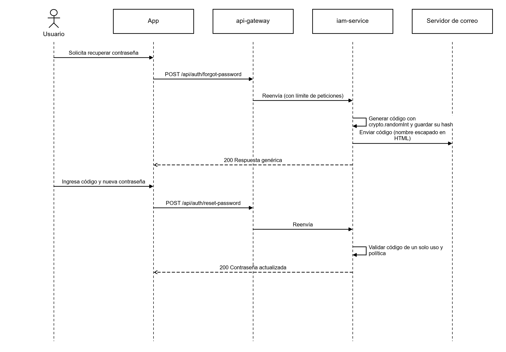
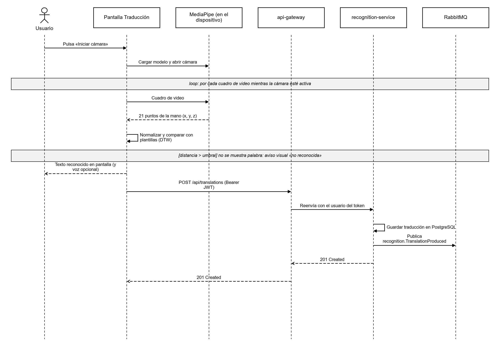
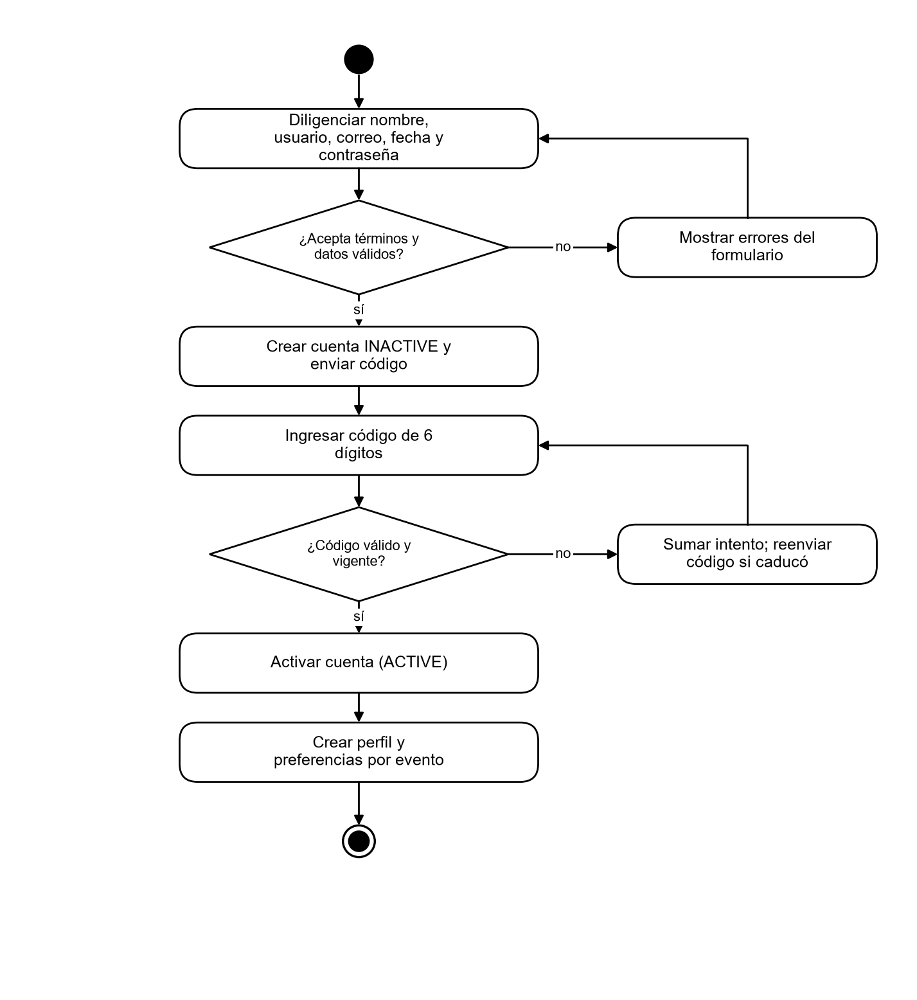

**SOFTWARE ANALYSIS DOCUMENT (DYNAMIC VIEWS)**

**PROJECT: Traduce Señas**

**TEAM MEMBERS:**

**Luis Alejandro Duarte Aldana**

**Juan Mauricio Suaza Solorzano**

**Juan Camilo Fierro Esquivel**

**NATIONAL LEARNING SERVICE – SENA**

**Software Analysis and Development**

2026

**Table of Contents**

# Introduction

This document presents the analysis of the Traduce Señas software from its dynamic view, that is, it describes how the system behaves over time: which messages its components exchange, which activities are executed, through which states its main objects pass, and how the microservices collaborate to fulfill each requirement.

the Unified Modeling Language (UML) is used, following the notation of Booch et al. (2005). Use case, sequence, activity, state machine, and communication diagrams are included. All diagrams are based on the requirements of the specification report and on the microservices architecture implemented in the backend repository.

## Purpose of the document

To describe the dynamic behavior of the system's critical processes so that the development team, the instructor, the evaluators, and anyone else can understand how each requirement is resolved before reviewing the code.

## Scope of the analysis

The analysis covers the processes with the greatest value and risk: login, registration with email verification, password recovery, live sign translation, and capture of training samples. Simple query processes (view alphabet, view history, view statistics) follow the same request-response pattern and are summarized in tables.

# Context of the analysis

Technically, the system consists of a client built with React Native and Expo (running on Android, iOS, and the web browser) and a microservices backend built with Node.js, Express, and TypeScript: an API Gateway and five domain services (iam, recognition, lexicon, analytics, and profile), each with its own PostgreSQL database, MongoDB for training samples, and RabbitMQ for asynchronous event-based communication.

**Table 1**

*Participants appearing in the dynamic diagrams*

| **Participant** | **Type** | **Responsibility in the behavior** |
|---|---|---|
| End user | Actor | Deaf or hearing person who uses the application |
| Administrator | Actor | Manages the lexicon, users, and samples, and queries statistics |
| App (React Native / Expo) | Client | Interface, camera, local recognition with MediaPipe, and REST calls |
| MediaPipe | On-device library | Detects the hand and returns 21 points per video frame |
| api-gateway | Edge service | Single entry point: validates JWT, limits requests, and routes |
| iam-service | Microservice | Accounts, authentication, roles, and password recovery |
| recognition-service | Microservice | Translations, sign templates, and training samples |
| lexicon-service | Microservice | Sign catalog, categories, and alphabet |
| analytics-service | Microservice | Recording of usage events and statistics |
| profile-service | Microservice | Profile, preferences, notifications, and achievements |
| RabbitMQ | Message broker | Transports domain events between services |

# Use case model

The use case diagram defines the boundaries of the actors' interactions with the system and is the starting point for the other dynamic views. The administrator inherits all the capabilities of the end user and also has access to the management functions.

**Figure 1**

*System use case diagram*

*Note.* Own elaboration.

**Table 2**

*Relationship between use cases and dynamic diagrams*

| **Use case** | **Requirement** | **Diagrams that describe it** |
|---|---|---|
| CU-01 Log in | RF1 | Sequence (Figure 2), account states (Figure 9) |
| CU-02 Register | RF1 | Sequence (Figure 3), activities (Figure 8) |
| CU-03 Recover password | RF1 | Sequence (Figure 4) |
| CU-04 Translate signs to text | RF3 | Sequence (Figure 5), activities (Figure 7), states (Figure 10), communication (Figure 11) |
| CU-05 Capture samples and train | RF3 | Sequence (Figure 6) |

# Sequence diagrams

Sequence diagrams show the temporal order of messages between participants. Solid arrows are calls; dashed arrows are responses. Gray boxes indicate conditions or repetitions.

## Log in

The client never calls a microservice directly: all requests go through the api-gateway on port 8080. The /api/auth route is public, so the gateway forwards it without requiring a token. The iam-service compares the password hash with bcrypt, verifies that the account is active, and signs a JWT that includes the user identifier and their roles, so that no other service has to query the iam database (Jones et al., 2015).

**Figure 2**

*Sequence diagram — Log in*

*Note.* Own elaboration.

## Registering and verifying the email

The account is created in the INACTIVE state and is only activated when the user enters the six-digit code sent to their email. The code is stored as a hash, expires, and counts failed attempts. When the account is created, the iam-service publishes the UserRegistered event so that the profile-service creates the profile without a direct call between services.

**Figure 3**

*Sequence diagram — Registration and email verification*

*Note.* Own elaboration.

## Recovering the password

The response to the request is generic so as not to reveal whether an email exists. The code is generated with crypto.randomInt, has an attempt limit, and the /api/auth route has a strict request limit to prevent brute-force attacks.

**Figure 4**

*Sequence diagram — Password recovery*

*Note.* Own elaboration.

## Translating signs live

Recognition runs on the device: MediaPipe obtains the 21 hand points in each frame, the application normalizes them (centers them on the wrist and scales them by the size of the palm), and compares them with the templates using Dynamic Time Warping (Sakoe and Chiba, 1978). If the distance exceeds the threshold, the application does not guess: it displays a visual warning. Only the final result is sent to the backend to be saved in the history, which reduces latency and protects privacy because the video never leaves the device.

**Figure 5**

*Sequence diagram — Live translation*

*Note.* Own elaboration.

## Capturing samples and training the recognition

This flow is restricted to the ADMIN role. Each sample requires demonstrable consent from the signer (Law 1581 of 2012) and is stored in MongoDB, separate from the relational data. With enough samples, the templates are generated, which the application then downloads.

**Figure 6**

*Sequence diagram — Sample capture and training*

*Note.* Own elaboration.

# Activity diagrams

Activity diagrams describe the workflow of a process, including its decisions and cycles.

## Translation process

**Figure 7**

*Activity diagram — Sign translation*

*Note.* Own elaboration.

## Registration process

**Figure 8**

*Activity diagram — User registration*

*Note.* Own elaboration.

# State machine diagrams

## User account states

The user account is the object with the most important lifecycle for security. A temporary lock is a date that lifts itself; when the lock scale is exhausted, the account moves to BLOCKED, and only an administrator can restore it. Deletion anonymizes the data instead of physically erasing it, to preserve audit integrity and comply with the right to erasure.

**Figure 9**

*State diagram — User account*

*Note.* Own elaboration.

**Table 3**

*User account transitions*

| **Source state** | **Event** | **Target state** | **Rule** |
|---|---|---|---|
| — | Registration with email | INACTIVE | Must accept terms (FR-002) |
| — | Registration with Google / Facebook | ACTIVE | The provider has already verified the email (FR-008) |
| INACTIVE | Valid verification code | ACTIVE | Single-use and valid code (FR-004) |
| ACTIVE | Repeated failed attempts | Temporary lock | Waits of 1, 5, and 10 minutes (FR-006) |
| Temporary lock | Lock scale exhausted | BLOCKED | Only an administrator restores (FR-007) |
| ACTIVE | The user deletes their account | Deleted | The row is anonymized (FR-014) |

## States of a translation session

**Figure 10**

*State diagram — Translation session*

*Note.* Own elaboration.

# Communication diagram between services

The communication diagram shows how the objects collaborate to complete a task, numbering the messages. When a translation is saved, the recognition-service publishes TranslationProduced to the traduce.events exchange. The profile-service consumes it to update achievements (for example, “First translation”) and the analytics-service records it as a usage event. No service waits for another's response to complete the user's request, which reduces coupling (Newman, 2021).

**Figure 11**

*Communication diagram — Saved translation and derived events*

*Note.* Own elaboration.

**Table 4**

*Main domain events*

| **Event** | **Publisher** | **Consumers** | **Effect** |
|---|---|---|---|
| iam.UserRegistered | iam-service | profile, analytics | Creates profile and preferences; counts the registration |
| iam.AccountDeletionRequested | iam-service | recognition, profile | Anonymizes history and profile data |
| recognition.TranslationProduced | recognition-service | profile, analytics | Advances achievements; records usage |
| lexicon.SignPublished | lexicon-service | recognition, analytics | Updates the catalog of recognizable signs |
| lexicon.SignWithdrawn | lexicon-service | recognition | Removes the sign from recognition |

# Summary of query interactions

**Table 5**

*Query request-response interactions*

| **Interaction** | **Route (via gateway)** | **Service** | **Access** |
|---|---|---|---|
| View alphabet | GET /api/lexicon/alphabet | lexicon-service | Public |
| Search signs | GET /api/lexicon/search | lexicon-service | Public |
| View history | GET /api/translations/history | recognition-service | Authenticated user (own data only) |
| Delete from history | DELETE /api/translations/:id | recognition-service | Owner of the translation |
| View profile | GET /api/profile/me | profile-service | Authenticated user |
| View statistics | GET /api/analytics/summary, /daily, /top-signs | analytics-service | ADMIN role |
| Manage roles | POST /api/iam/users/:id/roles | iam-service | ADMIN role |

# Conclusions

The dynamic views confirm three decisions from the analysis: recognition is performed on the device to meet the real-time requirement and protect privacy; every request goes through a single gateway that centralizes security; and the services are coordinated through asynchronous events, so that the failure of one does not block the user's operation.

The diagrams in this document serve as a reference for the detailed design and for writing the integration and end-to-end test cases.

# References

Booch, G., Rumbaugh, J., & Jacobson, I. (2005). *The unified modeling language user guide* (2nd ed.). Addison-Wesley.

Congreso de la República de Colombia. (2012, October 17). *Ley Estatutaria 1581 de 2012, por la cual se dictan disposiciones generales para la protección de datos personales*. Diario Oficial No. 48,587.

Jones, M., Bradley, J., & Sakimura, N. (2015). *JSON Web Token (JWT)* (RFC 7519). Internet Engineering Task Force. https://doi.org/10.17487/RFC7519

Newman, S. (2021). *Building microservices: Designing fine-grained systems* (2nd ed.). O'Reilly Media.

Pressman, R. S., & Maxim, B. R. (2020). *Software engineering: A practitioner's approach* (9th ed.). McGraw-Hill Education.

Sakoe, H., & Chiba, S. (1978). Dynamic programming algorithm optimization for spoken word recognition. *IEEE Transactions on Acoustics, Speech, and Signal Processing, 26*(1), 43–49. https://doi.org/10.1109/TASSP.1978.1163055

Sommerville, I. (2016). *Software engineering* (10th ed.). Pearson.

Zhang, F., Bazarevsky, V., Vakunov, A., Tkachenka, A., Sung, G., Chang, C.-L., & Grundmann, M. (2020). *MediaPipe Hands: On-device real-time hand tracking* (arXiv:2006.10214). arXiv. https://doi.org/10.48550/arXiv.2006.10214
