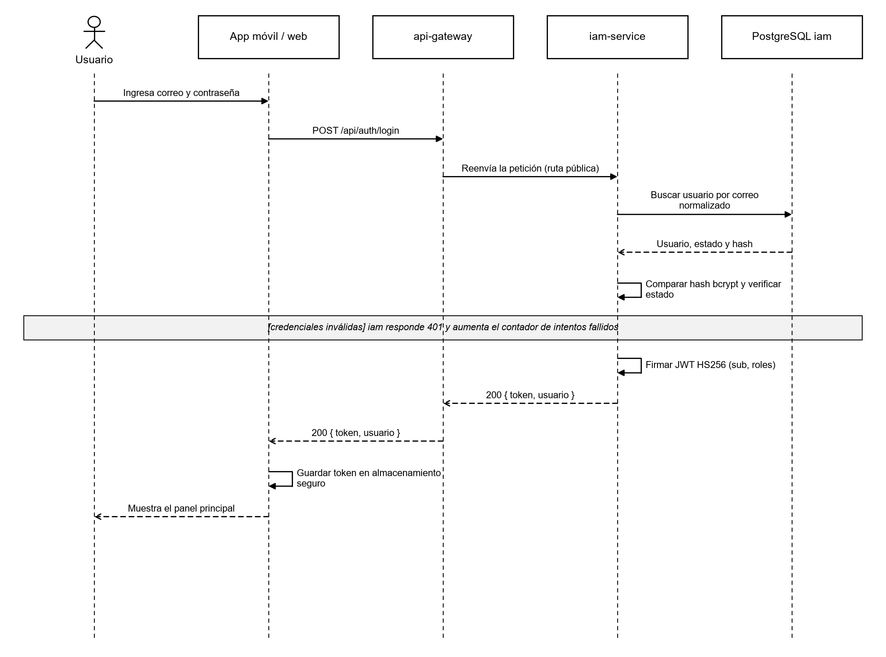
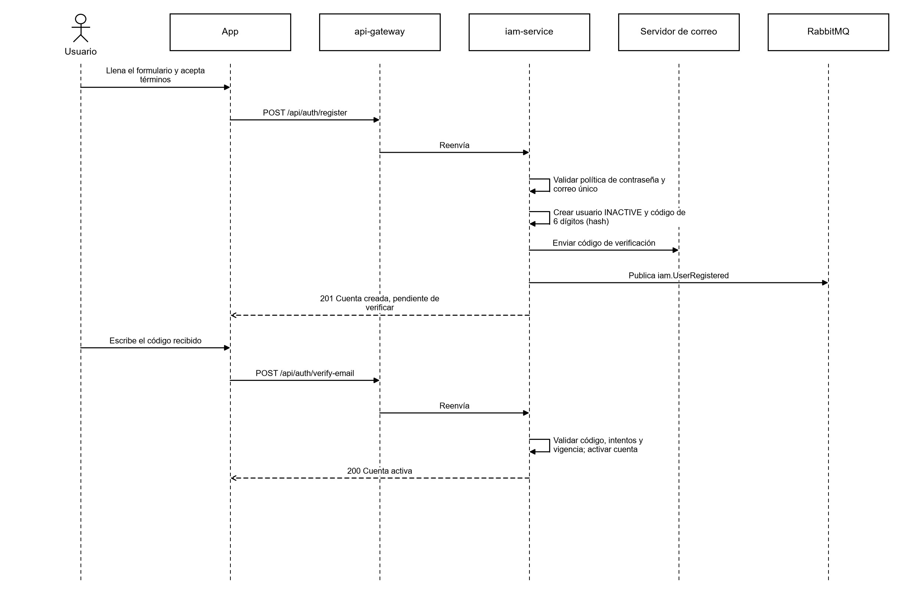
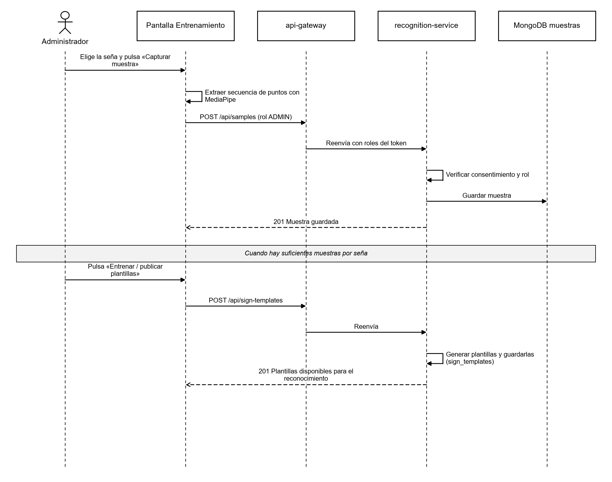
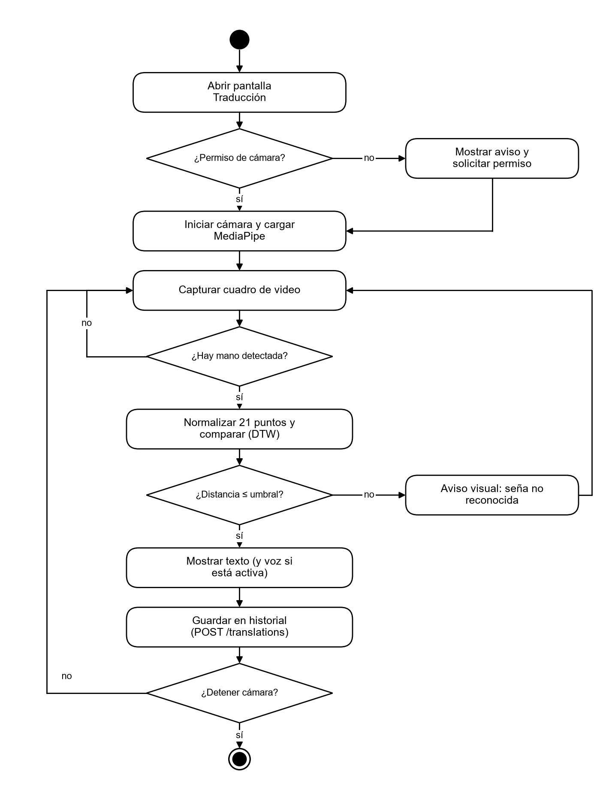
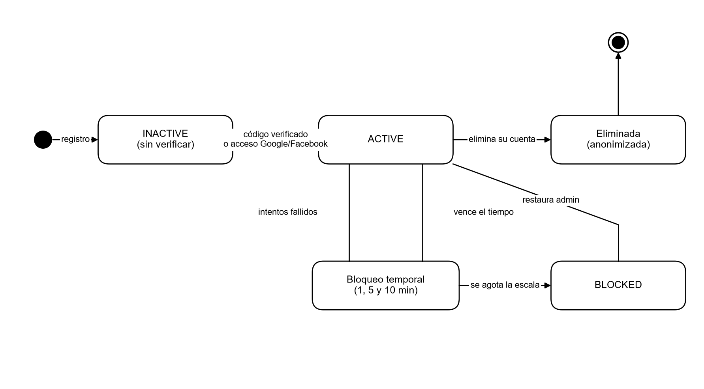
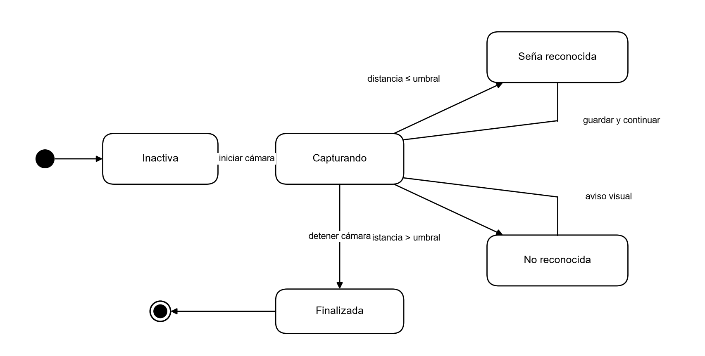
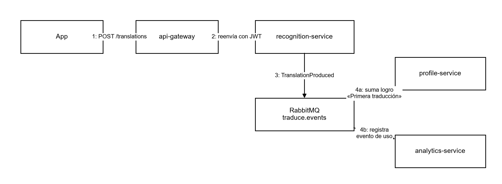

**DOCUMENTACIÓN DE ANÁLISIS DEL SOFTWARE (VISTAS DINÁMICAS)**

**PROYECTO: Traduce Señas**

**INTEGRANTES:**

**Luis Alejandro Duarte Aldana**

**Juan Mauricio Suaza Solorzano**

**Juan Camilo Fierro Esquivel**

**SERVICIO NACIONAL DE APRENDIZAJE – SENA**

**Análisis y Desarrollo De Software**

2026

**Tabla de contenido**

# Introducción

Este documento presenta el análisis del software Traduce Señas desde su vista dinámica, es decir, describe cómo se comporta el sistema en el tiempo: qué mensajes intercambian sus componentes, qué actividades se ejecutan, por qué estados pasan sus objetos principales y cómo colaboran los microservicios para cumplir cada requisito.

se usa el Lenguaje Unificado de Modelado (UML), siguiendo la notación de Booch et al. (2005). Se incluyen diagramas de casos de uso, de secuencia, de actividades, de máquina de estados y de comunicación. Todos los diagramas parten de los requisitos del informe de especificación y de la arquitectura de microservicios que está implementada en el repositorio del backend.

## Objetivo del documento

Describir el comportamiento dinámico de los procesos críticos del sistema para que el equipo de desarrollo, el instructor, los evaluadores y personas que entiendan cómo se resuelve cada requisito antes de revisar el código.

## Alcance del análisis

El análisis cubre los procesos que más valor y riesgo tienen: inicio de sesión, registro con verificación de correo, recuperación de contraseña, traducción de señas en vivo y captura de muestras para entrenamiento. Los procesos de consulta simple (ver alfabeto, ver historial, ver estadísticas) siguen el mismo patrón petición-respuesta y se resumen en tablas.

Un proceso posterior a estos diagramas es el reto diario: cuando se guarda una traducción, profile-service recibe el evento TranslationProduced, suma uno al reto del día del usuario y, al llegar a la meta, guarda los puntos y crea el aviso de reto completado. Los puntos acumulados desbloquean medallas. El historial agrupa las traducciones por sesión y las traducciones se borran a los 30 días.

# Contexto del análisis

Técnicamente, el sistema está formado por un cliente desarrollado con React Native y Expo (que se ejecuta en Android, iOS y navegador web) y un backend de microservicios en Node.js, Express y TypeScript: un API Gateway y cinco servicios de dominio (iam, recognition, lexicon, analytics y profile), cada uno con su propia base de datos PostgreSQL, MongoDB para las muestras de entrenamiento y RabbitMQ para la comunicación asíncrona por eventos.

**Tabla 1**

*Participantes que aparecen en los diagramas dinámicos*

| **Participante** | **Tipo** | **Responsabilidad en el comportamiento** |
|---|---|---|
| Usuario final | Actor | Persona sorda u oyente que usa la aplicación |
| Administrador | Actor | Gestiona léxico, usuarios, muestras y consulta estadísticas |
| App (React Native / Expo) | Cliente | Interfaz, cámara, reconocimiento local con MediaPipe y llamadas REST |
| MediaPipe | Biblioteca en el dispositivo | Detecta la mano y entrega 21 puntos por cuadro de video |
| api-gateway | Servicio de borde | Punto único de entrada: valida JWT, limita peticiones y enruta |
| iam-service | Microservicio | Cuentas, autenticación, roles y recuperación de contraseña |
| recognition-service | Microservicio | Traducciones, plantillas de señas y muestras de entrenamiento |
| lexicon-service | Microservicio | Catálogo de señas, categorías y alfabeto |
| analytics-service | Microservicio | Registro de eventos de uso y estadísticas |
| profile-service | Microservicio | Perfil, preferencias, notificaciones y logros |
| RabbitMQ | Intermediario de mensajes | Transporta los eventos de dominio entre servicios |

# Modelo de casos de uso

El diagrama de casos de uso delimita las interacciones de los actores con el sistema y es el punto de partida de las demás vistas dinámicas. El administrador hereda todas las capacidades del usuario final y además accede a las funciones de gestión.

**Figura 1**

*Diagrama de casos de uso del sistema*

*Nota.* Elaboración propia.

**Tabla 2**

*Relación entre casos de uso y diagramas dinámicos*

| **Caso de uso** | **Requisito** | **Diagramas que lo describen** |
|---|---|---|
| CU-01 Iniciar sesión | RF1 | Secuencia (Figura 2), estados de la cuenta (Figura 9) |
| CU-02 Registrarse | RF1 | Secuencia (Figura 3), actividades (Figura 8) |
| CU-03 Recuperar contraseña | RF1 | Secuencia (Figura 4) |
| CU-04 Traducir señas a texto | RF3 | Secuencia (Figura 5), actividades (Figura 7), estados (Figura 10), comunicación (Figura 11) |
| CU-05 Capturar muestras y entrenar | RF3 | Secuencia (Figura 6) |

# Diagramas de secuencia

Los diagramas de secuencia muestran el orden temporal de los mensajes entre participantes. Las flechas continuas son llamadas; las discontinuas, respuestas. Los recuadros grises indican condiciones o repeticiones.

## Iniciar sesión

El cliente nunca llama directamente a un microservicio: todas las peticiones pasan por el api-gateway en el puerto 8080. La ruta /api/auth es pública, por lo que el gateway la reenvía sin exigir token. El iam-service compara el hash de la contraseña con bcrypt, verifica que la cuenta esté activa y firma un JWT que incluye el identificador del usuario y sus roles, de modo que ningún otro servicio tenga que consultar la base de datos de iam (Jones et al., 2015).

**Figura 2**

*Diagrama de secuencia — Iniciar sesión*

*Nota.* Elaboración propia.

## Registrarse y verificar el correo

La cuenta se crea en estado INACTIVE y solo se activa cuando el usuario escribe el código de seis dígitos enviado a su correo. El código se guarda como hash, vence y cuenta los intentos fallidos. Al crearse la cuenta, iam-service publica el evento UserRegistered para que profile-service cree el perfil sin llamada directa entre servicios.

**Figura 3**

*Diagrama de secuencia — Registro y verificación de correo*

*Nota.* Elaboración propia.

## Recuperar la contraseña

La respuesta a la solicitud es genérica para no revelar si un correo existe. El código se genera con crypto.randomInt, tiene límite de intentos y la ruta /api/auth tiene un límite estricto de peticiones para impedir ataques de fuerza bruta.

**Figura 4**

*Diagrama de secuencia — Recuperación de contraseña*

*Nota.* Elaboración propia.

## Traducir señas en vivo

El reconocimiento se ejecuta en el dispositivo: MediaPipe obtiene los 21 puntos de la mano en cada cuadro, la aplicación los normaliza (centra en la muñeca y escala por el tamaño de la palma) y los compara con las plantillas mediante Dynamic Time Warping (Sakoe y Chiba, 1978). Si la distancia supera el umbral, la aplicación no adivina: muestra un aviso visual. Solo el resultado final viaja al backend para guardarse en el historial, lo que reduce la latencia y protege la privacidad porque el video nunca sale del dispositivo.

**Figura 5**

*Diagrama de secuencia — Traducción en vivo*

*Nota.* Elaboración propia.

## Capturar muestras y entrenar el reconocimiento

Este flujo está restringido al rol ADMIN. Cada muestra exige consentimiento demostrable del firmante (Ley 1581 de 2012) y se guarda en MongoDB, separada de los datos relacionales. Con suficientes muestras se generan las plantillas que después descarga la aplicación.

**Figura 6**

*Diagrama de secuencia — Captura de muestras y entrenamiento*

*Nota.* Elaboración propia.

# Diagramas de actividades

Los diagramas de actividades describen el flujo de trabajo de un proceso, con sus decisiones y ciclos.

## Proceso de traducción

**Figura 7**

*Diagrama de actividades — Traducción de señas*

*Nota.* Elaboración propia.

## Proceso de registro

**Figura 8**

*Diagrama de actividades — Registro de usuario*

*Nota.* Elaboración propia.

# Diagramas de máquina de estados

## Estados de la cuenta de usuario

La cuenta de usuario es el objeto con el ciclo de vida más importante para la seguridad. El bloqueo temporal es una fecha que se levanta sola; al agotarse la escala de bloqueos la cuenta pasa a BLOCKED y solo un administrador puede restaurarla. La eliminación anonimiza los datos en lugar de borrarlos físicamente, para conservar la integridad de la auditoría y cumplir el derecho de supresión.

**Figura 9**

*Diagrama de estados — Cuenta de usuario*

*Nota.* Elaboración propia.

**Tabla 3**

*Transiciones de la cuenta de usuario*

| **Estado origen** | **Evento** | **Estado destino** | **Regla** |
|---|---|---|---|
| — | Registro con correo | INACTIVE | Debe aceptar términos (FR-002) |
| — | Registro con Google / Facebook | ACTIVE | El proveedor ya verificó el correo (FR-008) |
| INACTIVE | Código de verificación válido | ACTIVE | Código de un solo uso y vigente (FR-004) |
| ACTIVE | Intentos fallidos repetidos | Bloqueo temporal | Esperas de 1, 5 y 10 minutos (FR-006) |
| Bloqueo temporal | Se agota la escala | BLOCKED | Solo un administrador restaura (FR-007) |
| ACTIVE | El usuario elimina su cuenta | Eliminada | Se anonimiza la fila (FR-014) |

## Estados de una sesión de traducción

**Figura 10**

*Diagrama de estados — Sesión de traducción*

*Nota.* Elaboración propia.

# Diagrama de comunicación entre servicios

El diagrama de comunicación muestra cómo colaboran los objetos para completar una tarea, numerando los mensajes. Cuando se guarda una traducción, recognition-service publica TranslationProduced en el exchange  traduce.events. profile-service lo consume para actualizar los logros (por ejemplo, «Primera traducción») y analytics-service lo registra como evento de uso. Ningún servicio espera la respuesta de otro para completar la petición del usuario, lo que reduce el acoplamiento (Newman, 2021).

**Figura 11**

*Diagrama de comunicación — Traducción guardada y eventos derivados*

*Nota.* Elaboración propia.

**Tabla 4**

*Eventos de dominio principales*

| **Evento** | **Publicador** | **Consumidores** | **Efecto** |
|---|---|---|---|
| iam.UserRegistered | iam-service | profile, analytics | Crea perfil y preferencias; cuenta el registro |
| iam.AccountDeletionRequested | iam-service | recognition, profile | Anonimiza historial y datos de perfil |
| recognition.TranslationProduced | recognition-service | profile, analytics | Avanza logros; registra uso |
| lexicon.SignPublished | lexicon-service | recognition, analytics | Actualiza el catálogo de señas reconocibles |
| lexicon.SignWithdrawn | lexicon-service | recognition | Retira la seña del reconocimiento |

# Resumen de interacciones de consulta

**Tabla 5**

*Interacciones petición-respuesta de consulta*

| **Interacción** | **Ruta (vía** **gateway)** | **Servicio** | **Acceso** |
|---|---|---|---|
| Ver alfabeto | GET /api/lexicon/alphabet | lexicon-service | Público |
| Buscar señas | GET /api/lexicon/search | lexicon-service | Público |
| Ver historial | GET /api/translations/history | recognition-service | Usuario autenticado (solo el propio) |
| Borrar del historial | DELETE /api/translations/:id | recognition-service | Dueño de la traducción |
| Ver perfil | GET /api/profile/me | profile-service | Usuario autenticado |
| Ver estadísticas | GET /api/analytics/summary, /daily, /top-signs | analytics-service | Rol ADMIN |
| Gestionar roles | POST /api/iam/users/:id/roles | iam-service | Rol ADMIN |

# Conclusiones

Las vistas dinámicas confirman tres decisiones del análisis: el reconocimiento se hace en el dispositivo para cumplir el requisito de tiempo real y proteger la privacidad; toda petición pasa por un único gateway que concentra la seguridad; y los servicios se coordinan con eventos asíncronos, de modo que la falla de uno no bloquea la operación del usuario.

Los diagramas de este documento sirven como referencia para el diseño detallado y para escribir los casos de prueba de integración y de extremo a extremo.

# Referencias

Booch, G., Rumbaugh, J., & Jacobson, I. (2005). *The* *unified*  *modeling*  *language*  *user* *guide* (2.ª ed.). Addison-Wesley.

Congreso de la República de Colombia. (2012, 17 de octubre). *Ley Estatutaria 1581 de 2012, por la cual se dictan disposiciones generales para la protección de datos personales*. Diario Oficial No. 48.587.

Jones, M., Bradley, J., & Sakimura, N. (2015). *JSON Web Token (JWT)* (RFC 7519). Internet Engineering  Task Force. https://doi.org/10.17487/RFC7519

Newman, S. (2021). *Building* *microservices**:* *Designing* *fine-**grained*  *systems* (2.ª ed.). O'Reilly Media.

Pressman, R. S., & Maxim, B. R. (2020). *Software* *engineering**: A* *practitioner's*  *approach* (9.ª ed.). McGraw-Hill Education.

Sakoe, H., & Chiba, S. (1978). Dynamic programming  algorithm  optimization  for  spoken  word  recognition. *IEEE* *Transactions*  *on*  *Acoustics**, Speech, and Signal Processing, 26*(1), 43–49. https://doi.org/10.1109/TASSP.1978.1163055

Sommerville, I. (2016). *Software* *engineering* (10.ª ed.). Pearson.

Zhang, F., Bazarevsky, V., Vakunov, A., Tkachenka, A., Sung, G., Chang, C.-L., & Grundmann, M. (2020). *MediaPipe* *Hands:* *On-device* *real-time* *hand* *tracking* (arXiv:2006.10214). arXiv. https://doi.org/10.48550/arXiv.2006.10214
