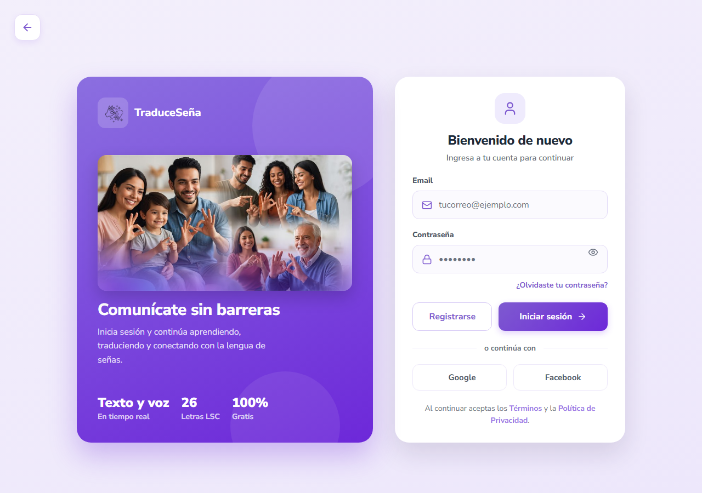
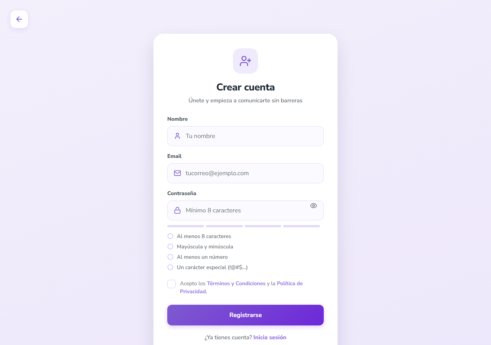
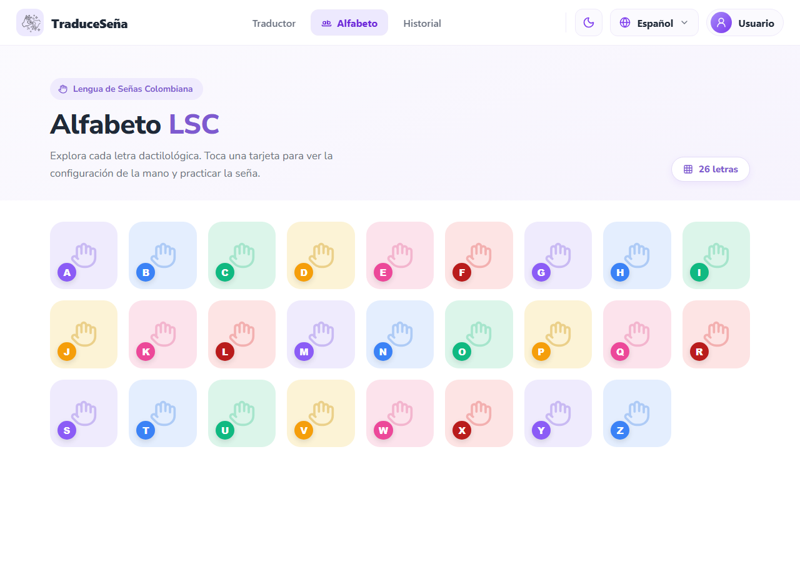
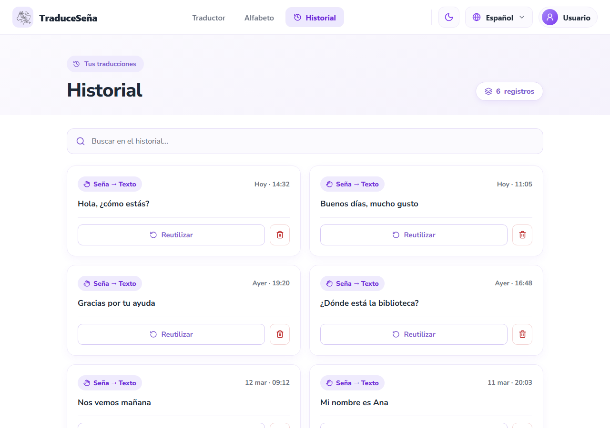
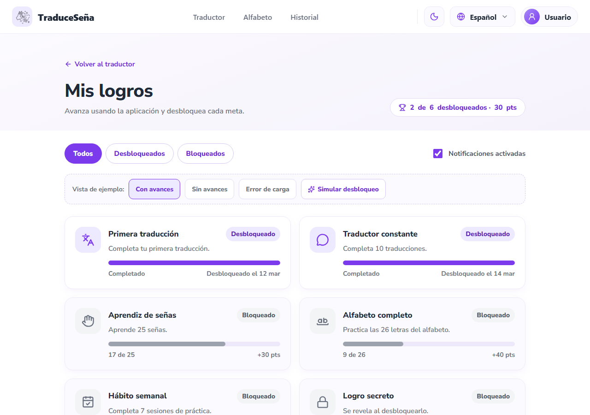
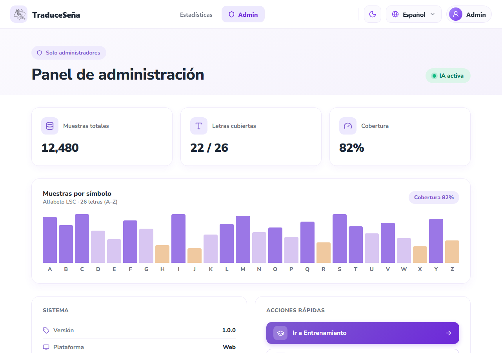
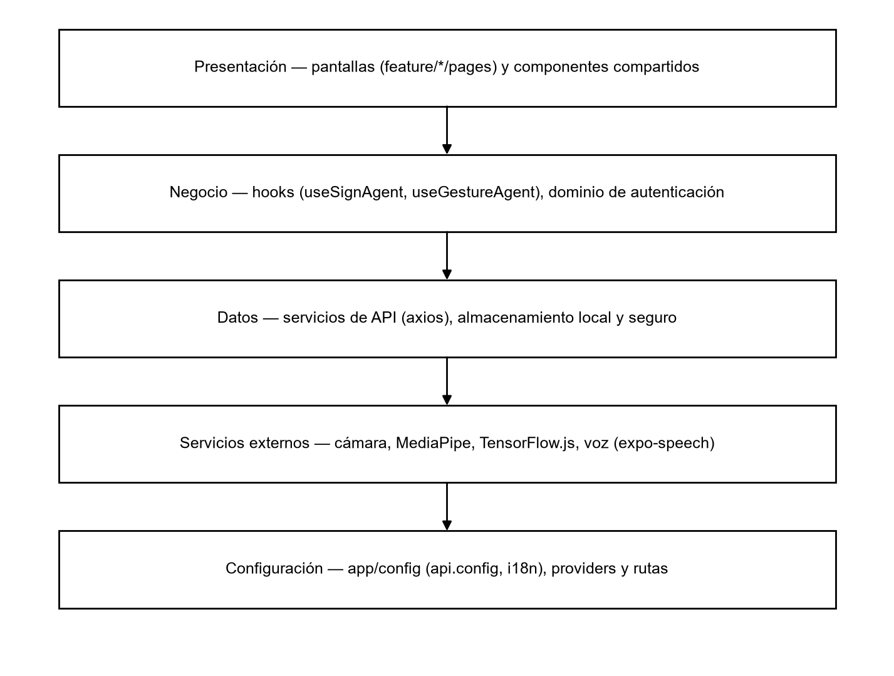

**SOFTWARE DESIGN DOCUMENTATION**

**PROJECT: Traduce Señas**

**TEAM MEMBERS:**

**Luis Alejandro Duarte Aldana**

**Juan Mauricio Suaza Solorzano**

**Juan Camilo Fierro Esquivel**

**NATIONAL LEARNING SERVICE – SENA**

**Software Analysis and Development**

2026

**Table of Contents**

# Introduction

The design document translates the requirements and analysis of Traduce Señas into concrete construction decisions. It brings together four views: the graphical interfaces the user sees, the architectural model that organizes the components, the design patterns applied in the code, and the data model that supports the system's information.

The decisions described here correspond to the code in the frontend and backend repositories (branch feat/microservices-split) and to the high-fidelity prototypes in the documentation repository.

# Graphical interface design

## Design principles

Because the main users are deaf people, the design is based on accessibility (W3C, 2018) and Nielsen's usability principles (1994):

- **Nothing by sound alone:** every audio output has a visible text equivalent.

- **Sufficient contrast:** 4.5:1 for normal text and 3:1 for large text, in light and dark themes.

- **Large touch targets:** minimum 48 × 48 dp; primary actions are 56 dp high.

- **One primary action per view**, so that the user always knows what to do next.

- **Readable text:** body text of 18 px on mobile and 16 px on desktop; no data below 14 px.

## Design system

**Table 1**

*Design system elements*

| **Element** | **Definition** |
|---|---|
| Themes | Light (default) and dark; accent color purple (brand) or green, saved on the device |
| Typography | Nunito Sans. H1 title 32 px, H2 24 px, H3 20 px, body 18/16 px, buttons 18 px in bold |
| Spacing | Scale of 4, 8, 12, 16, 20, 24, 32, 40, 48, and 72 px; side margins of 16 px on mobile and 24 px on desktop |
| Borders | Radius of 12 px on buttons and fields, 18 px on cards |
| Breakpoints | Mobile < 768 px, tablet 768–1023 px, desktop ≥ 1024 px |
| States | Success, error, warning (low confidence, temporary lock), and information, always with text in addition to color |

*Note.* Source: 12-ux-ui/design-system.md from the documentation repository.

## Navigation map

**Table 2**

*System screens and their access*

| **Screen** | **File in the frontend** | **Access** |
|---|---|---|
| Home (landing), About us, Demos | homescreen/pages | Public |
| Sign in, Registration, Verify code | auth/pages | Public |
| Recover and change password | auth/pages | Public / authenticated |
| Translation | Translation/pages/TranslationScreen.tsx | Authenticated |
| Alphabet | Alphabet/pages/AlphabetScreen.tsx | Authenticated (public demo) |
| History | History/pages/HistoryScreen.tsx | Authenticated |
| Profile, Terms, Privacy | Profile/pages | Authenticated |
| Statistics | Stats/pages/StatsScreen.tsx | ADMIN |
| Administration panel, Training, Samples | Admin/pages | ADMIN |

## Prototypes of the main screens

The following figures show the high-fidelity prototypes. They are the visual reference that the screens implemented in React Native follow.

**Figure 1**

*Prototype — Public home page*

*Note.* High-fidelity project prototype (folder 12-ux-ui/mockup of the documentation repository).

**Figure 2**

*Prototype — Sign-in*

*Note.* High-fidelity project prototype (folder 12-ux-ui/mockup of the documentation repository).

**Figure 3**

*Prototype — Account registration*

*Note.* High-fidelity project prototype (folder 12-ux-ui/mockup of the documentation repository).

**Figure 4**

*Prototype — Live translation screen*

*Note.* High-fidelity project prototype (folder 12-ux-ui/mockup of the documentation repository).

**Figure 5**

*Prototype — LSC alphabet*

*Note.* High-fidelity project prototype (folder 12-ux-ui/mockup of the documentation repository).

**Figure 6**

*Prototype — Translation history*

*Note.* High-fidelity project prototype (folder 12-ux-ui/mockup of the documentation repository).

**Figure 7**

*Prototype — Profile management and preferences*

*Note.* High-fidelity project prototype (folder 12-ux-ui/mockup of the documentation repository).

**Figure 8**

*Prototype — User achievements*

*Note.* High-fidelity project prototype (folder 12-ux-ui/mockup of the documentation repository).

**Figure 9**

*Prototype — Administration panel*

*Note.* High-fidelity project prototype (folder 12-ux-ui/mockup of the documentation repository).

**Figure 10**

*Prototype — Usage statistics*

*Note.* High-fidelity project prototype (folder 12-ux-ui/mockup of the documentation repository).

**Figure 11**

*Prototype — Sample capture for training*

*Note.* High-fidelity project prototype (folder 12-ux-ui/mockup of the documentation repository).

# Architectural model

## Architectural style

The backend follows a microservices architecture (Newman, 2021): five domain services behind an API Gateway. Each service has its own process, its own Dockerfile, and its own database; none reads another's database. Synchronous communication is REST through the gateway, and asynchronous communication consists of domain events over RabbitMQ.

Internally, each service applies the hexagonal or ports-and-adapters architecture (Cockburn, 2005; Martin, 2017): the domain and the use cases are at the center and do not know Express, PostgreSQL, or RabbitMQ.

## Container view

**Figure 12**

*Container view (C4 model, level 2)*

*Note.* Own elaboration based on the C4 model (Brown, 2018).

**Table 3**

*Backend components*

| **Component** | **Port** | **Responsibility** | **Storage** |
|---|---|---|---|
| api-gateway | 8080 | Single entry point, JWT validation, request rate limit, CORS with allowlist, proxy | — |
| iam-service | 3001 | Registration, sign-in, email verification, roles and permissions, recovery | PostgreSQL iam |
| recognition-service | 3002 | Translations, sign templates, samples, and training | PostgreSQL recognition + MongoDB |
| lexicon-service | 3003 | Sign catalog, categories, locations, 3D alphabet, and media | PostgreSQL lexicon + .glb/.png files |
| analytics-service | 3004 | Usage events and aggregated statistics | PostgreSQL analytics |
| profile-service | 3005 | Profile, preferences, notifications, and achievements | PostgreSQL profile |
| @traduce/shared | — | Common package: configuration, JWT, HTTP middleware, and event bus | — |

## Internal architecture of each service

**Figure 13**

*Hexagonal architecture of a microservice*

*Note.* Own elaboration.

services/lexicon-service/src/

├── domain/          entities, rules, and invariants

├── application/     use cases

├── ports/           input and output interfaces

├── adapters/

│   ├── inbound/http/   Express routes and controllers

│   └── outbound/       PostgreSQL repositories, RabbitMQ publisher

├── lexicon.module.ts   composition (dependency injection)

└── app.ts              service startup

## Client architecture

The client is organized by feature (src/feature/Translation, Alphabet, auth, History, Profile, Stats, Admin, homescreen) and, within each one, by layer. Shared pieces live in src/shared and configuration in src/app.

**Figure 14**

*React Native client layers*

*Note.* Own elaboration.

## Deployment view

**Figure 15**

*Deployment diagram*

*Note.* Own elaboration.

# Design patterns

The following table summarizes the patterns applied, where they are used, and what problem they solve. They are classified as architectural patterns, object-oriented design patterns (Gamma et al., 1994), and integration patterns.

**Table 4**

*Design patterns applied*

| **Pattern** | **Type** | **Where it is applied** | **Problem it solves** |
|---|---|---|---|
| Ports and adapters (hexagonal) | Architectural | All microservices (domain/, ports/, adapters/) | Isolates business logic from technology |
| API Gateway | Architectural / integration | services/api-gateway | The client knows a single address; security is centralized |
| Database per service | Architectural | One PostgreSQL per service in docker-compose | Independence of deployment and schema |
| Publish-subscribe (domain events) | Integration | RabbitMQ bus in @traduce/shared; exchange traduce.events | Coordination without synchronous coupling |
| Repository | Design (Fowler, 2002) | PostgreSQL and MongoDB output adapters | Data access behind a domain interface |
| Dependency injection / composition root | Design | *.module.ts of each service | Use cases receive their ports already built; facilitates testing |
| Strategy | Behavior (GoF) | Client gesture providers: mediapipeProvider, tfjsProvider, mockProvider | Change the recognition engine without touching the screen |
| Adapter | Structural (GoF) | .web.ts files and native client files (gestureProvider.web.ts) | The same interface works on web and mobile |
| Chain of responsibility | Behavior (GoF) | Express middleware: CORS → rate limit → JWT → proxy | Each filter processes or rejects the request in order |
| Observer | Behavior (GoF) | React hooks (useSignAgent, useGestureAgent) and context providers | The interface reacts to changes in camera and session state |
| Data transfer object (DTO) | Design | Typed event contracts and HTTP responses | Stable contracts between layers and services |
| Retry with backoff | Resilience | subscribeWithRetry and event bus reconnection | Tolerates temporary RabbitMQ outages |

## SOLID principles

**Table 5**

*Application of the SOLID principles*

| **Principle** | **Application in the project** |
|---|---|
| Single responsibility | Each use case is a class or function with a single task (for example, publishing a sign) |
| Open/closed | A new gesture provider is added by implementing the interface, without modifying the screen |
| Liskov substitution | The in-memory repositories in the tests substitute the PostgreSQL ones without changing behavior |
| Interface segregation | Small ports as needed (sign repository, event publisher, role reader) |
| Dependency inversion | The domain defines the ports; the infrastructure implements them and is injected into the module |

# Data model

## Model criteria

- **One database per service**; between services only logical identifiers are stored, without foreign keys.

- **Relational data in PostgreSQL** and gesture samples in **MongoDB**, because their structure varies and their volume grows separately.

- **Logical deletion** where the law or auditing requires it (history, anonymized accounts).

- **Database constraints** for critical rules: normalized and unique email, valid states, codes with attempts ≥ 0, one location per language.

- Names in English and in snake_case; primary keys with _id suffix; dates as TIMESTAMPTZ.

## Entity-relationship diagram

**Figure 16**

*Entity-relationship model of the main services (implemented)*

*Note.* Dashed lines indicate logical references between services, without foreign keys.

## Summary data dictionary

**Table 6**

*Data dictionary — users (iam-service)*

| **Field** | **Type** | **Constraint** | **Description** |
|---|---|---|---|
| user_id | SERIAL | PK | User identifier |
| name | VARCHAR(120) | NOT NULL | Full name |
| email | VARCHAR(255) | UNIQUE, normalized | Email in lowercase and without spaces |
| password | VARCHAR(255) | NOT NULL | bcrypt hash of the password |
| status | VARCHAR | ACTIVE / INACTIVE / BLOCKED | Account status |
| terms_accepted_at | TIMESTAMPTZ | — | Date terms were accepted (Law 1581) |

**Table 7**

*Data dictionary — user_tokens (iam-service)*

| **Field** | **Type** | **Constraint** | **Description** |
|---|---|---|---|
| token_id | SERIAL | PK | Identifier |
| user_id | INT | FK users | Code owner |
| token_type | VARCHAR(30) | EMAIL_VERIFICATION / PASSWORD_RESET | Code use |
| token_hash | VARCHAR(255) | NOT NULL | Hash of the code; never in plain text |
| attempts | INT | ≥ 0 | Failed validation attempts |
| expires_at / used_at | TIMESTAMPTZ | — | Expiration and single use |

**Table 8**

*Data dictionary — translations (recognition-service)*

| **Field** | **Type** | **Constraint** | **Description** |
|---|---|---|---|
| translation_id | SERIAL | PK | Identifier |
| user_id | INT | Logical reference to iam | Owner of the translation |
| input_text / output_text | TEXT | NOT NULL | Recognized signs and resulting text |
| confidence | NUMERIC(4,3) | 0 a 1 | Recognition confidence |
| is_deleted | BOOLEAN | Default FALSE | Logical deletion |

**Table 9**

*Data dictionary — sign_templates (recognition-service)*

| **Field** | **Type** | **Constraint** | **Description** |
|---|---|---|---|
| template_id | SERIAL | PK | Identifier |
| label | VARCHAR(80) | NOT NULL | Sign represented (letter or word) |
| kind | VARCHAR(10) | static / motion | Static or motion sign |
| features | JSONB | NOT NULL | Normalized points of the template |

**Table 10**

*Data dictionary — sign_lexicon and sign_localizations (lexicon-service)*

| **Field** | **Type** | **Constraint** | **Description** |
|---|---|---|---|
| lexicon_id | SERIAL | PK | Sign identifier |
| code | VARCHAR(50) | Stable | Language-independent code |
| category_id | INT | FK categories | Sign category |
| status | VARCHAR(10) | Default ACTIVE | Only ACTIVE is visible to the user |
| ui_language | VARCHAR(2) | ES / EN, unique per sign | Language of the localization |
| name / meaning | VARCHAR | NOT NULL | Name and meaning in that language |

**Table 11**

*Data dictionary — Other services*

| **Table** | **Service** | **Key constraint** | **Content** |
|---|---|---|---|
| usage_event | analytics | unique event_id | Usage event by section, type, and signs |
| user_profiles | profile | logical PK user_id | User presentation data |
| user_preferences | profile | ES/EN, LIGHT/DARK | Language, theme, and notifications |
| notifications | profile | PUSH / EMAIL / IN_APP channel | Visual-only notifications |
| achievements | profile | Meta > 0 | Achievement catalog and progress; since migration 010 it includes challenge-point medals |
| challenges | profile | Active definitions ordered by code | Daily challenge catalog (TRANSLATE_1, 3, 5 and 8, worth 5, 10, 15 and 25 points) and their texts in Spanish, English, French and Portuguese |
| user_challenges | profile | Unique per user and day | Snapshot of the challenge assigned to each user: target, progress and completion date |
| challenge_rewards | profile | One per assignment | Challenge points actually granted; their sum feeds the medals |
| admin_recipients, admin_report_runs | profile | One run per period | Recipients and control of the weekly and monthly email reports for administrators |
| gesture_samples | recognition (MongoDB) | Mandatory consent | Training samples |

The complete target model has 29 tables grouped into ten domains (identity, authorization, profile, lexicon, translation, AI, notifications, usage, gamification, and auditing) and is maintained in DBML format in the documentation repository (06-data/traduce_senas.dbml). The tables shown here are those that already have a migration in the code. The current profile migrations run from 001 to 010 (the last three: 008 admin reports, 009 daily challenges and 010 challenge-point medals).

Two recent design rules do not change tables. History translations are deleted after 30 days (recognition-service), and the app shows the history grouped by sessions, one card per session. Each web screen also has its own URL. Admin reports use the notification types ADMIN_WEEKLY_REPORT and ADMIN_MONTHLY_REPORT and are delivered by email (ADR-007). The daily challenge changes at midnight, Bogotá time, and only advances with saved translations.

# Conclusions

The design combines an interface conceived first for accessibility with an architecture that separates responsibilities at two levels: between services (microservices with their own database) and within each service (hexagonal). The applied patterns make the code easy to test and change, and the data model protects critical rules with constraints in the database itself.

# References

Booch, G., Rumbaugh, J., & Jacobson, I. (2005). *The unified modeling language user guide* (2nd ed.). Addison-Wesley.

Brown, S. (2018). *The C4 model for visualising software architecture*. https://c4model.com/

Cockburn, A. (2005). *Hexagonal architecture*. https://alistair.cockburn.us/hexagonal-architecture/

Evans, E. (2003). *Domain-driven design: Tackling complexity in the heart of software*. Addison-Wesley.

Fowler, M. (2002). *Patterns of enterprise application architecture*. Addison-Wesley.

Gamma, E., Helm, R., Johnson, R., & Vlissides, J. (1994). *Design patterns: Elements of reusable object-oriented software*. Addison-Wesley.

Martin, R. C. (2017). *Clean architecture: A craftsman's guide to software structure and design*. Prentice Hall.

Newman, S. (2021). *Building microservices: Designing fine-grained systems* (2nd ed.). O'Reilly Media.

Nielsen, J. (1994). *Usability engineering*. Morgan Kaufmann.

World Wide Web Consortium. (2018). *Web Content Accessibility Guidelines (WCAG) 2.1*. W3C. https://www.w3.org/TR/WCAG21/
