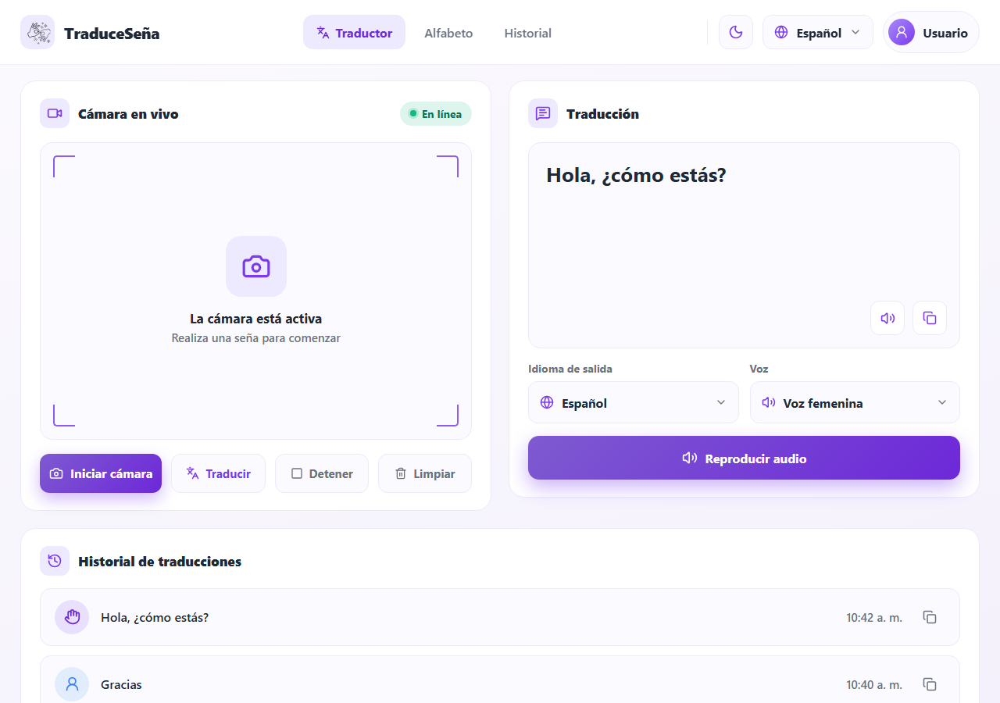
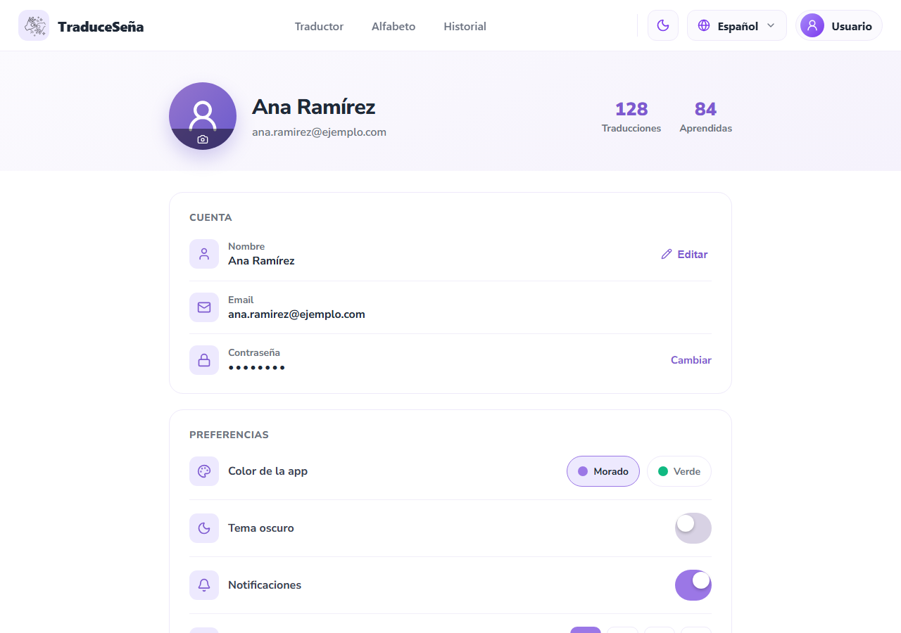
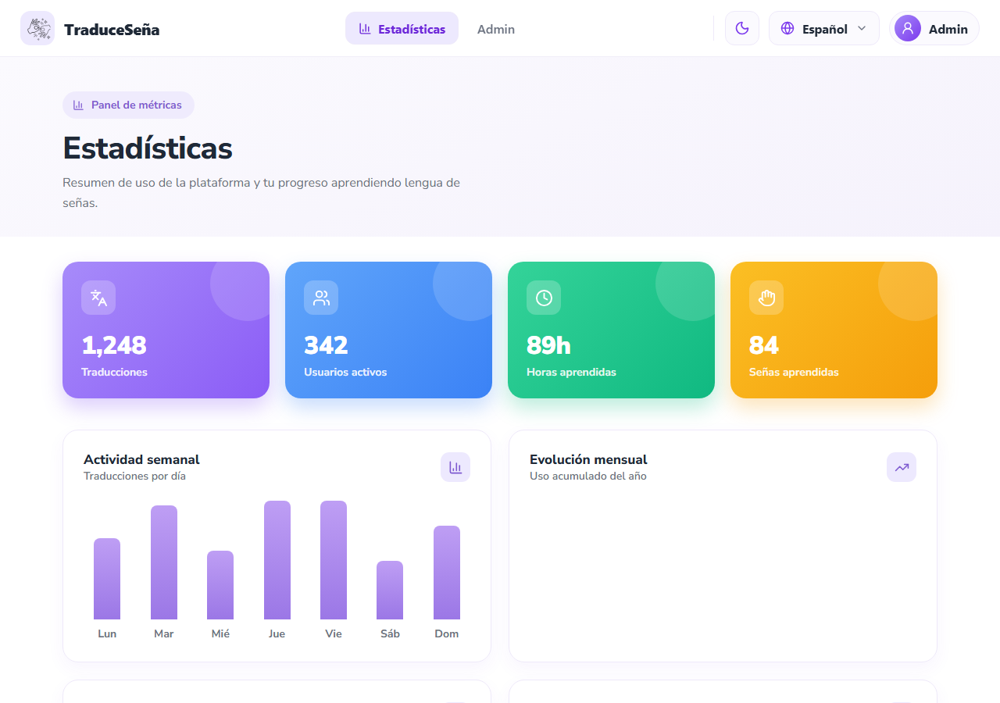
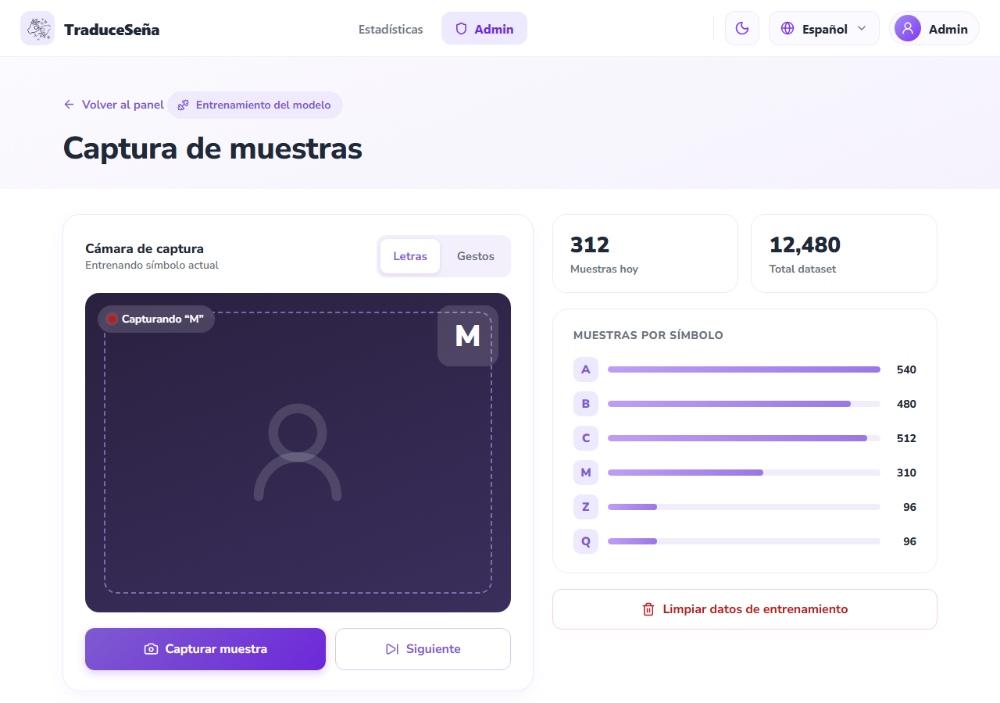
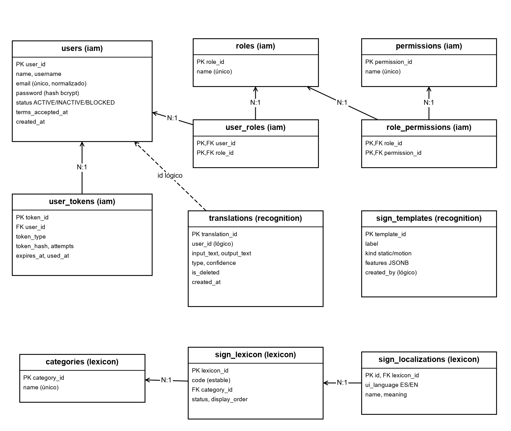

**DOCUMENTACIÓN DE DISEÑO DEL SOFTWARE**

**PROYECTO: Traduce Señas**

**INTEGRANTES:**

**Luis Alejandro Duarte Aldana**

**Juan Mauricio Suaza Solorzano**

**Juan Camilo Fierro Esquivel**

**SERVICIO NACIONAL DE APRENDIZAJE – SENA**

**Análisis y Desarrollo De Software**

2026

**Tabla de contenido**

# Introducción

El documento de diseño traduce los requisitos y el análisis de Traduce Señas en decisiones concretas de construcción. Reúne cuatro vistas: las interfaces gráficas que ve el usuario, el modelo arquitectónico que organiza los componentes, los patrones de diseño aplicados en el código y el modelo de datos que soporta la información del sistema.

Las decisiones descritas aquí corresponden al código que existe en los repositorios del frontend y del backend (rama feat/microservices-split) y a los prototipos de alta fidelidad del repositorio de documentación.

# Diseño de interfaces gráficas

## Principios de diseño

Como los usuarios principales son personas sordas, el diseño parte de la accesibilidad (W3C, 2018) y de los principios de usabilidad de Nielsen (1994):

- **Nada solo por sonido:** toda salida de audio tiene su equivalente en texto visible.

- **Contraste suficiente:** 4,5:1 para texto normal y 3:1 para texto grande, en tema claro y oscuro.

- **Objetivos táctiles grandes:** mínimo 48 × 48 dp; las acciones principales miden 56 dp de alto.

- **Una acción principal por vista**, para que el usuario sepa siempre qué hacer después.

- **Texto legible:** cuerpo de 18 px en móvil y 16 px en escritorio; ningún dato por debajo de 14 px.

## Sistema de diseño

**Tabla 1**

*Elementos del sistema de diseño*

| **Elemento** | **Definición** |
|---|---|
| Temas | Claro (predeterminado) y oscuro; color de acento morado (marca) o verde, guardados en el dispositivo |
| Tipografía | Nunito Sans. Título H1 32 px, H2 24 px, H3 20 px, cuerpo 18/16 px, botones 18 px en negrita |
| Espaciado | Escala de 4, 8, 12, 16, 20, 24, 32, 40, 48 y 72 px; márgenes laterales de 16 px en móvil y 24 px en escritorio |
| Bordes | Radio de 12 px en botones y campos, 18 px en tarjetas |
| Puntos de quiebre | Móvil < 768 px, tableta 768–1023 px, escritorio ≥ 1024 px |
| Estados | Éxito, error, advertencia (confianza baja, bloqueo temporal) e información, siempre con texto además del color |

*Nota.* Fuente: 12-ux-ui/design-system.md del repositorio de documentación.

## Mapa de navegación

**Tabla 2**

*Pantallas del sistema y su acceso*

| **Pantalla** | **Archivo en el frontend** | **Acceso** |
|---|---|---|
| Inicio (landing), Nosotros, Demos | homescreen/pages | Público |
| Iniciar sesión, Registro, Verificar código | auth/pages | Público |
| Recuperar y cambiar contraseña | auth/pages | Público / autenticado |
| Traducción | Translation/pages/TranslationScreen.tsx | Autenticado |
| Alfabeto | Alphabet/pages/AlphabetScreen.tsx | Autenticado (demo pública) |
| Historial | History/pages/HistoryScreen.tsx | Autenticado |
| Perfil, Términos, Privacidad | Profile/pages | Autenticado |
| Estadísticas | Stats/pages/StatsScreen.tsx | ADMIN |
| Panel de administración, Entrenamiento, Muestras | Admin/pages | ADMIN |

## Prototipos de las pantallas principales

Las figuras siguientes muestran los prototipos de alta fidelidad. Son la referencia visual que siguen las pantallas implementadas en React Native.

**Figura 1**

*Prototipo — Página de inicio pública*

*Nota.* Prototipo de alta fidelidad del proyecto (carpeta 12-ux-ui/mockup del repositorio de documentación).

**Figura 2**

*Prototipo — Inicio de sesión*

*Nota.* Prototipo de alta fidelidad del proyecto (carpeta 12-ux-ui/mockup del repositorio de documentación).

**Figura 3**

*Prototipo — Registro de cuenta*

*Nota.* Prototipo de alta fidelidad del proyecto (carpeta 12-ux-ui/mockup del repositorio de documentación).

**Figura 4**

*Prototipo — Pantalla de traducción en vivo*

*Nota.* Prototipo de alta fidelidad del proyecto (carpeta 12-ux-ui/mockup del repositorio de documentación).

**Figura 5**

*Prototipo — Alfabeto de la LSC*

*Nota.* Prototipo de alta fidelidad del proyecto (carpeta 12-ux-ui/mockup del repositorio de documentación).

**Figura 6**

*Prototipo — Historial de traducciones*

*Nota.* Prototipo de alta fidelidad del proyecto (carpeta 12-ux-ui/mockup del repositorio de documentación).

**Figura 7**

*Prototipo — Gestión del perfil y preferencias*

*Nota.* Prototipo de alta fidelidad del proyecto (carpeta 12-ux-ui/mockup del repositorio de documentación).

**Figura 8**

*Prototipo — Logros del usuario*

*Nota.* Prototipo de alta fidelidad del proyecto (carpeta 12-ux-ui/mockup del repositorio de documentación).

**Figura 9**

*Prototipo — Panel de administración*

*Nota.* Prototipo de alta fidelidad del proyecto (carpeta 12-ux-ui/mockup del repositorio de documentación).

**Figura 10**

*Prototipo — Estadísticas de uso*

*Nota.* Prototipo de alta fidelidad del proyecto (carpeta 12-ux-ui/mockup del repositorio de documentación).

**Figura 11**

*Prototipo — Captura de muestras para entrenamiento*

*Nota.* Prototipo de alta fidelidad del proyecto (carpeta 12-ux-ui/mockup del repositorio de documentación).

# Modelo arquitectónico

## Estilo arquitectónico

El backend sigue una arquitectura de microservicios (Newman, 2021): cinco servicios de dominio detrás de un API Gateway. Cada servicio tiene su propio proceso, su propio Dockerfile y su propia base de datos; ninguno lee la base de datos de otro. La comunicación síncrona es REST a través del gateway y la asíncrona son eventos de dominio sobre RabbitMQ.

Internamente, cada servicio aplica la arquitectura hexagonal o de puertos y adaptadores (Cockburn, 2005; Martin, 2017): el dominio y los casos de uso están en el centro y no conocen Express, PostgreSQL ni RabbitMQ.

## Vista de contenedores

**Figura 12**

*Vista de contenedores (modelo C4, nivel 2)*

*Nota.* Elaboración propia con base en el modelo C4 (Brown, 2018).

**Tabla 3**

*Componentes del backend*

| **Componente** | **Puerto** | **Responsabilidad** | **Almacenamiento** |
|---|---|---|---|
| api-gateway | 8080 | Entrada única, validación de JWT, límite de peticiones, CORS con lista blanca, proxy | — |
| iam-service | 3001 | Registro, inicio de sesión, verificación de correo, roles y permisos, recuperación | PostgreSQL iam |
| recognition-service | 3002 | Traducciones, plantillas de señas, muestras y entrenamiento | PostgreSQL recognition + MongoDB |
| lexicon-service | 3003 | Catálogo de señas, categorías, localizaciones, alfabeto 3D y medios | PostgreSQL lexicon + archivos .glb/.png |
| analytics-service | 3004 | Eventos de uso y estadísticas agregadas | PostgreSQL analytics |
| profile-service | 3005 | Perfil, preferencias, notificaciones y logros | PostgreSQL profile |
| @traduce/shared | — | Paquete común: configuración, JWT, middleware HTTP y bus de eventos | — |

## Arquitectura interna de cada servicio

**Figura 13**

*Arquitectura hexagonal de un microservicio*

*Nota.* Elaboración propia.

services/lexicon-service/src/

├── domain/          entidades, reglas e invariantes

├── application/     casos de uso

├── ports/           interfaces de entrada y salida

├── adapters/

│   ├── inbound/http/   rutas y controladores Express

│   └── outbound/       repositorios PostgreSQL, publicador RabbitMQ

├── lexicon.module.ts   composición (inyección de dependencias)

└── app.ts              arranque del servicio

## Arquitectura del cliente

El cliente está organizado por funcionalidades (src/feature/Translation, Alphabet, auth, History, Profile, Stats, Admin, homescreen) y, dentro de cada una, por capas. Las piezas comunes viven en src/shared y la configuración en src/app.

**Figura 14**

*Capas del cliente React Native*

*Nota.* Elaboración propia.

## Vista de despliegue

**Figura 15**

*Diagrama de despliegue*

*Nota.* Elaboración propia.

# Patrones de diseño

La tabla siguiente resume los patrones aplicados, dónde se usan y qué problema resuelven. Se clasifican en patrones arquitectónicos, de diseño orientado a objetos (Gamma et al., 1994) y de integración.

**Tabla 4**

*Patrones de diseño aplicados*

| **Patrón** | **Tipo** | **Dónde se aplica** | **Problema que resuelve** |
|---|---|---|---|
| Puertos y adaptadores (hexagonal) | Arquitectónico | Todos los microservicios (domain/, ports/, adapters/) | Aísla la lógica de negocio de la tecnología |
| API Gateway | Arquitectónico / integración | services/api-gateway | El cliente conoce una sola dirección; la seguridad se centraliza |
| Base de datos por servicio | Arquitectónico | Un PostgreSQL por servicio en docker-compose | Independencia de despliegue y de esquema |
| Publicar-suscribir (eventos de dominio) | Integración | Bus RabbitMQ en @traduce/shared; exchange traduce.events | Coordinación sin acoplamiento síncrono |
| Repositorio | Diseño (Fowler, 2002) | Adaptadores de salida PostgreSQL y MongoDB | Acceso a datos detrás de una interfaz del dominio |
| Inyección de dependencias / raíz de composición | Diseño | *.module.ts de cada servicio | Los casos de uso reciben sus puertos ya construidos; facilita las pruebas |
| Estrategia | Comportamiento (GoF) | Proveedores de gestos del cliente: mediapipeProvider, tfjsProvider, mockProvider | Cambiar el motor de reconocimiento sin tocar la pantalla |
| Adaptador | Estructural (GoF) | Archivos .web.ts y nativos del cliente (gestureProvider.web.ts) | La misma interfaz funciona en web y en móvil |
| Cadena de responsabilidad | Comportamiento (GoF) | Middleware de Express: CORS → límite → JWT → proxy | Cada filtro procesa o rechaza la petición en orden |
| Observador | Comportamiento (GoF) | Hooks de React (useSignAgent, useGestureAgent) y proveedores de contexto | La interfaz reacciona a cambios de estado de la cámara y la sesión |
| Objeto de transferencia de datos (DTO) | Diseño | Contratos de eventos tipados y respuestas HTTP | Contratos estables entre capas y servicios |
| Reintento con espera | Resiliencia | subscribeWithRetry y reconexión del bus de eventos | Tolera caídas temporales de RabbitMQ |

## Principios SOLID

**Tabla 5**

*Aplicación de los principios SOLID*

| **Principio** | **Aplicación en el proyecto** |
|---|---|
| Responsabilidad única | Cada caso de uso es una clase o función con una sola tarea (por ejemplo, publicar una seña) |
| Abierto/cerrado | Se agrega un nuevo proveedor de gestos implementando la interfaz, sin modificar la pantalla |
| Sustitución de Liskov | Los repositorios en memoria de las pruebas sustituyen a los de PostgreSQL sin cambiar el comportamiento |
| Segregación de interfaces | Puertos pequeños por necesidad (repositorio de señas, publicador de eventos, lector de roles) |
| Inversión de dependencias | El dominio define los puertos; la infraestructura los implementa y se inyecta en el módulo |

# Modelo de datos

## Criterios del modelo

- **Una base de datos por servicio**; entre servicios solo se guardan identificadores lógicos, sin claves foráneas.

- **Datos relacionales en PostgreSQL** y muestras de gestos en **MongoDB**, porque su estructura varía y su volumen crece aparte.

- **Borrado lógico** donde la ley o la auditoría lo exigen (historial, cuentas anonimizadas).

- **Restricciones en la base de datos** para las reglas críticas: correo normalizado y único, estados válidos, códigos con intentos ≥ 0, una localización por idioma.

- Nombres en inglés y en snake_case; claves primarias con sufijo _id; fechas TIMESTAMPTZ.

## Diagrama entidad-relación

**Figura 16**

*Modelo entidad-relación de los servicios principales (implementado)*

*Nota.* Las líneas discontinuas indican referencias lógicas entre servicios, sin clave foránea.

## Diccionario de datos resumido

**Tabla 6**

*Diccionario de datos — users (iam-service)*

| **Campo** | **Tipo** | **Restricción** | **Descripción** |
|---|---|---|---|
| user_id | SERIAL | PK | Identificador del usuario |
| name | VARCHAR(120) | NOT NULL | Nombre completo |
| email | VARCHAR(255) | UNIQUE, normalizado | Correo en minúsculas y sin espacios |
| password | VARCHAR(255) | NOT NULL | Hash bcrypt de la contraseña |
| status | VARCHAR | ACTIVE / INACTIVE / BLOCKED | Estado de la cuenta |
| terms_accepted_at | TIMESTAMPTZ | — | Fecha de aceptación de términos (Ley 1581) |

**Tabla 7**

*Diccionario de datos — user_tokens (iam-service)*

| **Campo** | **Tipo** | **Restricción** | **Descripción** |
|---|---|---|---|
| token_id | SERIAL | PK | Identificador |
| user_id | INT | FK users | Dueño del código |
| token_type | VARCHAR(30) | EMAIL_VERIFICATION / PASSWORD_RESET | Uso del código |
| token_hash | VARCHAR(255) | NOT NULL | Hash del código; nunca en texto plano |
| attempts | INT | ≥ 0 | Intentos fallidos de validación |
| expires_at / used_at | TIMESTAMPTZ | — | Vencimiento y uso único |

**Tabla 8**

*Diccionario de datos — translations (recognition-service)*

| **Campo** | **Tipo** | **Restricción** | **Descripción** |
|---|---|---|---|
| translation_id | SERIAL | PK | Identificador |
| user_id | INT | Referencia lógica a iam | Dueño de la traducción |
| input_text / output_text | TEXT | NOT NULL | Señas reconocidas y texto resultante |
| confidence | NUMERIC(4,3) | 0 a 1 | Confianza del reconocimiento |
| is_deleted | BOOLEAN | Predeterminado FALSE | Borrado lógico |

**Tabla 9**

*Diccionario de datos — sign_templates (recognition-service)*

| **Campo** | **Tipo** | **Restricción** | **Descripción** |
|---|---|---|---|
| template_id | SERIAL | PK | Identificador |
| label | VARCHAR(80) | NOT NULL | Seña representada (letra o palabra) |
| kind | VARCHAR(10) | static / motion | Seña estática o con movimiento |
| features | JSONB | NOT NULL | Puntos normalizados de la plantilla |

**Tabla 10**

*Diccionario de datos — sign_lexicon y sign_localizations (lexicon-service)*

| **Campo** | **Tipo** | **Restricción** | **Descripción** |
|---|---|---|---|
| lexicon_id | SERIAL | PK | Identificador de la seña |
| code | VARCHAR(50) | Estable | Código independiente del idioma |
| category_id | INT | FK categories | Categoría de la seña |
| status | VARCHAR(10) | Predeterminado ACTIVE | Solo ACTIVE es visible al usuario |
| ui_language | VARCHAR(2) | ES / EN, único por seña | Idioma de la localización |
| name / meaning | VARCHAR | NOT NULL | Nombre y significado en ese idioma |

**Tabla 11**

*Diccionario de datos — Otros servicios*

| **Tabla** | **Servicio** | **Restricción clave** | **Contenido** |
|---|---|---|---|
| usage_event | analytics | event_id único | Evento de uso por sección, tipo y señas |
| user_profiles | profile | PK user_id lógico | Datos de presentación del usuario |
| user_preferences | profile | ES/EN, LIGHT/DARK | Idioma, tema y notificaciones |
| notifications | profile | Canal PUSH / EMAIL / IN_APP | Notificaciones solo visuales |
| achievements | profile | Meta > 0 | Catálogo y progreso de logros; desde la migración 010 incluye medallas por puntos de reto |
| challenges | profile | Definiciones activas ordenadas por código | Catálogo de retos diarios (TRANSLATE_1, 3, 5 y 8, con 5, 10, 15 y 25 puntos) y sus textos en español, inglés, francés y portugués |
| user_challenges | profile | Único por usuario y día | Instantánea del reto asignado a cada usuario: meta, avance y fecha de finalización |
| challenge_rewards | profile | Una por asignación | Puntos de reto realmente concedidos; la suma alimenta las medallas |
| admin_recipients, admin_report_runs | profile | Un envío por periodo | Destinatarios y control de los reportes semanales y mensuales por correo para administradores |
| gesture_samples | recognition (MongoDB) | Consentimiento obligatorio | Muestras de entrenamiento |

El modelo objetivo completo tiene 29 tablas agrupadas en diez dominios (identidad, autorización, perfil, léxico, traducción, IA, notificaciones, uso, gamificación y auditoría) y se mantiene en formato DBML en el repositorio de documentación (06-data/traduce_senas.dbml). Las tablas mostradas aquí son las que ya tienen migración en el código. Las migraciones vigentes de profile van de la 001 a la 010 (las tres últimas: 008 reportes al administrador, 009 retos diarios y 010 medallas por puntos de reto).

Dos reglas de diseño recientes no cambian tablas. Las traducciones del historial se borran a los 30 días (recognition-service), y la aplicación muestra el historial agrupado por sesiones, una tarjeta por sesión. Además, cada pantalla web tiene su propia URL. Los reportes al administrador usan los tipos de notificación ADMIN_WEEKLY_REPORT y ADMIN_MONTHLY_REPORT y se entregan por correo (ADR-007). El reto del día cambia a medianoche, hora de Bogotá, y solo avanza con traducciones guardadas.

# Conclusiones

El diseño combina una interfaz pensada primero para la accesibilidad con una arquitectura que separa responsabilidades en dos niveles: entre servicios (microservicios con su propia base de datos) y dentro de cada servicio (hexagonal). Los patrones aplicados hacen que el código sea fácil de probar y de cambiar, y el modelo de datos protege las reglas críticas con restricciones en la propia base de datos.

# Referencias

Booch, G., Rumbaugh, J., & Jacobson, I. (2005). *The unified modeling language user guide* (2.ª ed.). Addison-Wesley.

Brown, S. (2018). *The C4 model for visualising software architecture*. https://c4model.com/

Cockburn, A. (2005). *Hexagonal architecture*. https://alistair.cockburn.us/hexagonal-architecture/

Evans, E. (2003). *Domain-driven design: Tackling complexity in the heart of software*. Addison-Wesley.

Fowler, M. (2002). *Patterns of enterprise application architecture*. Addison-Wesley.

Gamma, E., Helm, R., Johnson, R., & Vlissides, J. (1994). *Design patterns: Elements of reusable object-oriented software*. Addison-Wesley.

Martin, R. C. (2017). *Clean architecture: A craftsman's guide to software structure and design*. Prentice Hall.

Newman, S. (2021). *Building microservices: Designing fine-grained systems* (2.ª ed.). O'Reilly Media.

Nielsen, J. (1994). *Usability engineering*. Morgan Kaufmann.

World Wide Web Consortium. (2018). *Web Content Accessibility Guidelines (WCAG) 2.1*. W3C. https://www.w3.org/TR/WCAG21/
