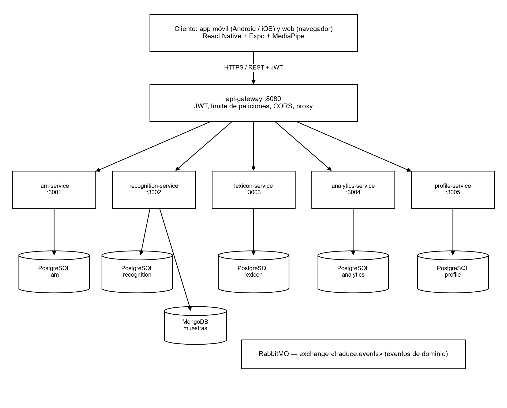

**CODE ARTIFACTS (DESKTOP, WEB AND MOBILE APPLICATION)**

**PROJECT: Traduce Señas**

**TEAM MEMBERS:**

**Luis Alejandro Duarte Aldana**

**Juan Mauricio Suaza Solorzano**

**Juan Camilo Fierro Esquivel**

**NATIONAL LEARNING SERVICE – SENA**

**Software Analysis and Development**

2026

**Table of Contents**

# Introduction

This document inventories and describes the code artifacts that make up Traduce Señas: where each one is located, how it is organized, which technologies it uses, and how it is built for each target platform (mobile, web and desktop).

The goal is for any evaluator or new team member to be able to locate the source code, understand its structure and generate the executables without relying on verbal explanations.

# Project repositories

**Table 1**

*Source code repositories*

| **Repository** | **URL** | **Content** | **Working branch** |
|---|---|---|---|
| frontendTS | https://github.com/tadeo77789/frontendTS | React Native / Expo application (mobile, web and desktop) | fix/traduccion-en-vivo |
| backendTS | https://github.com/mauro-1508/backendTS | API Gateway, five microservices and shared package | feat/microservices-split |
| trans-sl-docs | https://github.com/code-sena/trans-sl-docs | Technical documentation, OpenAPI contracts and prototypes | main |

*Note.* The branches correspond to the state as of October 7, 2026. Changes are merged into main through pull requests using squash and merge.

# Client artifact: cross-platform application

## Description

The client is a single TypeScript codebase, built with React Native 0.86 and Expo 57, which is compiled for three targets. The react-native-web library allows the same components to run in the browser; files with the .web.ts suffix contain the web-specific implementations (for example, access to MediaPipe in the browser), and Expo selects them automatically depending on the platform.

**Table 2**

*Client targets*

| **Target** | **Delivery method** | **User device requirements** |
|---|---|---|
| Mobile (Android / iOS) | Native application generated with Expo; in development it runs with Expo Go | Android 9+ or iOS 14+, camera |
| Web | Static site generated with “expo export --platform web” and served by Nginx in a Docker container | Up-to-date browser with camera access |
| Desktop | The same web application opened in the browser of a computer (Windows, macOS or Linux), with a layout adapted to screens ≥ 1024 px | Computer with webcam and Chrome, Edge or Firefox browser |

*Note.* No native desktop installer is generated: the desktop version is the responsive web application, which avoids maintaining a fourth codebase.

## Folder structure

frontend/

├── App.tsx                 entry point

├── app.json                Expo configuration

├── Dockerfile, nginx.conf  build and server for the web version

└── src/

├── app/                config (api.config.ts, i18n), providers, routes

├── feature/

│   ├── auth/           login, registration, verification, passwords

│   ├── Translation/    translation screen and vision engine

│   │   └── services/vision/  mediapipeProvider, classifier, normalize, wordEngine…

│   ├── Alphabet/       alphabet with 3D models (.glb)

│   ├── History/        translation history

│   ├── Profile/        profile, terms and privacy

│   ├── Stats/          statistics (administrator)

│   ├── Admin/          dashboard, training and samples

│   └── homescreen/     landing page, about us and public demos

├── shared/             components, hooks, types, utilities and constants

└── assets/             fonts, icons, images and alphabet 3D models

## Main client components

**Table 3**

*Key client files*

| **File** | **Function** |
|---|---|
| src/app/config/api.config.ts | Base URL of the backend. In development it still points to port 3000 of the previous backend; it must be changed to port 8080 of the API Gateway. In production it uses /api (web) and https://api.traducsenas.com/api (mobile) |
| feature/Translation/pages/TranslationScreen.tsx | Translation screen with Words / Alphabet selector |
| feature/Translation/hooks/useSignAgent.ts, useGestureAgent.ts | Capture, recognition and result publication cycle |
| services/vision/mediapipeProvider(.web).ts | Obtains the 21 hand landmarks in each frame |
| services/vision/normalize.ts | Centers on the wrist and scales by palm size |
| services/vision/classifier.ts, knnClassifier.ts, motionClassifier.ts | Classification of static letters and signs with movement |
| services/vision/templateStore.ts, motionTemplateStore.ts | Loading and caching of sign templates |
| services/translations.service.ts | Stores and queries the history in the backend |
| feature/auth/services | Real login against the backend and token handling |

## Main dependencies

**Table 4**

*Client dependencies*

| **Package** | **Version** | **Purpose** |
|---|---|---|
| expo | 57 | Cross-platform build platform |
| react / react-native | 19.2.3 / 0.86.3 | User interface |
| react-native-web | 0.21 | Browser execution |
| @mediapipe/tasks-vision | 0.10.14 | Hand detection |
| @tensorflow/tfjs | 4.22 | Classification models on the client |
| expo-camera | 57 | Camera access |
| expo-speech | 57 | Voice output |
| expo-secure-store / async-storage | 57 / 2.2 | Secure token and local preferences |
| @react-navigation/* | 6.x | Stack and tab navigation |
| axios | 1.7 | HTTP client for the gateway |

# Server artifact: microservices backend

## Microservices architecture

The server is not a single application: it is divided into six artifacts that are built, run and deployed separately. An API Gateway receives all client requests and forwards them to five domain microservices. Each microservice has its own process, its own Dockerfile, its own port and its own database, and none of them reads another's database. The services communicate with each other only through domain events published on RabbitMQ (Newman, 2021).

**Figure 1**

*Backend microservices architecture*

*Note.* Own elaboration.

**Table 5**

*Deployable backend artifacts*

| **Artifact** | **Responsibility** | **Port** | **Own database** | **Docker image** |
|---|---|---|---|---|
| api-gateway | Single entry point: JWT, rate limiting, CORS and proxy | 8080 | — | services/api-gateway/Dockerfile |
| iam-service | Accounts, authentication, roles and permissions | 3001 | PostgreSQL iam | services/iam-service/Dockerfile |
| recognition-service | Translations, sign templates and samples | 3002 | PostgreSQL recognition + MongoDB | services/recognition-service/Dockerfile |
| lexicon-service | Sign catalog, categories and alphabet | 3003 | PostgreSQL lexicon | services/lexicon-service/Dockerfile |
| analytics-service | Usage events and statistics | 3004 | PostgreSQL analytics | services/analytics-service/Dockerfile |
| profile-service | Profile, preferences, notifications and achievements | 3005 | PostgreSQL profile | services/profile-service/Dockerfile |

*Note.* The @traduce/shared package is not a service: it is a common library (configuration, JWT, middleware and event bus) that each microservice includes in its own image.

## Communication between microservices

**Table 6**

*Communication mechanisms*

| **Type** | **Mechanism** | **Example** |
|---|---|---|
| Client → backend | REST over HTTPS through the api-gateway, with JWT | POST /api/translations → recognition-service |
| Service → service | Asynchronous events in RabbitMQ (traduce.events exchange) | recognition.TranslationProduced → profile and analytics |
| Shared data | Logical identifiers only (user_id), with no foreign keys between databases | translations.user_id references iam without FK |

## Structure of the service repositories

The six artifacts are stored in a single repository to share build tools, but each one lives in its own folder with its package.json, its Dockerfile, its migrations and its tests:

backend/

├── docker-compose.yml      orchestrates the 6 services, 5 PostgreSQL, MongoDB and RabbitMQ

├── packages/shared/        common library @traduce/shared

└── services/

├── api-gateway/        Dockerfile · package.json · src/ · tests/

├── iam-service/        Dockerfile · package.json · db/ · src/ · tests/

├── recognition-service/ Dockerfile · package.json · db/ · src/ · tests/

├── lexicon-service/    Dockerfile · package.json · db/ · src/ · tests/

├── analytics-service/  Dockerfile · package.json · db/ · src/ · tests/

└── profile-service/    Dockerfile · package.json · db/ · src/ · tests/

## Internal structure of each microservice

Within each service, hexagonal architecture is applied: the domain and the use cases do not depend on Express or the database, but on ports implemented by adapters.

**Figure 2**

*Hexagonal architecture within a microservice*

*Note.* Own elaboration.

services/lexicon-service/

├── Dockerfile

├── db/003_lexicon.sql          migrations of its own database

└── src/

├── domain/                 entities and rules

├── application/            use cases

├── ports/                  interfaces

├── adapters/inbound/http/  Express routes

├── adapters/outbound/      PostgreSQL repository and event publisher

├── lexicon.module.ts       dependency composition

└── app.ts                  service startup

## Inventory and code size

**Table 7**

*Code size by component*

| **Component** | **.ts files (src)** | **Lines (src)** | **Test files** |
|---|---|---|---|
| api-gateway | 7 | 265 | 1 |
| iam-service | 77 | 2 094 | 22 |
| recognition-service | 58 | 3 016 | 11 |
| lexicon-service | 23 | 1 629 | 6 |
| analytics-service | 13 | 487 | 4 |
| profile-service | 20 | 823 | 4 |
| @traduce/shared | 21 | 671 | 5 |
| **Total backend** | **219** | **8 985** | **53** |
| Client (frontend/src, .ts and .tsx) | 109 | 16 713 | — |

*Note.* Count performed on October 7, 2026 on the branches indicated in Table 1.

## Exposed interfaces

**Table 8**

*Public API Gateway routes*

| **Prefix** | **Service** | **Operation examples** |
|---|---|---|
| /api/auth | iam-service | register, login, verify-email, resend-verification, forgot-password, reset-password |
| /api/users, /api/iam | iam-service | me, me/password, roles, role assignment to users |
| /api/translations | recognition-service | Save translation, history, logical deletion |
| /api/sign-templates, /api/samples, /api/recognition | recognition-service | Sign templates and training samples |
| /api/lexicon | lexicon-service | alphabet, search, categories, señas, publicar, localizaciones, recursos |
| /api/analytics | analytics-service | events, summary, daily, top-signs, reports/sections |
| /api/profile, /api/notifications, /api/achievements | profile-service | me, me/stats, notifications and achievements |

*Note.* Complete OpenAPI contracts in 07-api/contracts/openapi of the documentation repository.

# Building the artifacts

## Backend: one artifact per microservice

Each microservice is built, tested and deployed independently:

cd backend

cp .env.example .env                              # JWT_SECRET (32+) and passwords

npm install

npm run build -w @traduce/lexicon-service          # build a single service

npm test                                           # tests for all services

docker compose build lexicon-service               # single-service image

docker compose up -d --no-deps lexicon-service     # deploy only that service

docker compose up --build -d                       # start all services

## Mobile application

cd frontend

npm install

npx expo start --android     # or --ios; opens in Expo Go

# To generate the installer (APK/AAB or IPA), EAS Build is used:

npx eas build --platform android

The EAS Build configuration (eas.json) is not yet in the repository; it is created when the first distribution installer is generated.

## Web and desktop application

cd frontend

npx expo export --platform web --output-dir dist

docker build -t traduce-senas-web .

docker run -p 8081:80 traduce-senas-web

# Code conventions and version control

- Strict TypeScript on the client and server.

- Backend file names in snake_case; React components in PascalCase.

- Commits in English following Conventional Commits (feat, fix, chore, docs, test, refactor).

- One branch per feature; work is never done directly on main.

- Pull request with review and squash and merge.

- Sensitive variables only in .env (excluded by .gitignore); never in the code.

# Conclusions

The project's code artifacts are a single client delivered on mobile, web and desktop, and a microservices backend made up of an API Gateway and five domain services, each with its own Docker image and its own database. Each microservice can be built, tested and deployed without affecting the others, and Docker Compose makes it possible to start all of them together when the complete system is needed.

# References

Broadcom. (2026). *RabbitMQ documentation*. https://www.rabbitmq.com/docs

Docker Inc. (2026). *Docker Compose documentation*. https://docs.docker.com/compose/

Expo. (2026). *Expo documentation*. https://docs.expo.dev/

Martin, R. C. (2017). *Clean architecture: A craftsman's guide to software structure and design*. Prentice Hall.

Newman, S. (2021). *Building microservices: Designing fine-grained systems* (2nd ed.). O'Reilly Media.

Zhang, F., Bazarevsky, V., Vakunov, A., Tkachenka, A., Sung, G., Chang, C.-L., & Grundmann, M. (2020). *MediaPipe Hands: On-device real-time hand tracking* (arXiv:2006.10214). arXiv. https://doi.org/10.48550/arXiv.2006.10214
