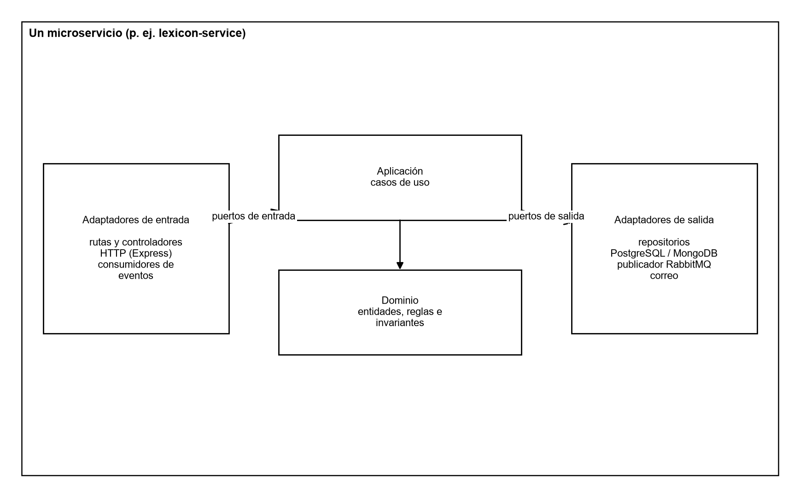

**ARTEFACTOS DE CÓDIGO (APLICACIÓN ESCRITORIO, WEB Y MÓVIL)**

**PROYECTO: Traduce Señas**

**INTEGRANTES:**

**Luis Alejandro Duarte Aldana**

**Juan Mauricio Suaza Solorzano**

**Juan Camilo Fierro Esquivel**

**SERVICIO NACIONAL DE APRENDIZAJE – SENA**

**Análisis y Desarrollo De Software**

2026

**Tabla de contenido**

# Introducción

Este documento inventaría y describe los artefactos de código que componen Traduce Señas: dónde está cada uno, cómo se organiza, qué tecnologías usa y cómo se construye para cada plataforma de destino (móvil, web y escritorio).

El objetivo es que cualquier evaluador o nuevo integrante del equipo pueda ubicar el código fuente, entender su estructura y generar los ejecutables sin depender de explicaciones verbales.

# Repositorios del proyecto

**Tabla 1**

*Repositorios de código fuente*

| **Repositorio** | **URL** | **Contenido** | **Rama de trabajo** |
|---|---|---|---|
| frontendTS | https://github.com/tadeo77789/frontendTS | Aplicación React Native / Expo (móvil, web y escritorio) | fix/traduccion-en-vivo |
| backendTS | https://github.com/mauro-1508/backendTS | API Gateway, cinco microservicios y paquete compartido | feat/microservices-split |
| trans-sl-docs | https://github.com/code-sena/trans-sl-docs | Documentación técnica, contratos OpenAPI y prototipos | main |

*Nota.* Las ramas corresponden al estado del 7 de octubre de 2026. Los cambios se integran a main por pull request con squash and merge.

# Artefacto cliente: aplicación multiplataforma

## Descripción

El cliente es una única base de código en TypeScript, construida con React Native 0.86 y Expo 57, que se compila para tres destinos. La biblioteca react-native-web permite que los mismos componentes se ejecuten en el navegador; los archivos con sufijo .web.ts contienen las implementaciones específicas de la web (por ejemplo, el acceso a MediaPipe en el navegador) y Expo los elige automáticamente según la plataforma.

**Tabla 2**

*Destinos del cliente*

| **Destino** | **Forma de entrega** | **Requisitos del equipo del usuario** |
|---|---|---|
| Móvil (Android / iOS) | Aplicación nativa generada con Expo; en desarrollo se ejecuta con Expo Go | Android 9+ o iOS 14+, cámara |
| Web | Sitio estático generado con «expo export --platform web» y servido por Nginx en un contenedor Docker | Navegador actualizado con acceso a cámara |
| Escritorio | La misma aplicación web abierta en el navegador de un computador (Windows, macOS o Linux), con diseño adaptado a pantallas ≥ 1024 px | Computador con cámara web y navegador Chrome, Edge o Firefox |

*Nota.* No se genera un instalador nativo de escritorio: la versión de escritorio es la aplicación web adaptable, lo que evita mantener una cuarta base de código.

## Estructura de carpetas

frontend/

├── App.tsx                 punto de entrada

├── app.json                configuración de Expo

├── Dockerfile, nginx.conf  construcción y servidor de la versión web

└── src/

├── app/                config (api.config.ts, i18n), providers, routes

├── feature/

│   ├── auth/           inicio de sesión, registro, verificación, contraseñas

│   ├── Translation/    pantalla de traducción y motor de visión

│   │   └── services/vision/  mediapipeProvider, classifier, normalize, wordEngine…

│   ├── Alphabet/       alfabeto con modelos 3D (.glb)

│   ├── History/        historial de traducciones

│   ├── Profile/        perfil, términos y privacidad

│   ├── Stats/          estadísticas (administrador)

│   ├── Admin/          panel, entrenamiento y muestras

│   └── homescreen/     landing, nosotros y demos públicas

├── shared/             componentes, hooks, tipos, utilidades y constantes

└── assets/             fuentes, íconos, imágenes y modelos 3D del alfabeto

## Componentes principales del cliente

**Tabla 3**

*Archivos clave del cliente*

| **Archivo** | **Función** |
|---|---|
| src/app/config/api.config.ts | URL base del backend. En desarrollo apunta todavía al puerto 3000 del backend anterior; debe cambiarse al 8080 del API Gateway. En producción usa /api (web) y https://api.traducsenas.com/api (móvil) |
| feature/Translation/pages/TranslationScreen.tsx | Pantalla de traducción con selector Palabras / Abecedario |
| feature/Translation/hooks/useSignAgent.ts, useGestureAgent.ts | Ciclo de captura, reconocimiento y publicación del resultado |
| services/vision/mediapipeProvider(.web).ts | Obtiene los 21 puntos de la mano en cada cuadro |
| services/vision/normalize.ts | Centra en la muñeca y escala por el tamaño de la palma |
| services/vision/classifier.ts, knnClassifier.ts, motionClassifier.ts | Clasificación de letras estáticas y señas con movimiento |
| services/vision/templateStore.ts, motionTemplateStore.ts | Carga y caché de las plantillas de señas |
| services/translations.service.ts | Guarda y consulta el historial en el backend |
| feature/auth/services | Inicio de sesión real contra el backend y manejo del token |

## Dependencias principales

**Tabla 4**

*Dependencias del cliente*

| **Paquete** | **Versión** | **Uso** |
|---|---|---|
| expo | 57 | Plataforma de compilación multiplataforma |
| react / react-native | 19.2.3 / 0.86.3 | Interfaz de usuario |
| react-native-web | 0.21 | Ejecución en navegador |
| @mediapipe/tasks-vision | 0.10.14 | Detección de la mano |
| @tensorflow/tfjs | 4.22 | Modelos de clasificación en el cliente |
| expo-camera | 57 | Acceso a la cámara |
| expo-speech | 57 | Salida de voz |
| expo-secure-store / async-storage | 57 / 2.2 | Token seguro y preferencias locales |
| @react-navigation/* | 6.x | Navegación por pilas y pestañas |
| axios | 1.7 | Cliente HTTP hacia el gateway |

# Artefacto servidor: backend de microservicios

## Arquitectura de microservicios

El servidor no es una sola aplicación: está dividido en seis artefactos que se construyen, se ejecutan y se despliegan por separado. Un API Gateway recibe todas las peticiones del cliente y las reenvía a cinco microservicios de dominio. Cada microservicio tiene su propio proceso, su propio Dockerfile, su propio puerto y su propia base de datos, y ninguno lee la base de datos de otro. Los servicios se comunican entre sí únicamente por eventos de dominio publicados en RabbitMQ (Newman, 2021).

**Figura 1**

*Arquitectura de microservicios del backend*

*Nota.* Elaboración propia.

**Tabla 5**

*Artefactos desplegables del backend*

| **Artefacto** | **Responsabilidad** | **Puerto** | **Base de datos propia** | **Imagen Docker** |
|---|---|---|---|---|
| api-gateway | Entrada única: JWT, límite de peticiones, CORS y proxy | 8080 | — | services/api-gateway/Dockerfile |
| iam-service | Cuentas, autenticación, roles y permisos | 3001 | PostgreSQL iam | services/iam-service/Dockerfile |
| recognition-service | Traducciones, plantillas de señas y muestras | 3002 | PostgreSQL recognition + MongoDB | services/recognition-service/Dockerfile |
| lexicon-service | Catálogo de señas, categorías y alfabeto | 3003 | PostgreSQL lexicon | services/lexicon-service/Dockerfile |
| analytics-service | Eventos de uso y estadísticas | 3004 | PostgreSQL analytics | services/analytics-service/Dockerfile |
| profile-service | Perfil, preferencias, notificaciones y logros | 3005 | PostgreSQL profile | services/profile-service/Dockerfile |

*Nota.* El paquete @traduce/shared no es un servicio: es una biblioteca común (configuración, JWT, middleware y bus de eventos) que cada microservicio incluye en su propia imagen.

## Comunicación entre microservicios

**Tabla 6**

*Mecanismos de comunicación*

| **Tipo** | **Mecanismo** | **Ejemplo** |
|---|---|---|
| Cliente → backend | REST sobre HTTPS a través del api-gateway, con JWT | POST /api/translations → recognition-service |
| Servicio → servicio | Eventos asíncronos en RabbitMQ (exchange traduce.events) | recognition.TranslationProduced → profile y analytics |
| Datos compartidos | Solo identificadores lógicos (user_id), sin claves foráneas entre bases | translations.user_id referencia a iam sin FK |

## Estructura de los repositorios de servicios

Los seis artefactos se guardan en un mismo repositorio para compartir herramientas de compilación, pero cada uno vive en su propia carpeta con su package.json, su Dockerfile, sus migraciones y sus pruebas:

backend/

├── docker-compose.yml      orquesta los 6 servicios, 5 PostgreSQL, MongoDB y RabbitMQ

├── packages/shared/        biblioteca común @traduce/shared

└── services/

├── api-gateway/        Dockerfile · package.json · src/ · tests/

├── iam-service/        Dockerfile · package.json · db/ · src/ · tests/

├── recognition-service/ Dockerfile · package.json · db/ · src/ · tests/

├── lexicon-service/    Dockerfile · package.json · db/ · src/ · tests/

├── analytics-service/  Dockerfile · package.json · db/ · src/ · tests/

└── profile-service/    Dockerfile · package.json · db/ · src/ · tests/

## Estructura interna de cada microservicio

Dentro de cada servicio se aplica la arquitectura hexagonal: el dominio y los casos de uso no dependen de Express ni de la base de datos, sino de puertos implementados por adaptadores.

**Figura 2**

*Arquitectura hexagonal dentro de un microservicio*

*Nota.* Elaboración propia.

services/lexicon-service/

├── Dockerfile

├── db/003_lexicon.sql          migraciones de su propia base

└── src/

├── domain/                 entidades y reglas

├── application/            casos de uso

├── ports/                  interfaces

├── adapters/inbound/http/  rutas Express

├── adapters/outbound/      repositorio PostgreSQL y publicador de eventos

├── lexicon.module.ts       composición de dependencias

└── app.ts                  arranque del servicio

## Inventario y tamaño del código

**Tabla 7**

*Tamaño del código por componente*

| **Componente** | **Archivos .ts (src)** | **Líneas (src)** | **Archivos de prueba** |
|---|---|---|---|
| api-gateway | 7 | 265 | 1 |
| iam-service | 77 | 2 094 | 22 |
| recognition-service | 58 | 3 016 | 11 |
| lexicon-service | 23 | 1 629 | 6 |
| analytics-service | 13 | 487 | 4 |
| profile-service | 20 | 823 | 4 |
| @traduce/shared | 21 | 671 | 5 |
| **Total backend** | **219** | **8 985** | **53** |
| Cliente (frontend/src, .ts y .tsx) | 109 | 16 713 | — |

*Nota.* Conteo realizado el 7 de octubre de 2026 sobre las ramas indicadas en la Tabla 1.

## Interfaces expuestas

**Tabla 8**

*Rutas públicas del API Gateway*

| **Prefijo** | **Servicio** | **Ejemplos de operaciones** |
|---|---|---|
| /api/auth | iam-service | register, login, verify-email, resend-verification, forgot-password, reset-password |
| /api/users, /api/iam | iam-service | me, me/password, roles, asignación de roles a usuarios |
| /api/translations | recognition-service | Guardar traducción, historial, borrado lógico |
| /api/sign-templates, /api/samples, /api/recognition | recognition-service | Plantillas de señas y muestras de entrenamiento |
| /api/lexicon | lexicon-service | alphabet, search, categories, señas, publicar, localizaciones, recursos |
| /api/analytics | analytics-service | events, summary, daily, top-signs, reports/sections |
| /api/profile, /api/notifications, /api/achievements | profile-service | me, me/stats, notificaciones y logros |

*Nota.* Contratos OpenAPI completos en 07-api/contracts/openapi del repositorio de documentación.

# Construcción de los artefactos

## Backend: un artefacto por microservicio

Cada microservicio se compila, se prueba y se despliega de forma independiente:

cd backend

cp .env.example .env                              # JWT_SECRET (32+) y contraseñas

npm install

npm run build -w @traduce/lexicon-service          # compilar un solo servicio

npm test                                           # pruebas de todos los servicios

docker compose build lexicon-service               # imagen de un solo servicio

docker compose up -d --no-deps lexicon-service     # desplegar solo ese servicio

docker compose up --build -d                       # levantar todos los servicios

## Aplicación móvil

cd frontend

npm install

npx expo start --android     # o --ios; se abre en Expo Go

# Para generar el instalador (APK/AAB o IPA) se usa EAS Build:

npx eas build --platform android

La configuración de EAS Build (eas.json) aún no está en el repositorio; se crea al generar el primer instalador de distribución.

## Aplicación web y de escritorio

cd frontend

npx expo export --platform web --output-dir dist

docker build -t traduce-senas-web .

docker run -p 8081:80 traduce-senas-web

# Convenciones de código y control de versiones

- TypeScript estricto en cliente y servidor.

- Nombres de archivos del backend en snake_case; componentes React en PascalCase.

- Commits en inglés con Conventional Commits (feat, fix, chore, docs, test, refactor).

- Una rama por funcionalidad; nunca se trabaja directamente sobre main.

- Pull request con revisión y squash and merge.

- Variables sensibles solo en .env (excluido por .gitignore); nunca en el código.

# Conclusiones

Los artefactos de código del proyecto son un cliente único que se entrega en móvil, web y escritorio, y un backend de microservicios formado por un API Gateway y cinco servicios de dominio, cada uno con su propia imagen Docker y su propia base de datos. Cada microservicio puede compilarse, probarse y desplegarse sin afectar a los demás, y Docker Compose permite levantarlos todos juntos cuando se necesita el sistema completo.

# Referencias

Broadcom. (2026). *RabbitMQ documentation*. https://www.rabbitmq.com/docs

Docker Inc. (2026). *Docker Compose documentation*. https://docs.docker.com/compose/

Expo. (2026). *Expo documentation*. https://docs.expo.dev/

Martin, R. C. (2017). *Clean architecture: A craftsman's guide to software structure and design*. Prentice Hall.

Newman, S. (2021). *Building microservices: Designing fine-grained systems* (2.ª ed.). O'Reilly Media.

Zhang, F., Bazarevsky, V., Vakunov, A., Tkachenka, A., Sung, G., Chang, C.-L., & Grundmann, M. (2020). *MediaPipe Hands: On-device real-time hand tracking* (arXiv:2006.10214). arXiv. https://doi.org/10.48550/arXiv.2006.10214
