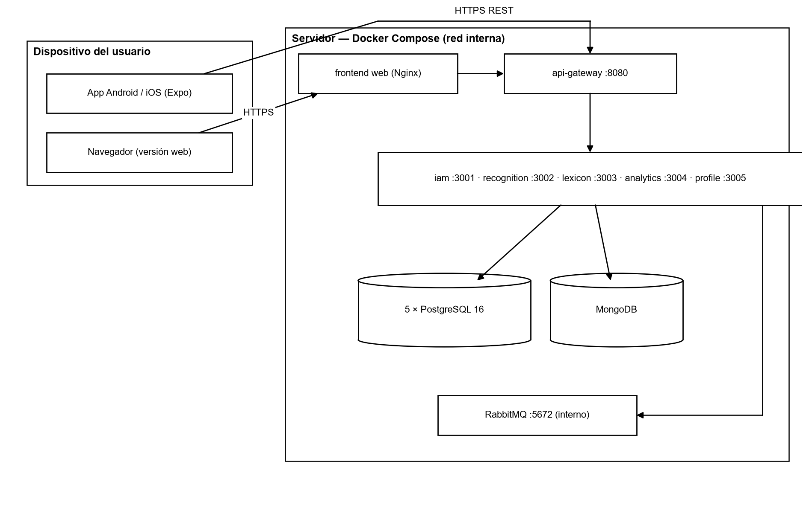

**SOFTWARE IMPLEMENTATION PROCEDURE**

**PROJECT: Traduce Señas**

**TEAM MEMBERS:**

**Luis Alejandro Duarte Aldana**

**Juan Mauricio Suaza Solorzano**

**Juan Camilo Fierro Esquivel**

**NATIONAL LEARNING SERVICE – SENA**

**Software Analysis and Development**

2026

**Table of Contents**

# Introduction

The deployment procedure describes, step by step, how to put Traduce Señas into operation in a production or test environment: what is needed, the order in which the components are installed, how to verify that everything works, and how to roll back to the previous version if something fails.

The procedure is intended for the system administrator or the team member responsible for the deployment, and it starts from a clean server with internet access.

## Scope

It covers the deployment of the complete backend (API Gateway, five microservices, databases, and RabbitMQ), the publication of the web and desktop versions, and the distribution of the mobile application. It does not cover the configuration of domains or certificates of a specific organization, which are mentioned as prerequisites.

# Deployment architecture

**Figure 1**

*System deployment diagram*

*Note.* Own elaboration.

Only the API Gateway (port 8080) and the web server are exposed to the network. The microservices (3001 to 3005), the databases, and RabbitMQ are only accessible within the internal Docker network; the database ports are published only on 127.0.0.1 for administration tasks.

# Prerequisites

**Table 1**

*Server requirements*

| **Resource** | **Minimum** | **Recommended** |
|---|---|---|
| Processor | 2 vCPU | 4 vCPU |
| RAM | 4 GB | 8 GB |
| Disk | 20 GB | 50 GB SSD |
| Operating system | 64-bit Linux (Ubuntu 22.04 LTS) or Windows with Docker Desktop | Ubuntu 24.04 LTS |
| Software | Docker 24+, Docker Compose 2.20+, Git 2.40+ | Same, with Node.js 20 LTS for maintenance tasks |
| Network | Ports 80/443 and 8080 open to the internet | Reverse proxy with HTTPS in front of the gateway |

**Table 2**

*Information to have before starting*

| **Data** | **Use** |
|---|---|
| JWT_SECRET (32 characters or more) | Signs session tokens; generate with «openssl rand -base64 48» |
| POSTGRES_PASSWORD | Password for the five PostgreSQL databases |
| MONGO_ROOT_PASSWORD | MongoDB password |
| RABBITMQ_PASSWORD | RabbitMQ password |
| EMAIL_USER / EMAIL_PASS | SMTP account for sending verification and recovery codes |
| CORS_ORIGINS | Authorized web domains, separated by commas |
| TLS certificate | HTTPS required in production |

*Note.* Passwords must not contain the characters @ : / ? # because they are included in the connection URLs.

# Deployment procedure

## Step 1. Prepare the server

sudo apt update && sudo apt upgrade -y

curl -fsSL https://get.docker.com | sh

sudo usermod -aG docker $USER      # log out and log back in

docker --version && docker compose version

## Step 2. Get the code

git clone https://github.com/mauro-1508/backendTS.git backend

git clone https://github.com/tadeo77789/frontendTS.git frontend

cd backend && git checkout main   # or the tag of the version to deploy

## Step 3. Configure the environment variables

cp .env.example .env

nano .env    # complete JWT_SECRET, POSTGRES_PASSWORD, MONGO_ROOT_PASSWORD,

# RABBITMQ_PASSWORD, EMAIL_USER, EMAIL_PASS and CORS_ORIGINS

Docker Compose stops with an error message if any required variable is missing; this prevents starting with default passwords.

## Step 4. Build and start the backend

docker compose up --build -d

docker compose ps     # all containers must be in running/healthy state

On startup, each service applies its SQL migrations (db/ folder of each service) to its own database.

## Step 5. Verify the backend

curl http://localhost:8080/health                # gateway

docker compose logs -f api-gateway    # check for errors

# RabbitMQ panel (server only): http://127.0.0.1:15672

## Step 6. Publish the web and desktop version

cd ../frontend

# Adjust the gateway URL in src/app/config/api.config.ts (for example https://api.midominio.co)

docker build -t traduce-senas-web .

docker run -d --name traduce-web -p 80:80 traduce-senas-web

## Step 7. Distribute the mobile application

- Set the public URL of the gateway (with HTTPS) in api.config.ts.

- Generate the installer with EAS Build: «npx eas build --platform android» (AAB/APK) or «--platform ios» (IPA).

- For pilot tests, distribute the APK directly or through Expo Go; for the public, publish it on Google Play and the App Store.

## Step 8. Create the administrator user

Register an account from the application, verify the email address, and assign the ADMIN role with an existing administrator (POST /api/iam/users/:id/roles) or, on the first installation, by inserting the relationship into the user_roles table of the iam database.

## Step 9. Load the initial content

- Import the sign templates for the alphabet and the words (ADMIN role, route /api/sign-templates).

- Verify that the alphabet appears in the application with its 27 letters (A–Z and Ñ).

- Review the categories and signs published in the lexicon.

# Implementation acceptance tests

**Table 3**

*Post-deployment checklist*

| **N.º** | **Verification** | **Expected result** |
|---|---|---|
| 1 | GET /health on the gateway | 200 OK |
| 2 | Registration of a new user | Verification email received; account active after verification |
| 3 | Login | Token received; main panel visible |
| 4 | Translation with the camera | Text displayed and saved in the history |
| 5 | «First translation» achievement | Appears in «My achievements» (event processed by profile-service) |
| 6 | Statistics with ADMIN role | Charts with the event from test 4 |
| 7 | Access to statistics with USER role | 403 Forbidden |
| 8 | Web version in a desktop browser | Interface adapted and camera working |

*Note.* The flow of tests 2 to 6 was run with Docker in the team's local environment on October 5, 2026, with a satisfactory result.

# Rollback plan

- Before each deployment, create a backup: «docker compose exec postgres-iam pg_dump …» for each database and «mongodump» for MongoDB.

- Tag the deployed version in Git (for example, v1.2.0).

- If verification fails: «docker compose down», return to the previous tag with «git checkout v1.1.0» and run «docker compose up --build -d».

- If the migration modified data, restore the backups with «psql < respaldo.sql» and «mongorestore».

- Record the incident in the corrective actions document.

# Post-operation

**Table 4**

*Operation tasks*

| **Task** | **Frequency** | **Command or action** |
|---|---|---|
| Database backup | Daily | pg_dump per service and mongodump, kept for 7 days |
| Log review | Daily | docker compose logs --since 24h |
| Dependency update | Monthly | npm audit and controlled update in a branch |
| Recognition accuracy review | Monthly | Compare unrecognized translations by sign |
| Restore test | Quarterly | Restore a copy in a test environment |

# Conclusions

Thanks to Docker Compose, deploying the complete backend is reduced to configuring an .env file and running a single command, and the web version is delivered as an Nginx container. The checklist and the rollback plan make it possible to deploy safely and revert within minutes if something fails.

# References

Broadcom. (2026). *RabbitMQ documentation*. https://www.rabbitmq.com/docs

Docker Inc. (2026). *Docker Compose documentation*. https://docs.docker.com/compose/

Expo. (2026). *Expo documentation*. https://docs.expo.dev/

Newman, S. (2021). *Building microservices: Designing fine-grained systems* (2nd ed.). O'Reilly Media.

OWASP Foundation. (2021). *OWASP Top 10: 2021*. https://owasp.org/Top10/

Sommerville, I. (2016). *Software engineering* (10th ed.). Pearson.
