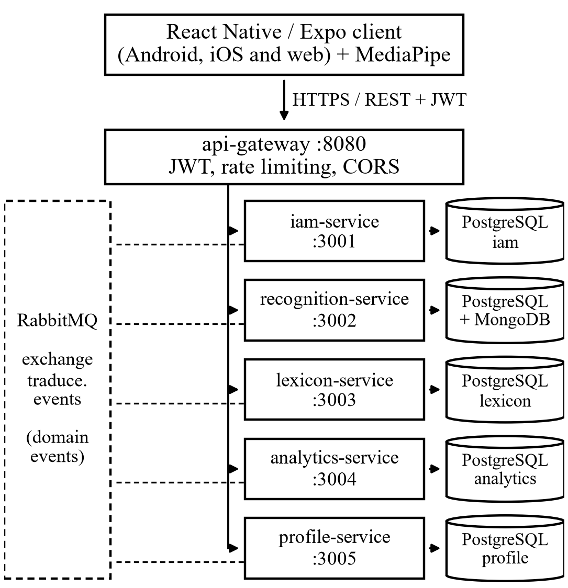
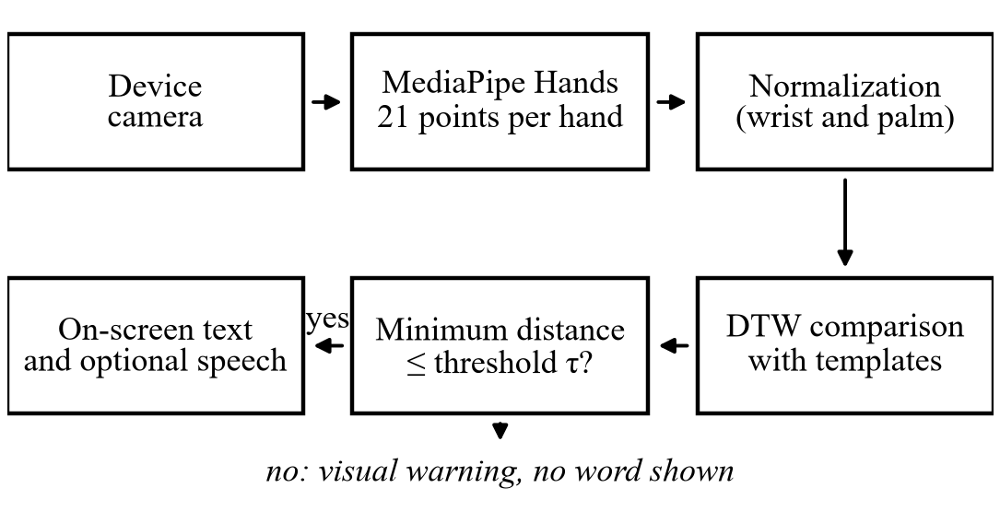

# Traduce Señas: Translating Colombian Sign Language into Text and Speech with On-Device Computer Vision and Microservices

Luis Alejandro Duarte Aldana, Juan Mauricio Suaza Solórzano and Juan Camilo Fierro Esquivel

*Software Analysis and Development Technologist Program, National Learning Service (SENA), Colombia*

*Abstract*—In Colombia the Deaf community has very few Colombian Sign Language (LSC) interpreters, and many of its everyday errands and conversations depend on the goodwill of others. This paper presents Traduce Señas, a phone and browser application that recognizes signs through the camera and turns them into text and speech. Recognition runs on the device itself: hand landmarks are extracted, normalized and compared against templates with Dynamic Time Warping, and when the match is not good enough the application warns the user instead of guessing. The server side was organized into five hexagonal microservices coordinated through events. The automated suite finished with 494 passing tests and no failures, the main flow was verified end to end, and the four critical and high findings of the security audit were closed. In a preliminary signer-independent measurement on the LSC-54 dataset, seven signs reached 75 % accuracy with 2 % wrong words. The limits of the approach for signs that differ only in location or movement are discussed.

Index Terms—Colombian sign language, computer vision, MediaPipe, Dynamic Time Warping, microservices, hexagonal architecture, accessibility

# Introduction

## The Problem

The World Health Organization estimates that more than 1.5 billion people live with some degree of hearing loss [1]. In Colombia, a large part of the Deaf population communicates in Colombian Sign Language (LSC), recognized by Law 982 of 2005 [2], which also requires communication barriers to be removed. Reality is different: the number of interpreters is far below demand, and even lower in rural areas and public offices [3].

The effect shows in simple situations. Asking for a medicine, checking a price at the corner store or running an errand at a service counter forces a Deaf person to write on paper, to gesture or to bring someone along. Without an interpreter nearby, they lose autonomy, and their participation in education, work and health services shrinks.

## Motivation

Today almost everyone carries a phone with a camera, and computer vision models can already track the hand and its joints in real time without special hardware [4]. It seemed reasonable to take advantage of that combination to build a low-cost tool that bridges everyday conversations, without trying to replace the interpreter where their presence is essential.

We also wanted to show that a team of three apprentices can carry out a project of this kind with formal engineering practices: traceable requirements, documented architecture, automated tests and a security audit. That is why this paper gives as much weight to how the system was built and verified as to recognition itself.

## Objectives

The general objective was to design and implement a mobile and web application that translates LSC into text or speech in real time, in order to reduce the communication barriers Deaf people face in everyday settings. Four specific objectives followed from it: recognize signs and deliver the translation immediately; present it in written or spoken words that any hearing person understands; ease communication in settings such as the classroom, a store or a service counter; and validate the tool in real situations to confirm its accuracy and usefulness.

## Scope and Organization of the Paper

The version described includes accounts with roles and permissions, translation history, alphabet lookup, visual notifications, achievements, statistics for the administrator and sample capture for training. Reverse translation (from text or speech into signs), full coverage of the LSC vocabulary and offline use are out of scope.

The rest of the paper is organized as follows: Section II reviews related work; Section III describes the methodology and design decisions; Section IV, the implementation; Section V, the testing strategy; Section VI presents the results, Section VII discusses them and Section VIII draws the conclusions.

# Related Work

This section gathers the background that guided the technical decisions: how automatic sign language recognition has been approached, which resources exist for LSC and which architectural styles were taken as reference.

## Automatic Sign Language Recognition

Early systems relied on sensor gloves or depth cameras, which limited their use outside the laboratory. Recent surveys show that the field has moved toward conventional video and deep learning, with good results on large datasets but with a strong dependence on labeled data that barely exists for minority languages [5]. The same surveys insist on separating evaluation with the training signers from evaluation with new people, a harder condition that is closer to real use [6].

A lighter alternative is to work with hand landmarks instead of pixels. MediaPipe offers ready-to-use perception pipelines [7], and its Hands solution estimates 21 three-dimensional points per hand and per frame with enough performance for mid-range phones [4]. Working on these points reduces the amount of data and makes it easier to protect the signer's identity.

## Resources for Colombian Sign Language

Open resources for LSC are scarce. Mora-Zarate *et al.* [8] published LSC-54, a set of 54 signs recorded by 22 people and distributed directly as already extracted MediaPipe landmarks. Since it uses the same extractor as the application, it can be incorporated without transforming the data, which is why it was chosen as the basis for expanding the vocabulary.

## Temporal Alignment of Sequences

A sign with movement is a sequence of postures, and two people —or the same person at two different moments— perform it at different speeds. Dynamic Time Warping (DTW), originally proposed for spoken word recognition [9], aligns two sequences by warping their time axis and returns a distance that stays small even when the rhythm changes. Its practical advantage is that it classifies with few examples per class and without training a neural network; its cost is that computation grows with the length of the sequences.

## Microservices and Hexagonal Architecture

Newman [10] describes microservices as small services that can be deployed independently and own their data, and warns that their operational cost is only justified when the domain can be split cleanly. Hexagonal architecture, or ports and adapters, organizes each service around its business logic and leaves the database, the web server and messaging as interchangeable details [11]. The project combined both styles, with the precautions discussed in Section VII.

# Methodology

## Development Approach

The work was managed with Scrum [12] in two-week sprints, fourteen in total between January and July 2026. The instructor acted as product owner and accepted each increment in the sprint review, and whatever came up in retrospectives was recorded as an improvement action. A story was considered done when the code had been reviewed, the tests passed, accessibility had been checked and the documentation was up to date.

Requirements were specified following the IEEE 830 standard [13]. The eleven high-level functional requirements were broken down into 79 detailed requirements (62 mandatory, 12 desirable and 5 optional) and traced to user stories, the data model and test cases. Twelve non-functional requirements were also defined, each with an acceptance metric. Accessibility was treated as the first constraint, because the main users are Deaf people.

## Design Decisions

Before writing code, alternatives were compared for every significant decision. Table I summarizes the chosen options and why the others were discarded. Two criteria weighed more than the rest: the video should never leave the phone, and three people had to be able to sustain the project with a single client codebase.

Technical Decisions and Discarded Alternatives

| Decision | Discarded | Reason |
|---|---|---|
| React Native client with Expo (Android, iOS and web) | Native apps in Kotlin and Swift | Three codebases are unmanageable for three people |
| On-device recognition | Sending video to the server | Lower latency and data use; video never leaves the phone |
| Templates compared with DTW | Neural network trained from scratch | Works with few examples and its errors can be explained |
| Node.js and TypeScript microservices behind an API Gateway | Modular monolith | Scale recognition separately and split work by domain |
| PostgreSQL per service; MongoDB for samples | One shared MySQL database | Data isolation; flexible documents for samples |
| RabbitMQ for events | Apache Kafka | Kafka is oversized for the expected volume |
| Deployment with Docker Compose | Manual installation | Reproducible environment with a single command |

## System Architecture

Fig. 1 shows the container view. The client only knows one address, the gateway's, which validates the JWT token, applies rate limiting and the origin allow-list before routing each request. Behind it there are five domain services: *iam* (identity, accounts and roles), *recognition* (translations, templates and samples), *lexicon* (sign catalog and alphabet), *analytics* (usage events and reports) and *profile* (profile, preferences, notifications and achievements).

Container view of Traduce Señas. Dashed lines represent the publication and consumption of domain events.

Each service owns its database and none queries another one's. When a service needs to learn about something that happened elsewhere, it does so through domain events published on a shared exchange. For example, when an account is created *iam* publishes UserRegistered and *profile* creates the profile with no direct call between them.

## Recognition Pipeline

Recognition runs entirely on the device (Fig. 2). For each frame the extractor returns 21 points *p*i = (*x*i, *y*i, *z*i) per hand. So that the position of the hand in the image and its distance to the camera do not affect the comparison, each point is translated to the origin of the wrist *p*0 and scaled by the palm size, measured as the distance between the wrist and the base of the middle finger *p*9:

$pi=pi-p0p9-p0,  i=0,…,20#1$

The 63 values of each hand are concatenated into a vector of 126 features; when the second hand is absent, its part is filled with zeros so that it adds no distance for one-handed signs. Static letters are classified from the configuration of the fingers. Signs with movement are resampled to 30 frames, forming a sequence *A* = (*a*1, …, *a*n), and compared with each template *B* = (*b*1, …, *b*m) through the DTW recurrence [9], where *D*i,j is the accumulated cost of the best alignment between the first *i* frames of *A* and the first *j* frames of *B*:

$Di,j=dai,bj+minDi-1,j,Di,j-1,Di-1,j-1#2$

where *d* is the Euclidean distance between postures. The computation is restricted to a band of four frames around the diagonal, which avoids absurd alignments and reduces the cost, and the final distance is normalized by the mean length of both sequences:

$ΔA,B=2Dn,mn+m#3$

The recognized sign is the template with the smallest Δ, but it is only accepted if that distance does not exceed a threshold τ; otherwise the application shows a visual warning and no word at all. We preferred this conservative behavior because, for the person using the tool, a wrong translation is more harmful than no translation. The accepted word appears on screen and, if the user wishes, it is read aloud.

On-device sign recognition pipeline.

## Security, Privacy and Accessibility

Sign samples are treated as sensitive personal data, so their handling follows Law 1581 of 2012 [14]: no sample is stored without a dated and versioned authorization, samples are unlinked from the signer's identity and users can delete their account, which erases their data and anonymizes their usage events. Passwords are stored with bcrypt, the token signing secret is mandatory and at least 32 characters long, and authentication routes are rate limited.

For accessibility, level AA of the WCAG 2.1 guidelines [15] was adopted as the target. In practice this translated into three design rules:

- **Nothing by sound alone:** every alert or result has a visual representation.

- **Contrast:** text keeps a minimum ratio of 4.5:1 against its background.

- **Touch targets:** no control is smaller than 48 dp.

# Implementation

## Internal Structure of the Services

All services share the same organization, which allowed any team member to work on someone else's service without a long adjustment period. As an example, the structure of the lexicon service is as follows:

services/lexicon-service/src/

├── domain/        entities and rules

├── application/   use cases

├── ports/         input and output interfaces

├── adapters/

│   ├── inbound/http/  routes and controllers

│   └── outbound/      repositories and publisher

├── lexicon.module.ts  composition

└── app.ts             startup

The domain and the use cases do not import the web framework or the database driver: they depend on ports that the adapters implement. The composition module builds the adapters and injects them into the use cases, so in tests it is enough to replace a real repository with an in-memory one.

Cross-cutting code lives in a shared package: the token provider, the authentication and role/permission authorization middlewares, the error handler, the typed event contracts and retry with exponential backoff. This prevents each service from solving problems common to all of them in its own way.

## Cross-Platform Client

The client was organized by features (translation, alphabet, authentication, history, profile, statistics and administration), each with its own presentation, business and data layers. The recognition engine was isolated behind an interface with several implementations —one based on MediaPipe, another on TensorFlow.js and a mock one for testing— following the Strategy pattern, and the differences between web and mobile were solved with platform-specific files. Changing the engine therefore does not require touching the screens.

## Flow of a Translation

When the pipeline accepts a sign, the client sends the text, never the video, to the gateway together with the user's token. *recognition* stores the translation in the history and publishes the TranslationProduced event; *profile* consumes it to advance achievements, such as “First translation”, and *analytics* records it as a usage event. None of these consumers delays the response to the user, and if the message bus goes down, the services reconnect and retry their subscription on their own.

## Deployment

The whole backend —gateway, services, databases and broker— starts from a single Compose file. The databases and the broker only listen on the server's local interface, their passwords are read from an environment file that is not versioned and each service exposes a health endpoint to check that it is running.

# Testing and Validation

## Testing Strategy

The test pyramid was followed. At the base, fast unit tests on the domain and the use cases, with fake repositories and written with the native Node.js test runner; the coverage target was 80 % of lines and 90 % in the domain layer. In the middle, integration tests against the real databases and broker, and contract tests against the OpenAPI specification. At the top, a few end-to-end tests over the critical flows. Performance tests with k6, accessibility tests with TalkBack and a pilot test with Deaf and hearing users were also planned.

## Functional Cases

Sixteen functional cases were designed on the critical requirements. They include sign-up with email verification, sign-in depending on the account status, password recovery with an expired code, rate limiting, role control over templates, history privacy, account deletion and rejection of samples without consent.

## Code and Security Audit

Once the split into microservices was finished, a code and security audit was carried out. Each finding was recorded with its root cause and the action taken, and the fix was confirmed by running the full suite again.

## Recognition Evaluation Protocol

Recognition accuracy cannot be validated with unit tests, so a signer-independent protocol was defined: templates are built with some people and queried with samples from others who did not take part in them, applying exactly the same normalization and comparison as the application. For each sign, the percentage of hits, the percentage of wrong words and the signs it is confused with are computed. Publishing a template requires a minimum accuracy of 85 %.

# Results

## Automated Tests

The run of October 7, 2026 finished with 494 passing tests, none failed or skipped, spread over 115 suites and taking 87 seconds. Table II shows how they are distributed by component.

Automated Tests by Component

| Component | Files | Verified aspects |
|---|---|---|
| @traduce/shared | 5 | Tokens, authorization, errors, event contracts, retries and bus |
| api-gateway | 1 | Prefix routing, CORS and public routes |
| iam | 22 | Sign-up and verification, sign-in by status, recovery, roles and account deletion |
| recognition | 11 | Translations, history, ADMIN-only templates and samples |
| lexicon | 6 | Catalog, alphabet, search, categories and publishing |
| analytics | 4 | Event recording and reports |
| profile | 4 | Profile, preferences, notifications and achievements |

## Functional Cases and End-to-End Test

Of the sixteen functional cases, thirteen passed and three are still pending: sign-up without accepting the terms, which does not yet have its own automated test, and two that require manual execution on a device (the unrecognized sign and history privacy). The end-to-end test of October 5, 2026, with all containers running, went through sign-up, sign-in, a translation, the achievement unlock and the recording of the usage event without errors.

## Security and Defects

The audit found two critical problems, two high ones and seven lower-severity defects. Table III summarizes the critical and high findings, all already fixed. Of the rest, only one is still under verification: querying the profile when it has not yet been created by an event.

Critical and High Audit Findings

| Finding | Level | Fix |
|---|---|---|
| The service started without a JWT secret or with a weak one | Critical | Mandatory secret of 32+ characters, with issuer and audience |
| Databases and broker exposed with default passwords | Critical | Ports bound to 127.0.0.1 only and passwords from the environment |
| Predictable recovery code with no attempt limit | High | Cryptographic generator, attempt counter and limit on /api/auth |
| Any user could import or delete templates | High | Writing restricted to the ADMIN role |

## Non-Functional Requirements

Attributes that depend on configuration and code were verified; those that require a production server or a physical device are still pending (Table IV).

Status of Non-Functional Tests

| Attribute | Criterion | Status |
|---|---|---|
| Color contrast | ≥ 4.5:1 | Passed |
| Mandatory JWT secret | Does not start without it | Passed |
| Internal services not exposed | Only on 127.0.0.1 | Passed |
| Broker failure and recovery | Automatic reconnection | Passed |
| Navigation with TalkBack | Flows without blocking | Pending |
| P95 latency (login, translation, lexicon) | < 300 ms at 50 req/s | Pending |
| Frames per second during capture | ≥ 15 on mid-range | Pending |

## Sign Recognition

The alphabet mode classifies static letters in real time both in the browser and on the phone. Before expanding the vocabulary, the structure of LSC-54 was analyzed, and three findings changed the plan: samples have between 40 and 133 frames, some frames do not contain a real hand, and most signs are made with both hands. In addition, the copies labeled as repetitions turned out to be shifts of the same recording rather than independent performances.

With the part of the dataset that could be downloaded (153 original recordings), only seven signs had at least four samples from two or more signers. For those seven, always querying against templates from other people, overall accuracy was 75 % with 2 % wrong words over 85 queries. “Amarillo” (yellow), “blanco” (white) and “morado” (purple) were always recognized; “gris” (gray), on the other hand, was always the first option but never below the threshold, so it was never accepted.

The threshold analysis also showed that the value of 1.1, calibrated with templates from the same person and the same camera, rejected almost everything when the signer changed. Raising it quickly reduced the share of empty answers while wrong words never exceeded 2 %, which led to recalibrating it. These figures are preliminary: seven signs are not enough to commit to a vocabulary, and the full measurement will resume once the dataset download is complete.

## Delivered Product

The system adds up to about 9,000 lines of code in the backend and 16,700 in the client, and has high-fidelity prototypes for 18 of the 21 planned screens.

# Discussion

## On-Device Recognition

Processing the camera on the phone was, in hindsight, the best decision: it solved both the real-time and the privacy requirements, because only text reaches the server. The price is that quality depends on the user's hardware, and the requirement of fifteen frames per second on mid-range devices still has to be confirmed.

## The Cost of Microservices

For a team of three, microservices do not come for free: there are more containers, more databases and more ways to fail. That cost was contained with the shared package, an identical structure in every service and a single deployment file. In return, work was divided by domain without team members getting in each other's way, and a failure in one service does not stop the others. The audit also showed the weak side: both critical findings came from default values meant only for development, a risk that multiplies with every new service.

## Limitations of the Approach

Normalizing with respect to the wrist, which makes the comparison robust, is also its main limitation: it erases the location of the hand relative to the body and much of its trajectory. Signs that share the hand configuration and only change place, such as “good morning”, “good afternoon” and “good evening”, can become indistinguishable. Adding the second hand improved the separation between signs, but it does not solve that problem. That is why we decided to measure first which signs can really be told apart before promising a vocabulary.

## Lessons Learned

Beyond the technical side, the project left three lessons:

- **Recompute metrics from the source.** A review revealed that the requirements catalog reported higher traceability than the real one.

- **Study a sample before downloading in bulk.** This would have revealed the true nature of the LSC-54 repetitions earlier.

- **One piece of data, one source.** The budget ended up with four different totals in different documents.

## Relation to Previous Work

Surveys in the field report high accuracy with deep networks trained on large volumes of video [5]. This work sits at another point of the trade-off: a smaller vocabulary in exchange for a system that works with few examples, runs on an ordinary phone and can explain its errors. Signer-independent evaluation follows the recommendation of [6] and brings the figures, modest as they are, closer to what a real user will experience.

# Conclusions

## Summary of Findings

Traduce Señas shows that a small team using open tools can build an LSC translation application that runs on ordinary phones and computers, respects personal data and does not guess when it is unsure. The backend reached a verifiable state: the automated suite is fully green, the main flow was tested end to end and the serious security findings were closed.

## Contributions

The work leaves three contributions: a working application designed for the Colombian Deaf community; a documented and tested reference architecture for training projects that want to use microservices without losing control; and a signer-independent evaluation protocol to measure LSC recognition before offering a vocabulary.

## Future Work

In the short term, tests will be integrated into GitHub Actions so that no change gets in with failing tests, load tests with k6 will be run, and structured logs and latency metrics will be added. In the next version the engine must take into account the position of the hand relative to the body and its movement. Finally, the pilot test with Deaf users at an educational institution is the missing step to meet the fourth specific objective and to measure the real effect of the tool on everyday communication.

## Final Reflection

Perhaps the most important lesson was learning to say “not yet”. It would have been easy to announce a twenty-word vocabulary; we preferred to measure first, because in a tool designed for Deaf people a wrong translation is not a technical detail, but a misunderstanding in a real conversation.

##### References

1. World Health Organization, *World Report on Hearing*. Geneva, Switzerland: WHO, 2021. [Online]. Available: https://www.who.int/publications/i/item/9789240020481

1. Congreso de la República de Colombia, “Ley 982 de 2005, por la cual se establecen normas tendientes a la equiparación de oportunidades para las personas sordas y sordociegas,” *Diario Oficial*, no. 45.995, Aug. 2, 2005.

1. Instituto Nacional para Sordos (INSOR), “Observatorio social de la población sorda colombiana,” 2020. [Online]. Available: https://www.insor.gov.co/observatorio/

1. F. Zhang, V. Bazarevsky, A. Vakunov, A. Tkachenka, G. Sung, C.-L. Chang, and M. Grundmann, “MediaPipe Hands: On-device real-time hand tracking,” 2020, arXiv:2006.10214.

1. R. Rastgoo, K. Kiani, and S. Escalera, “Sign language recognition: A deep survey,” *Expert Systems with Applications*, vol. 164, Art. no. 113794, 2021.

1. O. Koller, “Quantitative survey of the state of the art in sign language recognition,” 2020, arXiv:2008.09918.

1. C. Lugaresi *et al.*, “MediaPipe: A framework for building perception pipelines,” 2019, arXiv:1906.08172.

1. J. E. Mora-Zarate, C. L. Garzón-Castro, and J. A. Castellanos Rivillas, “LSC-54: A landmark-based dataset for Colombian Sign Language,” *Data in Brief*, 2025, doi: 10.1016/j.dib.2025.112145.

1. H. Sakoe and S. Chiba, “Dynamic programming algorithm optimization for spoken word recognition,” *IEEE Trans. Acoust., Speech, Signal Process.*, vol. 26, no. 1, pp. 43–49, 1978, doi: 10.1109/TASSP.1978.1163055.

1. S. Newman, *Building Microservices: Designing Fine-Grained Systems*, 2nd ed. Sebastopol, CA, USA: O’Reilly Media, 2021.

1. A. Cockburn, “Hexagonal architecture,” 2005. [Online]. Available: https://alistair.cockburn.us/hexagonal-architecture/

1. K. Schwaber and J. Sutherland, *The Scrum Guide*, 2020. [Online]. Available: https://scrumguides.org/

1. *IEEE Recommended Practice for Software Requirements Specifications*, IEEE Std 830-1998, 1998, doi: 10.1109/IEEESTD.1998.88286.

1. Congreso de la República de Colombia, “Ley Estatutaria 1581 de 2012, por la cual se dictan disposiciones generales para la protección de datos personales,” *Diario Oficial*, no. 48.587, Oct. 17, 2012.

1. World Wide Web Consortium, “Web Content Accessibility Guidelines (WCAG) 2.1,” W3C Recommendation, 2018. [Online]. Available: https://www.w3.org/TR/WCAG21/
