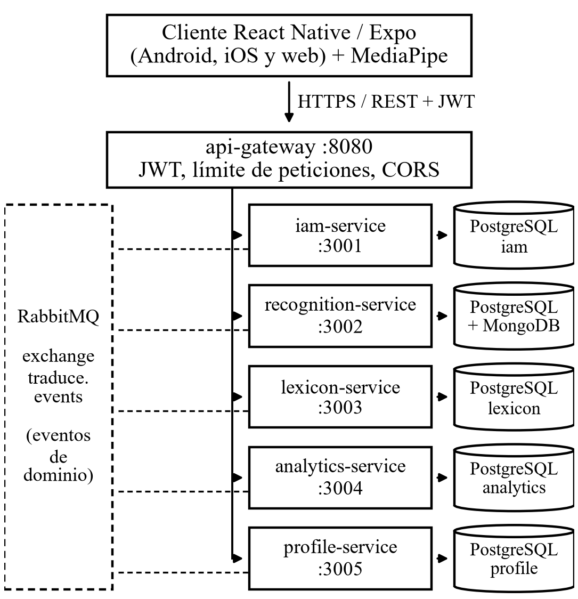
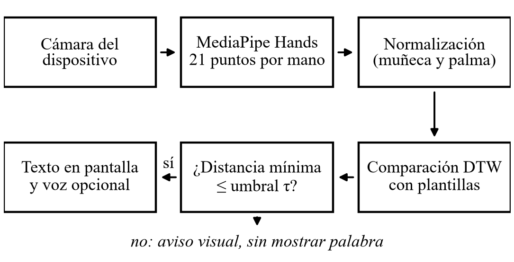

# Traduce Señas: traducción de la Lengua de Señas Colombiana a texto y voz con visión por computadora en el dispositivo y microservicios

Luis Alejandro Duarte Aldana, Juan Mauricio Suaza Solórzano y Juan Camilo Fierro Esquivel

*Tecnólogo en Análisis y Desarrollo de Software, Servicio Nacional de Aprendizaje (SENA), Colombia*

*Resumen*—En Colombia la comunidad sorda cuenta con muy pocos intérpretes de Lengua de Señas Colombiana (LSC), y buena parte de sus trámites y conversaciones diarias depende de la buena voluntad de terceros. Este trabajo presenta Traduce Señas, una aplicación para teléfono y navegador que reconoce señas con la cámara y las convierte en texto y voz. El reconocimiento se hace en el propio dispositivo: se extraen los puntos de referencia de las manos, se normalizan y se comparan con plantillas mediante Dynamic Time Warping; cuando la coincidencia no es suficiente, la aplicación avisa en lugar de adivinar. El servidor se organizó en cinco microservicios con arquitectura hexagonal coordinados por eventos. La suite automatizada terminó con 494 pruebas aprobadas y ninguna fallida, el flujo principal se verificó de extremo a extremo y se cerraron los cuatro hallazgos críticos y altos de la auditoría de seguridad. En una medición preliminar con firmantes independientes del conjunto LSC-54, siete señas alcanzaron un 75 % de acierto con un 2 % de palabras equivocadas. Se discuten los límites del enfoque para señas que solo difieren en ubicación o movimiento.

Index Terms—lengua de señas colombiana, visión por computadora, MediaPipe, Dynamic Time Warping, microservicios, arquitectura hexagonal, accesibilidad

# Introducción

## El Problema

La Organización Mundial de la Salud estima que más de 1 500 millones de personas viven con algún grado de pérdida auditiva [1]. En Colombia, buena parte de la población sorda se comunica en Lengua de Señas Colombiana (LSC), reconocida por la Ley 982 de 2005 [2], norma que además obliga a eliminar las barreras de comunicación. La realidad es otra: el número de intérpretes está muy por debajo de la demanda y es todavía menor en las zonas rurales y en las entidades públicas [3].

El efecto se nota en situaciones sencillas. Pedir un medicamento, preguntar un precio en la tienda o hacer una diligencia en una ventanilla obliga a la persona sorda a escribir en un papel, a gesticular o a ir acompañada. Sin un intérprete cerca pierde autonomía, y su participación en la educación, el trabajo y los servicios de salud se reduce.

## Motivación

Hoy casi cualquier persona lleva en el bolsillo un teléfono con cámara, y los modelos de visión por computadora ya permiten seguir la mano y sus articulaciones en tiempo real sin hardware especial [4]. Nos pareció razonable aprovechar esa combinación para construir una herramienta de bajo costo que sirva de puente en las conversaciones cotidianas, sin pretender reemplazar al intérprete allí donde su presencia es indispensable.

También quisimos demostrar que un equipo de tres aprendices puede sacar adelante un proyecto de este tipo con prácticas de ingeniería formales: requisitos trazables, arquitectura documentada, pruebas automatizadas y auditoría de seguridad. Por eso el artículo da tanto peso a la forma de construir y verificar el sistema como al reconocimiento en sí.

## Objetivos

El objetivo general fue diseñar e implementar una aplicación móvil y web que traduzca la LSC a texto o voz en tiempo real, para reducir las barreras de comunicación que enfrentan las personas sordas en entornos cotidianos. De él se derivaron cuatro objetivos específicos: reconocer señas y entregar la traducción de inmediato; presentarla en palabras escritas o habladas que cualquier oyente entienda; facilitar la comunicación en escenarios como el aula, una tienda o una ventanilla de atención; y validar la herramienta en situaciones reales para comprobar su precisión y su utilidad.

## Alcance y Organización del Artículo

La versión descrita incluye cuentas con roles y permisos, historial de traducciones, consulta del alfabeto, notificaciones visuales, logros, estadísticas para el administrador y captura de muestras para entrenamiento. Quedan por fuera la traducción inversa (de texto o voz hacia señas), la cobertura completa del vocabulario de la LSC y el uso sin conexión.

El resto del documento se organiza así: la Sección II revisa los trabajos relacionados; la III describe la metodología y las decisiones de diseño; la IV, la implementación; la V, la estrategia de pruebas; la VI presenta los resultados, la VII los discute y la VIII recoge las conclusiones.

# Trabajos Relacionados

Esta sección reúne los antecedentes que orientaron las decisiones técnicas: cómo se ha abordado el reconocimiento automático de lengua de señas, qué recursos existen para la LSC y qué estilos de arquitectura se tomaron como referencia.

## Reconocimiento Automático de Lengua de Señas

Los primeros sistemas dependían de guantes con sensores o de cámaras de profundidad, lo que limitaba su uso fuera del laboratorio. Las revisiones recientes muestran que el campo se desplazó hacia el video convencional y el aprendizaje profundo, con buenos resultados en conjuntos grandes, pero con una fuerte dependencia de datos etiquetados que casi no existen para lenguas minoritarias [5]. Las mismas revisiones insisten en distinguir la evaluación con los firmantes del entrenamiento de la evaluación con personas nuevas, condición más exigente y más cercana al uso real [6].

Una alternativa más liviana consiste en trabajar con puntos de referencia de la mano en lugar de píxeles. MediaPipe ofrece canalizaciones de percepción listas para usar [7], y su solución Hands estima 21 puntos tridimensionales por mano y por cuadro con un rendimiento suficiente para teléfonos de gama media [4]. Trabajar sobre esos puntos reduce el volumen de datos y facilita proteger la identidad de quien firma.

## Recursos para la Lengua de Señas Colombiana

Los recursos abiertos para la LSC son escasos. Mora-Zarate *et al.* [8] publicaron LSC-54, un conjunto de 54 señas grabadas por 22 personas y distribuido directamente como puntos de MediaPipe ya extraídos. Como usa el mismo extractor que la aplicación, puede incorporarse sin transformar los datos, y por eso se eligió como base para ampliar el vocabulario.

## Alineamiento Temporal de Secuencias

Una seña con movimiento es una secuencia de posturas, y dos personas —o la misma persona en dos momentos— la ejecutan a velocidades distintas. Dynamic Time Warping (DTW), propuesto originalmente para el reconocimiento de palabras habladas [9], alinea dos secuencias deformando su eje temporal y entrega una distancia que sigue siendo pequeña aunque el ritmo cambie. Su ventaja práctica es que clasifica con pocos ejemplos por clase y sin entrenar una red neuronal; su costo, que el cálculo crece con la longitud de las secuencias.

## Microservicios y Arquitectura Hexagonal

Newman [10] describe los microservicios como servicios pequeños, desplegables de forma independiente y dueños de sus datos, y advierte que su costo operativo solo se justifica cuando el dominio se deja dividir con claridad. La arquitectura hexagonal, o de puertos y adaptadores, organiza cada servicio alrededor de su lógica de negocio y deja la base de datos, el servidor web y la mensajería como detalles intercambiables [11]. El proyecto combinó ambos estilos, con las precauciones que se comentan en la Sección VII.

# Metodología

## Enfoque de Desarrollo

El trabajo se gestionó con Scrum [12] en sprints de dos semanas, catorce en total entre enero y julio de 2026. El instructor hizo las veces de dueño del producto y aceptó cada incremento en la revisión de sprint, y lo que surgía en las retrospectivas se registró como acción de mejora. Una historia se daba por terminada cuando el código estaba revisado, las pruebas pasaban, la accesibilidad estaba verificada y la documentación se había actualizado.

Los requisitos se especificaron según el estándar IEEE 830 [13]. Los once requisitos funcionales de alto nivel se desglosaron en 79 requisitos detallados (62 obligatorios, 12 deseables y 5 opcionales) y se trazaron hasta las historias de usuario, el modelo de datos y los casos de prueba. Se definieron además doce requisitos no funcionales, cada uno con una métrica de aceptación. La accesibilidad se trató como la primera restricción, porque los usuarios principales son personas sordas.

## Decisiones de Diseño

Antes de escribir código se compararon alternativas para cada decisión de peso. La Tabla I resume las elegidas y el motivo por el que se descartaron las demás. Dos criterios pesaron más que el resto: que el video nunca saliera del teléfono y que tres personas pudieran sostener el proyecto con una sola base de código en el cliente.

Decisiones Técnicas y Alternativas Descartadas

| Decisión | Descartada | Motivo |
|---|---|---|
| Cliente en React Native con Expo (Android, iOS y web) | Apps nativas en Kotlin y Swift | Tres bases de código son inmanejables para tres personas |
| Reconocimiento en el dispositivo | Enviar el video al servidor | Menos latencia y datos; el video no sale del teléfono |
| Plantillas comparadas con DTW | Red neuronal entrenada desde cero | Funciona con pocos ejemplos y sus errores se pueden explicar |
| Microservicios en Node.js y TypeScript tras un API Gateway | Monolito modular | Escalar el reconocimiento por separado y repartir el trabajo por dominio |
| PostgreSQL por servicio; MongoDB para muestras | Una base MySQL compartida | Aislamiento de datos; documentos flexibles para las muestras |
| RabbitMQ para eventos | Apache Kafka | Kafka es desproporcionado para el volumen esperado |
| Despliegue con Docker Compose | Instalación manual | Entorno reproducible con un solo comando |

## Arquitectura del Sistema

La Fig. 1 muestra la vista de contenedores. El cliente solo conoce una dirección, la del gateway, que valida el token JWT, aplica el límite de peticiones y la lista blanca de orígenes antes de enrutar cada solicitud. Detrás hay cinco servicios de dominio: *iam* (identidad, cuentas y roles), *recognition* (traducciones, plantillas y muestras), *lexicon* (catálogo de señas y alfabeto), *analytics* (eventos de uso y reportes) y *profile* (perfil, preferencias, notificaciones y logros).

Vista de contenedores de Traduce Señas. Las líneas punteadas representan la publicación y el consumo de eventos de dominio.

Cada servicio es dueño de su base de datos y ninguno consulta la de otro. Cuando uno necesita enterarse de algo que ocurrió en otro, lo hace por eventos de dominio publicados en un exchange común. Por ejemplo, al crearse una cuenta *iam* publica UserRegistered y *profile* crea el perfil sin que exista una llamada directa entre ambos.

## Canal de Reconocimiento

El reconocimiento se ejecuta por completo en el dispositivo (Fig. 2). Por cada cuadro el extractor entrega 21 puntos *p*i = (*x*i, *y*i, *z*i) por mano. Para que la posición de la mano en la imagen y su distancia a la cámara no influyan en la comparación, cada punto se traslada al origen de la muñeca *p*0 y se escala por el tamaño de la palma, medido como la distancia entre la muñeca y la base del dedo medio *p*9:

$pi=pi-p0p9-p0,  i=0,…,20#1$

Los 63 valores de cada mano se concatenan en un vector de 126 rasgos; cuando la segunda mano no aparece, su parte se llena con ceros para que no sume distancia en las señas de una sola mano. Las letras estáticas se clasifican a partir de la configuración de los dedos. Las señas con movimiento se remuestrean a 30 cuadros, formando una secuencia *A* = (*a*1, …, *a*n), y se comparan con cada plantilla *B* = (*b*1, …, *b*m) mediante la recurrencia de DTW [9], donde *D*i,j es el costo acumulado del mejor alineamiento entre los primeros *i* cuadros de *A* y los primeros *j* de *B*:

$Di,j=dai,bj+minDi-1,j,Di,j-1,Di-1,j-1#2$

donde *d* es la distancia euclidiana entre posturas. El cálculo se restringe a una banda de cuatro cuadros alrededor de la diagonal, lo que evita alineamientos absurdos y reduce el costo, y la distancia final se normaliza por la longitud media de ambas secuencias:

$ΔA,B=2Dn,mn+m#3$

La seña reconocida es la plantilla con menor Δ, pero solo se acepta si esa distancia no supera un umbral τ; en caso contrario la aplicación muestra un aviso visual y ninguna palabra. Preferimos este comportamiento conservador porque, para quien usa la herramienta, una traducción equivocada es más dañina que la ausencia de traducción. La palabra aceptada aparece en pantalla y, si el usuario lo desea, se lee en voz alta.

Canal de reconocimiento de señas en el dispositivo.

## Seguridad, Privacidad y Accesibilidad

Las muestras de señas se tratan como datos personales sensibles, de modo que su manejo se ajustó a la Ley 1581 de 2012 [14]: ninguna muestra se guarda sin una autorización con fecha y versión, las muestras quedan desvinculadas de la identidad de quien firma y el usuario puede eliminar su cuenta, con lo cual sus datos se borran y sus eventos de uso se anonimizan. Las contraseñas se guardan con bcrypt, el secreto de firma de los tokens es obligatorio y de al menos 32 caracteres, y las rutas de autenticación tienen límite de peticiones.

En accesibilidad se adoptó como meta el nivel AA de las pautas WCAG 2.1 [15]. En la práctica eso se tradujo en tres reglas de diseño:

- **Nada solo por sonido:** toda alerta o resultado tiene una representación visual.

- **Contraste:** el texto mantiene una relación mínima de 4,5:1 con su fondo.

- **Objetivos táctiles:** ningún control mide menos de 48 dp.

# Implementación

## Estructura Interna de los Servicios

Todos los servicios comparten la misma organización, lo que permitió que cualquier integrante trabajara en un servicio ajeno sin un periodo largo de adaptación. Como ejemplo, la estructura del servicio de léxico es la siguiente:

services/lexicon-service/src/

├── domain/        entidades y reglas

├── application/   casos de uso

├── ports/         interfaces de entrada y salida

├── adapters/

│   ├── inbound/http/  rutas y controladores

│   └── outbound/      repositorios y publicador

├── lexicon.module.ts  composición

└── app.ts             arranque

El dominio y los casos de uso no importan el framework web ni el controlador de la base de datos: dependen de puertos que los adaptadores implementan. El módulo de composición construye los adaptadores y los inyecta en los casos de uso, de modo que en las pruebas basta con sustituir un repositorio real por uno en memoria.

El código transversal vive en un paquete compartido: el proveedor de tokens, los middlewares de autenticación y de autorización por rol y permiso, el manejador de errores, los contratos tipados de eventos y el reintento con espera exponencial. Así se evita que cada servicio resuelva a su manera problemas que son comunes a todos.

## Cliente Multiplataforma

El cliente se organizó por funcionalidades (traducción, alfabeto, autenticación, historial, perfil, estadísticas y administración), cada una con sus propias capas de presentación, negocio y datos. El motor de reconocimiento quedó aislado detrás de una interfaz con varias implementaciones —una basada en MediaPipe, otra en TensorFlow.js y una simulada para pruebas—, según el patrón Estrategia, y las diferencias entre web y móvil se resolvieron con archivos específicos por plataforma. Cambiar de motor, por lo tanto, no obliga a tocar las pantallas.

## Flujo de una Traducción

Cuando el canal acepta una seña, el cliente envía al gateway el texto, nunca el video, junto con el token del usuario. *recognition* guarda la traducción en el historial y publica el evento TranslationProduced; *profile* lo consume para avanzar los logros, como «Primera traducción», y *analytics* lo registra como evento de uso. Ninguno de esos consumidores retrasa la respuesta al usuario, y si el bus de mensajes se cae, los servicios se reconectan y reintentan la suscripción por sí mismos.

## Despliegue

El backend completo —gateway, servicios, bases de datos y broker— se levanta con un único archivo de Compose. Las bases de datos y el broker solo escuchan en la interfaz local del servidor, sus contraseñas se leen de un archivo de entorno que no se versiona y cada servicio expone un endpoint de salud para verificar que está en funcionamiento.

# Pruebas y Validación

## Estrategia de Pruebas

Se siguió la pirámide de pruebas. En la base, pruebas unitarias rápidas sobre el dominio y los casos de uso, con repositorios falsos y escritas con el ejecutor nativo de Node.js; la meta de cobertura fue del 80 % de las líneas y del 90 % en la capa de dominio. En el medio, pruebas de integración contra las bases de datos y el broker reales y pruebas de contrato frente a la especificación OpenAPI. En la cima, pocas pruebas de extremo a extremo sobre los flujos críticos. Se planificaron además pruebas de rendimiento con k6, de accesibilidad con TalkBack y una prueba piloto con usuarios sordos y oyentes.

## Casos Funcionales

Sobre los requisitos críticos se diseñaron dieciséis casos funcionales. Entre ellos están el registro con verificación de correo, el inicio de sesión según el estado de la cuenta, la recuperación de contraseña con un código vencido, el límite de peticiones, el control de roles sobre las plantillas, la privacidad del historial, la eliminación de la cuenta y el rechazo de muestras sin consentimiento.

## Auditoría de Código y Seguridad

Al terminar la separación en microservicios se hizo una auditoría de código y de seguridad. Cada hallazgo se registró con su causa raíz y la acción tomada, y la corrección se comprobó volviendo a ejecutar la suite completa.

## Protocolo de Evaluación del Reconocimiento

La precisión del reconocimiento no se valida con pruebas unitarias, así que se definió un protocolo independiente del firmante: las plantillas se construyen con unas personas y se consultan con muestras de otras que no participaron en ellas, aplicando exactamente la misma normalización y la misma comparación de la aplicación. Por cada seña se calcula el porcentaje de aciertos, el de palabras equivocadas y las señas con las que se confunde. Para publicar una plantilla se exige una precisión mínima del 85 %.

# Resultados

## Pruebas Automatizadas

La ejecución del 7 de octubre de 2026 terminó con 494 pruebas aprobadas, ninguna fallida ni omitida, repartidas en 115 suites y en 87 segundos. La Tabla II muestra cómo se distribuyen por componente.

Pruebas Automatizadas por Componente

| Componente | Archivos | Aspectos verificados |
|---|---|---|
| @traduce/shared | 5 | Tokens, autorización, errores, contratos de eventos, reintentos y bus |
| api-gateway | 1 | Enrutamiento por prefijo, CORS y rutas públicas |
| iam | 22 | Registro y verificación, sesión según estado, recuperación, roles y borrado de cuenta |
| recognition | 11 | Traducciones, historial, plantillas solo para ADMIN y muestras |
| lexicon | 6 | Catálogo, alfabeto, búsqueda, categorías y publicación |
| analytics | 4 | Registro de eventos y reportes |
| profile | 4 | Perfil, preferencias, notificaciones y logros |

## Casos Funcionales y Prueba de Extremo a Extremo

De los dieciséis casos funcionales, trece se aprobaron y tres siguen pendientes: el registro sin aceptar los términos, que aún no tiene una prueba automatizada propia, y dos que exigen ejecución manual en un dispositivo (la seña no reconocida y la privacidad del historial). La prueba de extremo a extremo del 5 de octubre de 2026, con todos los contenedores en marcha, recorrió el registro, el inicio de sesión, una traducción, el desbloqueo del logro y el registro del evento de uso sin errores.

## Seguridad y Defectos

La auditoría encontró dos problemas críticos, dos altos y siete defectos de menor severidad. La Tabla III resume los críticos y los altos, todos ya corregidos. De los demás solo uno sigue en verificación: la consulta del perfil cuando este todavía no se ha creado por evento.

Hallazgos Críticos y Altos de la Auditoría

| Hallazgo | Nivel | Corrección |
|---|---|---|
| El servicio arrancaba sin secreto JWT o con uno débil | Crítico | Secreto obligatorio de 32+ caracteres, con issuer y audience |
| Bases de datos y broker expuestos con contraseñas por defecto | Crítico | Puertos solo en 127.0.0.1 y contraseñas desde el entorno |
| Código de recuperación predecible y sin límite de intentos | Alto | Generador criptográfico, contador de intentos y límite en /api/auth |
| Cualquier usuario podía importar o borrar plantillas | Alto | Escritura reservada al rol ADMIN |

## Requisitos No Funcionales

Los atributos que dependen de la configuración y del código quedaron verificados; los que requieren un servidor de producción o un dispositivo físico siguen pendientes (Tabla IV).

Estado de las Pruebas No Funcionales

| Atributo | Criterio | Estado |
|---|---|---|
| Contraste de colores | ≥ 4,5:1 | Aprobado |
| Secreto JWT obligatorio | No arranca sin él | Aprobado |
| Servicios internos no expuestos | Solo en 127.0.0.1 | Aprobado |
| Caída y regreso del broker | Reconexión automática | Aprobado |
| Navegación con TalkBack | Flujos sin bloqueo | Pendiente |
| Latencia P95 (login, traducción, léxico) | < 300 ms a 50 pet./s | Pendiente |
| Cuadros por segundo en la captura | ≥ 15 en gama media | Pendiente |

## Reconocimiento de Señas

El modo abecedario clasifica letras estáticas en tiempo real tanto en el navegador como en el teléfono. Antes de ampliar el vocabulario se analizó la estructura de LSC-54, y tres hallazgos cambiaron el plan: las muestras tienen entre 40 y 133 cuadros, una parte de los cuadros no contiene una mano real y la mayoría de las señas se hacen con las dos manos. Además, las copias marcadas como repeticiones resultaron ser desplazamientos de una misma grabación y no ejecuciones independientes.

Con la parte del conjunto que se alcanzó a descargar (153 grabaciones originales) solo siete señas tenían al menos cuatro muestras de dos o más firmantes. En esas siete, consultando siempre contra plantillas de otras personas, el acierto global fue del 75 % con un 2 % de palabras equivocadas en 85 consultas. «Amarillo», «blanco» y «morado» se reconocieron siempre; «gris», en cambio, quedó como primera opción en todos los casos, pero nunca por debajo del umbral, y por eso no se aceptó ninguna vez.

El análisis del umbral mostró también que el valor de 1,1, calibrado con plantillas de la misma persona y la misma cámara, rechazaba casi todo al cambiar de firmante. Al subirlo, la proporción de respuestas vacías bajó con rapidez mientras las palabras equivocadas nunca pasaron del 2 %, lo que llevó a recalibrarlo. Estas cifras son preliminares: siete señas no bastan para comprometer un vocabulario, y la medición completa se retomará cuando termine la descarga del conjunto.

## Producto Obtenido

El sistema suma cerca de 9 000 líneas de código en el backend y 16 700 en el cliente, y cuenta con prototipos de alta fidelidad para 18 de las 21 pantallas previstas.

# Discusión

## Reconocimiento en el Dispositivo

Procesar la cámara en el teléfono fue, en retrospectiva, la decisión más acertada: resolvió a la vez el requisito de tiempo real y el de privacidad, porque al servidor solo llega texto. El precio es que la calidad depende del hardware del usuario, y el requisito de quince cuadros por segundo en equipos de gama media todavía está por comprobarse.

## El Costo de los Microservicios

Para un equipo de tres personas los microservicios no salen gratis: hay más contenedores, más bases de datos y más maneras de fallar. Ese costo se contuvo con el paquete compartido, una estructura idéntica en todos los servicios y un solo archivo de despliegue. A cambio, el trabajo se repartió por dominio sin que los integrantes se estorbaran y una falla en un servicio no detiene a los demás. La auditoría mostró también el lado débil: los dos hallazgos críticos venían de valores por defecto pensados solo para desarrollo, un riesgo que se multiplica con cada servicio nuevo.

## Limitaciones del Enfoque

La normalización respecto a la muñeca, que hace robusta la comparación, es también su principal limitación: borra la ubicación de la mano respecto al cuerpo y buena parte de su trayectoria. Señas que comparten la configuración de la mano y solo cambian de lugar, como «buenos días», «buenas tardes» y «buenas noches», pueden volverse indistinguibles. Incorporar la segunda mano mejoró la separación entre señas, pero no resuelve ese problema. Por eso se decidió medir primero qué señas se distinguen de verdad antes de prometer un vocabulario.

## Lecciones Aprendidas

Más allá de lo técnico, el proyecto dejó tres lecciones:

- **Recalcular las métricas desde la fuente.** En una revisión se descubrió que el catálogo de requisitos reportaba una trazabilidad mayor que la real.

- **Estudiar una muestra antes de descargar en masa.** Así se habría detectado antes la verdadera naturaleza de las repeticiones de LSC-54.

- **Un dato, una sola fuente.** El presupuesto llegó a tener cuatro totales distintos en documentos diferentes.

## Relación con Trabajos Previos

Las revisiones del área reportan precisiones altas con redes profundas entrenadas sobre grandes volúmenes de video [5]. Este trabajo se ubica en otro punto del compromiso: menos vocabulario a cambio de un sistema que funciona con pocos ejemplos, corre en un teléfono común y permite explicar sus errores. La evaluación con firmantes independientes sigue la recomendación de [6] y hace que las cifras, aunque modestas, se acerquen más a lo que vivirá un usuario real.

# Conclusiones

## Resumen de Hallazgos

Traduce Señas muestra que un equipo pequeño, con herramientas abiertas, puede construir una aplicación de traducción de LSC que funciona en teléfonos y computadores comunes, respeta los datos personales y no adivina cuando no está segura. El backend quedó en un estado verificable: la suite automatizada está completa en verde, el flujo principal se probó de extremo a extremo y los hallazgos graves de seguridad se cerraron.

## Contribuciones

El trabajo deja tres aportes: una aplicación funcional pensada para la comunidad sorda colombiana; una arquitectura de referencia, documentada y probada, para proyectos formativos que quieran usar microservicios sin perder el control; y un protocolo de evaluación independiente del firmante para medir el reconocimiento de la LSC antes de ofrecer un vocabulario.

## Trabajos Futuros

A corto plazo se integrarán las pruebas en GitHub Actions para que ningún cambio entre con pruebas en rojo, se ejecutarán las pruebas de carga con k6 y se añadirán registros estructurados y métricas de latencia. En la siguiente versión el motor debe incorporar la posición de la mano respecto al cuerpo y su movimiento. Por último, la prueba piloto con usuarios sordos en una institución educativa es el paso que falta para cumplir el cuarto objetivo específico y medir el efecto real de la herramienta en la comunicación cotidiana.

## Reflexión Final

Tal vez la enseñanza más importante fue aprender a decir «todavía no». Habría sido fácil anunciar un vocabulario de veinte palabras; preferimos medir antes, porque en una herramienta pensada para personas sordas una traducción equivocada no es un detalle técnico, sino un malentendido en una conversación real.

##### Referencias

1. World Health Organization, *World Report on Hearing*. Ginebra, Suiza: WHO, 2021. [En línea]. Disponible: https://www.who.int/publications/i/item/9789240020481

1. Congreso de la República de Colombia, «Ley 982 de 2005, por la cual se establecen normas tendientes a la equiparación de oportunidades para las personas sordas y sordociegas», *Diario Oficial*, n.º 45.995, 2 ago. 2005.

1. Instituto Nacional para Sordos (INSOR), «Observatorio social de la población sorda colombiana», 2020. [En línea]. Disponible: https://www.insor.gov.co/observatorio/

1. F. Zhang, V. Bazarevsky, A. Vakunov, A. Tkachenka, G. Sung, C.-L. Chang y M. Grundmann, «MediaPipe Hands: On-device real-time hand tracking», 2020, arXiv:2006.10214.

1. R. Rastgoo, K. Kiani y S. Escalera, «Sign language recognition: A deep survey», *Expert Systems with Applications*, vol. 164, art. 113794, 2021.

1. O. Koller, «Quantitative survey of the state of the art in sign language recognition», 2020, arXiv:2008.09918.

1. C. Lugaresi *et al.*, «MediaPipe: A framework for building perception pipelines», 2019, arXiv:1906.08172.

1. J. E. Mora-Zarate, C. L. Garzón-Castro y J. A. Castellanos Rivillas, «LSC-54: A landmark-based dataset for Colombian Sign Language», *Data in Brief*, 2025, doi: 10.1016/j.dib.2025.112145.

1. H. Sakoe y S. Chiba, «Dynamic programming algorithm optimization for spoken word recognition», *IEEE Trans. Acoust., Speech, Signal Process.*, vol. 26, n.º 1, pp. 43–49, 1978, doi: 10.1109/TASSP.1978.1163055.

1. S. Newman, *Building Microservices: Designing Fine-Grained Systems*, 2.ª ed. Sebastopol, CA, EE. UU.: O’Reilly Media, 2021.

1. A. Cockburn, «Hexagonal architecture», 2005. [En línea]. Disponible: https://alistair.cockburn.us/hexagonal-architecture/

1. K. Schwaber y J. Sutherland, *The Scrum Guide*, 2020. [En línea]. Disponible: https://scrumguides.org/

1. *IEEE Recommended Practice for Software Requirements Specifications*, IEEE Std 830-1998, 1998, doi: 10.1109/IEEESTD.1998.88286.

1. Congreso de la República de Colombia, «Ley Estatutaria 1581 de 2012, por la cual se dictan disposiciones generales para la protección de datos personales», *Diario Oficial*, n.º 48.587, 17 oct. 2012.

1. World Wide Web Consortium, «Web Content Accessibility Guidelines (WCAG) 2.1», W3C Recommendation, 2018. [En línea]. Disponible: https://www.w3.org/TR/WCAG21/
