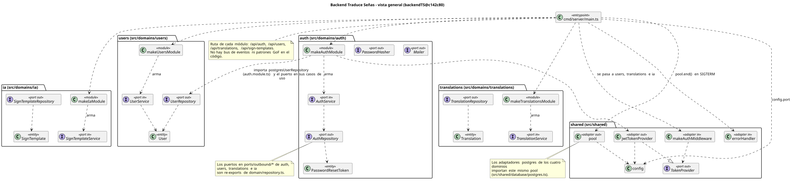

<div align="center">

**Traduce Señas: Technical Manual**

Juan Mauricio Suaza Solórzano

Luis Alejandro Duarte Aldana

Juan Camilo Fierro Esquivel

Instructor: Karol Daniela Correa

October 7, 2026

</div>

## Table of Contents

- [Introduction](#introduction)
- [Purpose](#purpose)
- [1. System Requirements](#1-system-requirements)
- [2. Development Tools](#2-development-tools)
- [3. Architecture](#3-architecture)
   - [3.1 Backend Domains (develop)](#31-backend-domains-develop)
   - [3.2 API Routes (develop)](#32-api-routes-develop)
- [4. Database](#4-database)
   - [4.1 Relational Model](#41-relational-model)
   - [4.2 Manual SQL Migrations (Current)](#42-manual-sql-migrations-current)
   - [4.3 Old Liquibase in Parallel](#43-old-liquibase-in-parallel)
   - [4.4 Mismatches With the Documentation](#44-mismatches-with-the-documentation)
- [5. Security](#5-security)
   - [5.1 Authentication](#51-authentication)
   - [5.2 Email Verification and Recovery](#52-email-verification-and-recovery)
   - [5.3 Authorization (RBAC)](#53-authorization-rbac)
   - [5.4 Open Risks](#54-open-risks)
- [6. Sign Recognition (AI)](#6-sign-recognition-ai)
- [7. Frontend](#7-frontend)
- [8. Diagrams](#8-diagrams)
- [9. Tests](#9-tests)
- [10. Installation](#10-installation)
   - [10.1 Local Installation (Summary)](#101-local-installation-summary)
   - [10.2 Installation on a Web Server](#102-installation-on-a-web-server)
- [11. Running the Application](#11-running-the-application)
- [12. Actual vs Documented](#12-actual-vs-documented)
- [13. Pending Items](#13-pending-items)
- [References](#references)

## Introduction

This manual describes the version of the system on the `develop` branch as of October 3, 2026 (Backend `2c4e62d`, Frontend `c1456cf`). To install the system, see the [Installation manual](installation-manual-apa.md).

- `Backend@develop:<path>` = file from the `develop` branch of the Backend repository. It can be read without switching branches with `git show origin/develop:<path>` (inside the Backend repository).
- `Frontend@develop:<path>` = file from the `develop` branch of the Frontend repository (frontendTS).

## Purpose

This manual explains to developers joining the project how Traduce Señas is built: tools, architecture, API routes, database, security, sign recognition, frontend, diagrams and tests.

## 1. System Requirements

See the Installation manual, section 2.1.

## 2. Development Tools

**Table 1**

*Development Tools*

| Topic | Status | Source |
|-------|--------|--------|
| Backend | Node.js (OpenJS Foundation, n.d.-b), Express 5 (OpenJS Foundation, n.d.-a), TypeScript, PostgreSQL (The PostgreSQL Global Development Group, n.d.) with `pg`, validation with `zod`, email with `nodemailer`, tests with `vitest` | `Backend@develop:package.json` |
| Frontend | Expo 57 (Expo, n.d.), React Native 0.86 (Meta Platforms, Inc., n.d.), react-native-web, React Navigation 6, axios, Context API. **No React Query.** | `package.json` of the Frontend repository |

## 3. Architecture

**Table 2**

*Architecture*

| Topic | Status | Source |
|-------|--------|--------|
| Overall style | **Modular monolith**: a single Express process that mounts one router per domain. | `Backend@develop:cmd/server/main.ts` |
| Internal style | **Not formally decided.** Each domain uses `domain / application / ports / adapters` folders (similar to hexagonal); the older documents say "N layers". | Folder structure of `Backend@develop:src/domains/` |
| Data | PostgreSQL. **No MongoDB**: there is no driver and no service in the compose file, and `src/shared/database/montsdb/` only has `.gitkeep`. ADR-003 (trans-sl-docs repository) talks about PostgreSQL + MongoDB: the code does not follow it. | `Backend@develop:package.json` |

```
Browser --8080--> nginx (frontend) --/api/--> Express backend :3000 --pg--> PostgreSQL :5432
     \--> CDN: MediaPipe and Google models (recognition runs in the browser)
```

The microservices, the gateway and the contracts in `Docs/07-api` and `Docs/09-microservices` are **templates**; they do not describe this system.

### 3.1 Backend Domains (`develop`)

`cmd/server/main.ts` mounts six routers (in `develop`). Each domain has its own `*.module.ts`, which wires ports to adapters.

**Table 3**

*Backend Domains (`develop`)*

| Domain | Base route | What it does |
|--------|------------|--------------|
| `auth` | `/api/auth` | Sign-up, sign-in, email verification, password recovery |
| `users` | `/api/users` | My user data (`/me`) |
| `translations` | `/api/translations` | Save, list and delete translations |
| `ia` | `/api/sign-templates` | Templates of signs with movement (plus training scripts outside the server) |
| `iam` | `/api/iam` | Roles and permissions (RBAC) |
| `analytics` | `/api/analytics` | Usage events and an aggregated report per section |

How they connect without knowing each other: `auth` receives a `roleAssigner` adapter and `analytics` a `permissionChecker`, both built with the `iam` service in `main.ts`. This way `auth` and `analytics` do not import code from `iam`.

### 3.2 API Routes (`develop`)

"Token" = header `Authorization: Bearer <token>`. Source: the `routes.ts` of each domain.

**Table 4**

*API Routes (`develop`)*

| Method | Route | Token | Permission |
|--------|-------|-------|------------|
| POST | `/api/auth/register` | No | — |
| POST | `/api/auth/login` | No | — |
| POST | `/api/auth/verify-email` | No | — (requires code **and** password) |
| POST | `/api/auth/resend-verification` | No | — |
| POST | `/api/auth/forgot-password` | No | — |
| POST | `/api/auth/verify-code` | No | — |
| POST | `/api/auth/reset-password` | No | — |
| GET | `/api/users/me` | Yes | — |
| POST | `/api/translations` | Yes | token only |
| GET | `/api/translations/history` | Yes | token only (`limit` max. 200, default 50; `offset`) |
| DELETE | `/api/translations/:id` | Yes | token only (soft delete) |
| GET | `/api/sign-templates` | **No** (public on purpose) | — |
| POST | `/api/sign-templates` | Yes | **none** (token only) |
| DELETE | `/api/sign-templates/:id` | Yes | **none** (token only) |
| GET | `/api/iam/me/access` | Yes | — (returns my roles and permissions) |
| GET | `/api/iam/roles` | Yes | `users.manage` |
| POST | `/api/iam/users/:userId/roles` | Yes | `users.manage` |
| DELETE | `/api/iam/users/:userId/roles/:roleName` | Yes | `users.manage` |
| DELETE | `/api/iam/roles/:roleId` | Yes | `users.manage` |
| POST | `/api/analytics/events` | Yes | — |
| GET | `/api/analytics/reports/sections` | Yes | `stats.read` |

Notes:

- `list_roles.ts`, `assign_role.ts`, `revoke_role.ts` and `delete_role.ts` check `users.manage` inside the use case.
- There is a Google sign-in use case (`google_login.ts`) registered in `auth.module.ts`, but **no route exposes it**. `passport`, `passport-google-oauth20` and `express-session` are installed and unused.
- There is no OpenAPI document for these routes; `Docs/07-api` only has templates.
- `iam` and `analytics` errors: `{ success: false, code, message }` with 400, 403, 404 or 409. Everything else falls through to the `errorHandler` (generic 500).

## 4. Database

### 4.1 Relational Model

The reference data model is in the documentation repository (`Docs/06-data/traduce_senas.dbml`, 29 tables organized by domain). The tables that exist in the database today are the ones created by the migrations in section 4.2; the differences between the two are listed in section 4.4.

### 4.2 Manual SQL Migrations (Current)

The table describes `origin/develop`.

`Backend@develop:migrations/`, run by Postgres in alphabetical order when the volume is created (the compose file mounts them as `initdb.d`).

**Table 5**

*Manual SQL Migrations (Current)*

| File | What it creates |
|------|-----------------|
| `000_users.sql` | `users` (and `password_reset_token`, which 005 leaves unused) |
| `001_translations.sql` | `translations` (accepts the types `texto_sena`, `sena_texto`, `voz_sena`) |
| `002_sign_templates.sql` | `sign_templates` (`features` as JSONB) |
| `003_iam_roles_permissions.sql` | `roles`, `permissions`, `user_roles`, `role_permissions` + USER/LINGUIST/ADMIN roles and 13 permissions |
| `004_analytics_usage_events.sql` | `usage_events` (insert only) |
| `005_auth_email_normalization_user_tokens.sql` | Normalized email (CHECK) and `user_tokens` (codes hashed with bcrypt, plus attempts) |
| `006_users_status_email_verification.sql` | `users.status` (`ACTIVE`, `INACTIVE`, `BLOCKED`) and `email_verified_at` |

### 4.3 Old Liquibase in Parallel

`Backend@develop:DB/traduce_senas/` (`master.xml` and changelogs 001 to 011) is an **old version**. The compose file explicitly says "DO NOT use the old master.xml". The current tables are the ones created by the migrations in section 4.2.

### 4.4 Mismatches With the Documentation

- The reference DBML (`Docs/06-data/traduce_senas.dbml`) uses UUID, `full_name`, `password_hash`; the migrations use `SERIAL`, `name`, `password`.
- Blockers ALIGN-01, ALIGN-02 and DATA-11 in `Docs/06-data/open-items.md` are still open.
- The documented migration strategy (`node-pg-migrate`) does not match reality (manual SQL).

### 4.5 Profile service: challenges, reports and migrations 001 to 010

Sections 4.2 to 4.4 describe the previous monolithic backend. In the microservice version, `profile-service` has its own migrations (`services/profile-service/db/`), from `001` to `010`. The last three:

- `008_admin_reports.sql`: notification types for admin reports and reminders, and the `admin_recipients` and `admin_report_runs` tables. Weekly and monthly reports are sent by email (Nodemailer, with logo and a button to the admin panel) to administrators who have notifications enabled.
- `009_daily_challenges.sql`: tables `challenges`, `user_challenges` (unique per user and day) and `challenge_rewards`, the `CHALLENGE_COMPLETED` notice type and the challenges TRANSLATE_1, 3, 5 and 8 (5, 10, 15 and 25 points). The challenge of the day is chosen by Bogotá date and only advances with saved translations.
- `010_challenge_reward_achievements.sql`: adds the `DAILY_CHALLENGE_POINTS` metric for challenge-point medals.

New routes (with token): `GET /api/profile/challenges/today`, `GET /api/profile/challenges/rewards/summary` and `POST /api/achievements/activity`. In `recognition-service`, translations are deleted after 30 days. On an existing volume, migrations are applied by hand (see the implementation procedure). Emails use the variables `EMAIL_USER`, `EMAIL_PASS` and `APP_URL`.

## 5. Security

### 5.1 Authentication

- **JWT** (Jones et al., 2015) signed with `jsonwebtoken` and the `JWT_SECRET` secret. The payload carries `user_id` and `email`; **it expires after 1 day** (`src/shared/security/jwt.ts`, `config.ts`).
- The code does not set the algorithm: `jsonwebtoken` uses **HS256** by default. (The documents that say RS256 are templates.)
- `auth_middleware.ts` requires `Authorization: Bearer ...`, verifies the signature and sets `req.user = { userId, email }`. **It does not check the account status**: a blocked account keeps a valid token until it expires.
- Passwords with **bcrypt** (Provos & Mazières, 1999). Sign-in always performs a bcrypt comparison (against a fake hash if there is no account) to avoid timing leaks, and only reveals the status (`INACTIVE`, `BLOCKED`) after the password has been verified.

### 5.2 Email Verification and Recovery

- New account = `INACTIVE`. A **6-digit code** is sent, generated with `crypto.randomInt`, stored as a bcrypt hash; it **expires after 15 minutes**, allows **5 attempts** (`MAX_ATTEMPTS`), and resending requires a **60 s** wait and is limited to **5 per hour** (`auth/domain/service.ts`).
- `verify-email` requires the code **and** the password (this prevents someone else from activating another person's account), and always returns the same generic error.
- `forgot-password` and `resend-verification` respond the same whether or not the account exists; the work runs in the background.
- If the email cannot be sent, sign-up still creates the account (`verification_email_sent: false`).

### 5.3 Authorization (RBAC)

- Permissions are read from the database **on every protected request** (`listPermissionsForUser`), so removing a role takes effect immediately (unless the client has already loaded the tabs).
- Invariants in `iam/domain/service.ts`: the last ADMIN is not revoked, nobody is left without roles, the base roles are protected and a role in use is not deleted.
- The first ADMIN is assigned **manually with SQL** (there is no endpoint). See the Administrator manual, section 3.
- Sign-up: `auth` calls the `roleAssigner` to grant USER; if it fails, it **deletes the account** that was just created and responds with an error.
- Analytics: `analytics` only stores and returns **aggregates** per section; the report requires `stats.read`.

### 5.4 Open Risks

**Table 6**

*Open Risks*

| Risk | Severity | Details |
|------|----------|---------|
| `POST/DELETE /api/sign-templates` without role control | High | `ia/adapters/inbound/http/routes.ts` l. 15-16 only uses `authMiddleware`. Any authenticated account can upload or delete templates (this affects everyone's recognition). It should require `models.manage` or `lexicon.write`. |
| Token still valid after blocking the account | Medium | The middleware does not check `users.status`. Up to 1 day. |
| No attempt limit on `/auth/login` and no global limiter | Medium | There is no rate limit in `main.ts` and no dependency for it (code search). |
| Open CORS | Low/Medium | `app.use(cors())` with no list of origins. |
| No account deletion | High (legal) | Law 1581 of 2012 (Ley 1581 de 2012): the frontend button only shows a notice. There is no deletion/anonymization route. |
| Missing `JWT_SECRET` | High | There is no validation at startup: if it is missing, token signing fails at runtime. |
| Strong password only on the client | Medium | The backend does not validate strength: `auth_request.ts` only limits the password to 72 bytes (bcrypt's limit). The rule of 8 characters with uppercase, a number and a symbol is only in the frontend (`useRegisterForm.ts` l. 44-49, `RegisterScreen.tsx` l. 35-38); the API accepts weak passwords. |
| Token in `AsyncStorage` (web) | Medium | On the web, `AsyncStorage` uses `localStorage`: any injected script (XSS) can read the token. On mobile, `expo-secure-store` is used. |
| Development credentials in the compose file | Medium | Fixed values in `docker-compose.yml` (a file outside the repos). Do not use on servers. |
| Real password in plain text in another branch's documentation | High | Found in the Backend repo (not copied here). It must be **rotated and cleaned up**. |
| Frontend privacy texts with unverified claims | Medium | `i18n/locales/*.ts` claims HTTPS/encrypted WebSockets; there is no evidence of this in the code. They are not reproduced here. |

Improvements that are **no longer risks** compared with earlier versions: codes no longer use `Math.random` (`randomInt`), and there is an attempt limit (in verification and recovery).

## 6. Sign Recognition (AI)

- **Recognition runs in the browser.** The backend only stores and distributes templates (`Backend@develop:src/domains/ia/README.md`: "does not infer").
- Base: **MediaPipe Tasks Vision 0.10.14** (HandLandmarker and PoseLandmarker; Lugaresi et al., 2019; Zhang et al., 2020), loaded from a CDN. 21 normalized points per hand.
- Two modes in `TranslationScreen`: **Words** (default, web only) and **Alphabet**.
  - **Words:** if there is a custom model (`public/models/lsc/`, TF.js, 30 × 128 input, `glosas.json` with 54 words), it uses it (`modelWordEngine.web.ts`); otherwise it falls back to the generic 7-gesture `GestureRecognizer`.
  - **Alphabet:** geometry + **KNN** (Cover & Hart, 1967) + **DTW** (Sakoe & Chiba, 1978) with 16-frame templates. The templates are downloaded from `GET /api/sign-templates?kind=motion`.
- **Two input formats coexist** (16 × 126 in DTW and 30 × 128 in the TF.js model): they are not the same pipeline.
- On iOS/Android, Words mode is not supported (`wordEngine.ts`). `TFJS_MODEL_URL = ''`: the mobile TF.js path is inactive.
- **Training outside the server** (`Backend@develop:src/domains/ia/training/`): TypeScript scripts (`npm run ia:*`) to download/convert the LSC-54 dataset (Mora-Zarate et al., 2025) and upload templates; Python/Keras scripts and Colab notebooks to train a Conv1D + GRU model and export it to TensorFlow.js (Google, n.d.). The resulting model is copied to `Frontend/public/models/lsc/`.
- **LSC-54 dataset license:** CC BY-NC 4.0 (non-commercial use, it must be cited). This conflicts with the open decision about a commercial fee.
- The model learned from people recorded in a studio; it may fail with a different camera. That is why the "My repetitions" screen (`ModelSamplesScreen`) exists: it records your own repetitions to readjust it. The accuracy of the current model has not been measured yet.

## 7. Frontend

Structure (`src` of the Frontend repository): `app/` (config, providers, routes), `feature/` (Admin, Alphabet, History, Profile, Stats, Translation, auth, homescreen), `shared/` (components, constants, services, types, utilities), and `public/models/lsc/` (model).

- **Providers** (`App.tsx`): `SafeAreaProvider` > `LanguageProvider` > `ThemeProvider` > `AuthProvider` > `AccessProvider`.
- **AccessContext** (`app/providers/AccessContext.tsx`): when signing in it calls `GET /api/iam/me/access` and stores `roles` and `permissions`. If it fails, it denies everything and shows a warning ("accessLoadError"). `useAdminMode()` derives `adminMode` (= `users.manage`), `canStats` (`stats.read`) and `canAdmin` (`users.manage` or `models.manage`).
- **Navigation** (`MainTabNavigator.tsx`): with `adminMode`, Statistics/Admin/Profile are shown; without it, Translation/Alphabet/History/Profile. An ADMIN does not see Translation.
- **HTTP client** (`shared/services/api.client.ts`): axios with the token in `expo-secure-store` (mobile) or `AsyncStorage` (web); an interceptor adds `Authorization` only to the app's own API and warns on 401.
- **i18n** (`app/config/i18n/locales/`): Spanish, English, French and Portuguese; Spanish is the default language.
- **`.web.ts` files:** Metro picks `*.web.ts` on the web (for example `wordEngine.web.ts`).

Connection status of screens with the backend:

**Table 7**

*Frontend*

| Screen / function | Connected? |
|-------------------|------------|
| Sign-in, sign-up, verify email, resend code | Yes |
| Translation (save), History (list/delete) | Yes |
| Permissions (`/iam/me/access`) | Yes |
| Templates (`/sign-templates`) | Yes |
| Forgot password / code / new password / change password | **No**: they use a simulated `setTimeout` (`ForgotPasswordScreen`, `VerifyCodeScreen`, `NewPasswordScreen`, `ChangePasswordScreen`) |
| Delete account | **No**: it only shows a notice (`ProfileScreen.tsx` l. 66-75) |
| Statistics | **No**: hard-coded numbers and charts (`StatsScreen.tsx`); `ENDPOINTS.analytics*` are defined and unused |
| Role management (`/iam/roles`, etc.) | **There is no screen**; API only |
| Google and Facebook buttons | **No** (no function; `LoginScreen.tsx` l. 145-150) |
| Notifications (switch in Profile, only with `notifications.manage`) | **No**: local screen state only; it is not saved and does not call the server (`ProfileScreen.tsx` l. 45-48 and 195-197) |

> **Notifications in the backend.** The latest version of the Backend `develop` branch, now organized as microservices, includes two routes in `profile-service`: `GET /api/notifications` (paginated list; parameters `page`, `limit` max. 100 and `unreadOnly`) and `PATCH /api/notifications/:id/read` (mark as read), both requiring a token. They are not in the table in section 3.2, which describes `2c4e62d`, and the frontend does not use them yet.

## 8. Diagrams

The class diagrams (CL) were made with PlantUML and are based on `backendTS@c142c80`: they **do not include** `iam`, `analytics` or the `auth` changes in `develop`.

**Figure 1**

*CL-02, Backend Overview (Based on c142c80, Before iam and Analytics)*



**Table 8**

*Diagrams*

| ID | Diagram | File |
|----|---------|------|
| CL-01 | Classes by pattern | `class-backend-patterns.svg` |
| CL-02 | Overview | `class-backend-overview.svg` |
| CL-03 | auth domain | `class-backend-auth.svg` |
| CL-04 | users domain | `class-backend-users.svg` |
| CL-05 | translations domain | `class-backend-translations.svg` |
| CL-06 | ia domain | `class-backend-ia.svg` |
| CL-07 | Shared | `class-backend-shared.svg` |
| CL-08 | Planned entities (not implemented) | `class-backend-planned.svg` |
| UC-01 | Use cases (imported PDF, no source) | `use-cases.pdf` |

Diagram UC-01 should be read together with the MVP scope: sign to text or speech only.

## 9. Tests

- **Backend** (in `origin/develop`): 17 `*.test.ts` files in `tests/` (domain, application and adapters of `auth`, `iam`, `analytics`, `ia`, `translations`, `users`) with **vitest 5**. Command: `npm test` (`vitest run`).
- **Frontend (version 1.2.0):** `npm test` runs Jest (services, authentication forms, vision classifiers and template stores) and `npm run e2e` runs the end-to-end tests with Playwright (`e2e/` folder: auth, alphabet, history) against the backend in Docker Compose. `npm run typecheck` is also available.
- **CI:** no repository has GitHub Actions workflows: `Backend@develop` has no `.github/`, `Frontend` only has Copilot notes in `.github/`, and `Docs` only the pull request template.

## 10. Installation

### 10.1 Local Installation (Summary)

See the [Installation manual](installation-manual-apa.md). Summary: `infra/docker-compose.yml` (outside the repos) starts `frontend` (nginx, `127.0.0.1:8080`), `backend` (`127.0.0.1:3000`) and `postgres:16-alpine` (`127.0.0.1:5433`), with the migrations mounted as `initdb.d`. No Redis or Mongo. Images built with `build-frontend.sh` and `build-backend.sh`. The develop Dockerfile does not yet include the HEALTHCHECK that the compose file needs to start the web; see the warning in the Installation manual.

### 10.2 Installation on a Web Server

This version does not include a procedure for deploying to a web server; see the Installation manual, section 2.6.

## 11. Running the Application

See the Installation manual, sections 2.3 and 4.

## 12. Actual vs Documented

**Table 9**

*Actual vs Documented*

| Topic | Documented | Actual |
|-------|------------|--------|
| Architecture | Microservices (templates) | Modular monolith |
| Database | MySQL (overview document in the trans-sl-docs repository) or PostgreSQL + MongoDB (ADR-003) | PostgreSQL only |
| Recognition | MediaPipe + OpenCV; TF.js | MediaPipe + KNN/DTW + custom TF.js model; no OpenCV |
| Frontend | React Query | No React Query |
| JWT | RS256 in Docs' `.env.example` | HS256, `JWT_SECRET` secret, 1 day |
| API | `/refresh`, `/logout`, `/jwks` in templates | They do not exist; routes in section 3.2 |
| Migrations | `node-pg-migrate` | Manual SQL (000-006) + old Liquibase |
| Scope | Sign to text/speech | The `translations` table also accepts `texto_sena` and `voz_sena`, unused in the MVP |
| Integration branch | `dev` (git-conventions document in the trans-sl-docs repository) | The Backend and Frontend repos use `develop` |

## 13. Pending Items

1. Write **ADR-004** (modular monolith) and update the ADR index.
2. Decide the internal style (layers or hexagonal).
3. Add role control to `POST/DELETE /api/sign-templates`.
4. Implement **account deletion** (Ley 1581 de 2012) and connect the Profile button.
5. Connect password recovery and password change in the frontend.
6. Connect Statistics to the `/api/analytics/reports/sections` report and send usage events.
7. Role management screen.
8. Review the token after an account is blocked and add an attempt limiter to sign-in.
9. Unify migrations (manual SQL or Liquibase) and close ALIGN-01, ALIGN-02, DATA-11.
10. Commit `Dockerfile` (with `HEALTHCHECK`), `.dockerignore`, `docker-compose.yml` and the scripts, or document another route.
11. Generate a real OpenAPI document for the routes in section 3.2.
12. Update the CL diagrams to `develop` (add `iam` and `analytics`).
13. Unify the two AI input formats and measure the model's accuracy.
14. Review and rotate the development credentials of the Backend repository.

## References

Cover, T., & Hart, P. (1967). Nearest neighbor pattern classification. *IEEE Transactions on Information Theory*, *13*(1), 21–27. https://doi.org/10.1109/TIT.1967.1053964

Expo. (n.d.). *Expo documentation*. Retrieved October 7, 2026, from https://docs.expo.dev/

Google. (n.d.). *TensorFlow.js*. Retrieved October 7, 2026, from https://www.tensorflow.org/js

Jones, M., Bradley, J., & Sakimura, N. (2015). *JSON Web Token (JWT)* (RFC 7519). Internet Engineering Task Force. https://doi.org/10.17487/RFC7519

Ley 1581 de 2012 [Law 1581 of 2012]. *Por la cual se dictan disposiciones generales para la protección de datos personales* [Issuing general provisions for the protection of personal data]. October 17, 2012. D.O. No. 48587.

Lugaresi, C., Tang, J., Nash, H., McClanahan, C., Uboweja, E., Hays, M., Zhang, F., Chang, C.-L., Yong, M. G., Lee, J., Chang, W.-T., Hua, W., Georg, M., & Grundmann, M. (2019). *MediaPipe: A framework for building perception pipelines* [Preprint]. arXiv. https://doi.org/10.48550/arXiv.1906.08172

Meta Platforms, Inc. (n.d.). *React Native*. Retrieved October 7, 2026, from https://reactnative.dev/docs/getting-started

Mora-Zarate, J. E., Garzón-Castro, C. L., & Castellanos Rivillas, J. A. (2025). LSC-54: A landmark-based dataset for Colombian Sign Language. *Data in Brief*, *63*, Article 112145. https://doi.org/10.1016/j.dib.2025.112145

OpenJS Foundation. (n.d.-a). *Express 5.x API reference*. Retrieved October 7, 2026, from https://expressjs.com/en/5x/api.html

OpenJS Foundation. (n.d.-b). *Node.js documentation*. Retrieved October 7, 2026, from https://nodejs.org/docs/latest/api/

Provos, N., & Mazières, D. (1999). A future-adaptable password scheme. In *Proceedings of the 1999 USENIX Annual Technical Conference*. USENIX Association.

Sakoe, H., & Chiba, S. (1978). Dynamic programming algorithm optimization for spoken word recognition. *IEEE Transactions on Acoustics, Speech, and Signal Processing*, *26*(1), 43–49. https://doi.org/10.1109/TASSP.1978.1163055

The PostgreSQL Global Development Group. (n.d.). *PostgreSQL 16 documentation*. Retrieved October 7, 2026, from https://www.postgresql.org/docs/16/

Zhang, F., Bazarevsky, V., Vakunov, A., Tkachenka, A., Sung, G., Chang, C.-L., & Grundmann, M. (2020). *MediaPipe Hands: On-device real-time hand tracking* [Preprint]. arXiv. https://doi.org/10.48550/arXiv.2006.10214
