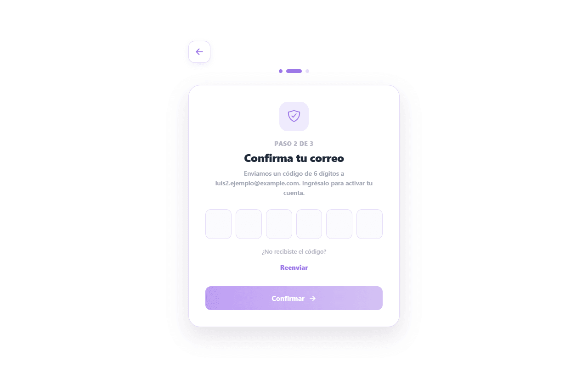
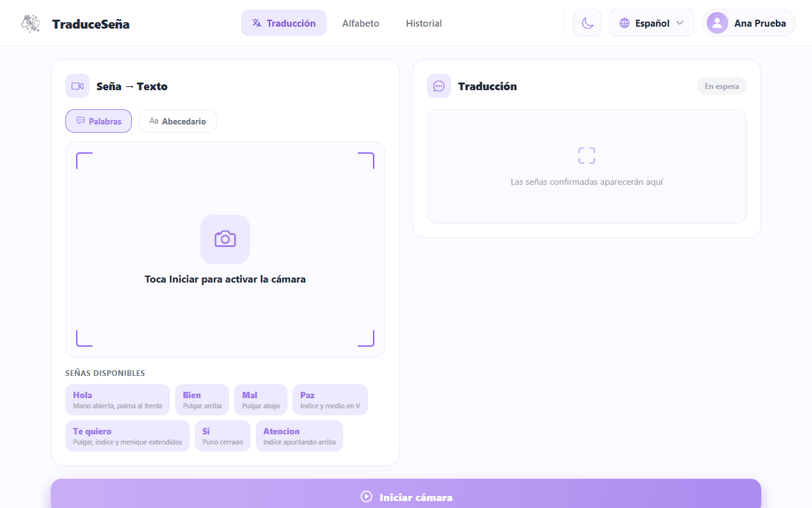
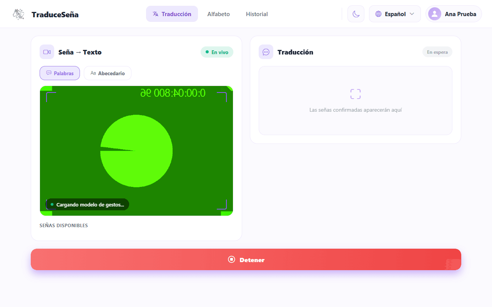
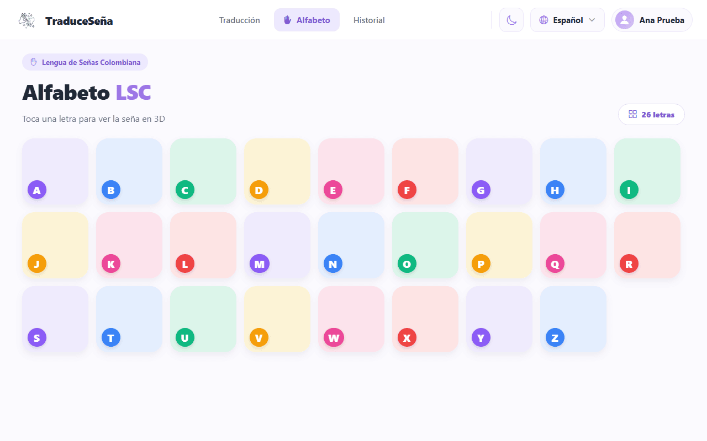
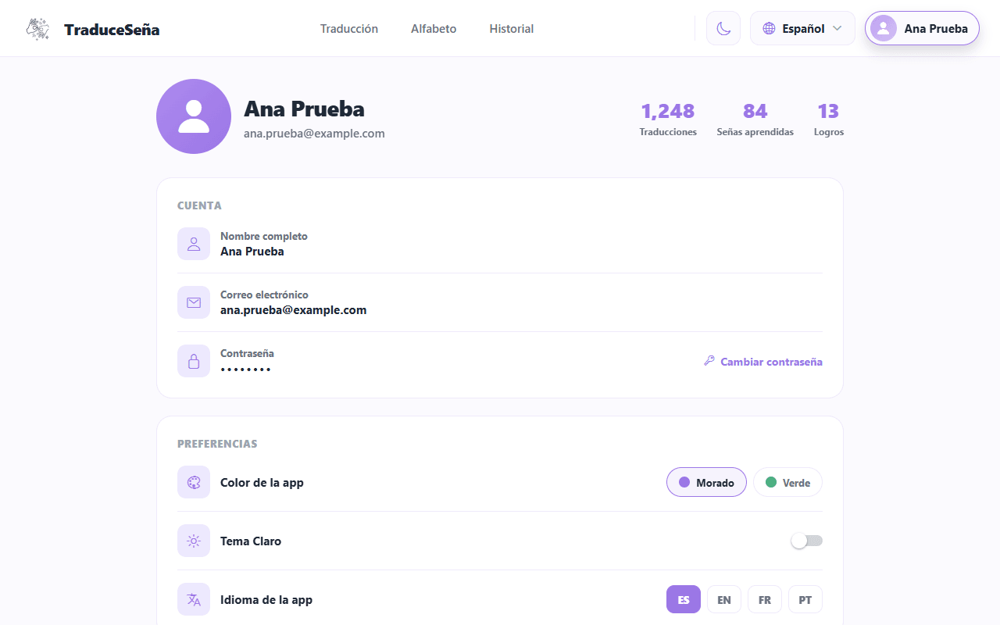

**Traduce Señas: User Manual**

Juan Mauricio Suaza Solórzano

Luis Alejandro Duarte Aldana

Juan Camilo Fierro Esquivel

Instructor: Karol Daniela Correa

October 7, 2026

## Table of Contents

- [1. Purpose of the System](#1-purpose-of-the-system)
- [2. Scope of the System](#2-scope-of-the-system)
- [3. Requirements](#3-requirements)
- [4. Accessing the System](#4-accessing-the-system)
   - [4.1 Opening the Application](#41-opening-the-application)
   - [4.2 Signing Up](#42-signing-up)
   - [4.3 Confirming Your Email](#43-confirming-your-email)
   - [4.4 Signing In and Out](#44-signing-in-and-out)
- [5. Functions of the User Role](#5-functions-of-the-user-role)
   - [5.1 Translating Signs to Text](#51-translating-signs-to-text)
   - [5.2 Listening to and Copying the Result](#52-listening-to-and-copying-the-result)
   - [5.3 Alphabet](#53-alphabet)
   - [5.4 History](#54-history)
   - [5.5 Profile](#55-profile)
- [6. Known Limitations](#6-known-limitations)
- [7. Your Data and Your Privacy](#7-your-data-and-your-privacy)
- [8. If Something Goes Wrong](#8-if-something-goes-wrong)
- [9. Minimal Glossary](#9-minimal-glossary)
- [References](#references)

## 1. Purpose of the System

The images in this manual are real screenshots of the application with fictitious data. They show the app in Spanish; the labels quoted in this manual are the ones the app shows when its language is set to English.

Traduce Señas is an application (web and, partly, mobile) that uses the camera to recognize **Colombian Sign Language (LSC)** and show what it understands as **text**. That text can also be **heard as speech**.

## 2. Scope of the System

What it does today:

- Recognizes signs with the camera and turns them into **text**.
- Reads the text **aloud**.
- Saves what was translated in a **history** that you can view and delete.

What it does **not** do (not in this version):

- It does not turn text or speech into signs. There is no 3D avatar that performs the signs either.
- It does not replace a **certified interpreter**. It can make mistakes. For important matters (health, legal procedures, formal education), use an interpreter.
- It only knows a limited vocabulary: about 54 words and the alphabet (see section 6).

## 3. Requirements

**Table 1**

*Requirements*

| You need | Details |
|----------|---------|
| A device with a camera | A computer with a webcam, or a phone. |
| A recent browser | **Word** translation works **only in the web version**. |
| Internet | The app downloads the recognition tools (MediaPipe; Zhang et al., 2020) from the internet when the camera opens. |
| Camera permission | The browser asks for it the first time. You must accept it. |
| Good lighting | Light from the front or from above; avoid windows or lamps behind you. |
| Good framing | Your whole hands must be visible, with space on both sides. |
| An email address | To create the account and confirm it with a code. |

## 4. Accessing the System

### 4.1 Opening the Application

1. Open the address given to you by whoever manages the application. In a normal local installation it is `http://127.0.0.1:8080` (see the Installation manual).
2. You will see the home page with the **Sign up** and **Sign in** options. On the web there are also presentation pages (About us, translator demo and alphabet demo).

**Figure 1**

*Application Home Page*

### 4.2 Signing Up

1. On the home page, tap **Sign up**.
2. On **Create your Account**, enter your full name, your email address and a password.
3. The application asks for a password of **at least 8 characters** that combines uppercase, lowercase, numbers and a symbol (this is a rule of the sign-up screen). The strength indicator tells you whether it is Weak, Medium or Strong.
4. Check **I accept the terms and conditions**. You cannot continue without it.
5. Tap **Sign up**.

**Figure 2**

*Create Your Account Screen, With Fictitious Data*

If the email already has an account you will see "This email already has an account".

### 4.3 Confirming Your Email

Your account starts out **inactive** until you confirm your email.

1. Check your email (and the spam folder). You will receive a **6-digit code**.
2. On the **Confirm your email** screen, enter the 6 digits and tap **Confirm**.
3. When "Email confirmed, please sign in" appears, you can sign in.

**Figure 3**

*Confirm Your Email Screen*

Things you should know:

- The code **expires after 15 minutes**.
- You have a maximum of **5 attempts** per code. If you get it wrong many times you have to request another one.
- To request another code, use **Resend**. You must wait **60 seconds** between one send and the next, and **5 sends per hour** are allowed.
- If you close the page before confirming, when you come back you will see "Sign in to finish confirming your email".
- If "We couldn't send the code, request a new one" appears when you sign up, the account was created: request the code with **Resend**.

### 4.4 Signing In and Out

1. Tap **Sign in**.
2. Enter your email and password and tap **Sign in**.

**Figure 4**

*Sign In Screen*

Possible messages:

**Table 2**

*Signing In and Out*

| Message | What it means |
|---------|---------------|
| "Incorrect email or password" | Check what you typed. |
| "Confirm your email to continue" | The code from step 4.3 is missing. |
| "Your account is blocked. Contact support." | An administrator blocked the account. |
| "Could not reach the server..." | Check your internet connection or tell the administrator. |
| "Your session has expired. Please sign in again." | A session lasts 1 day; sign in again. |

> **The "Google" and "Facebook" buttons do not work yet.** They appear on the sign-in screen but are not connected. Sign in with email and password.

To **sign out**: go to the **button with your name**, at the top right, and tap **Sign out**.

## 5. Functions of the User Role

### 5.1 Translating Signs to Text

After signing in you will see the bottom bar (or top bar on wide screens) with the **Translation**, **Alphabet** and **History** tabs, and the **button with your name** (**Profile**) at the top right.

> If your account is an administration account you will see other tabs (Statistics and Admin) and not the translation ones. This is explained in the Administrator manual.

The **Translation** screen has two modes, which you choose with two buttons:

- **Words**: recognizes complete LSC words. It is the default mode. **It only works in the web version.** On a phone you will see the notice "Gesture recognition is only available on the web version".
- **Alphabet**: recognizes letters (fingerspelling).

**Figure 5**

*Translation Screen, Words Mode*

#### 5.1.1 Words Mode

1. Choose **Words**.
2. Tap **Start camera**. If the browser asks for permission, accept it.
3. Wait for "Loading gesture model..." to finish (the first time takes longer).
4. Stand in front of the camera with your hands in view. You will see "Show a sign to the camera".
5. Make the **complete sign, clearly and calmly**. The screen shows "Signing…", "Analysing…".
6. When the app is confident, the word appears in **Confirmed signs**. Each confirmed sign is **saved to the history automatically**.
7. Tap **Stop** when you are done.

**Figure 6**

*Camera Active; the Camera Image Is Simulated*

Tips from the app itself: keep your hand centered in the camera, ensure good lighting and repeat the sign if it is not detected.

If you see "Low confidence, try the sign again" or "Could not recognise", repeat the sign more calmly. If you see "No hands in frame", move closer or center your hands.

#### 5.1.2 Alphabet Mode

1. Choose **Alphabet** and tap **Start camera**.
2. Make the letter in front of the camera and hold it for a moment.
3. The recognized letters are added to **Recognized text**.
4. Use **Space** to separate words, **Delete** to remove the last letter and **Clear** to start over (the trash can deletes the confirmed signs of Words mode).
5. Tap **Stop** when you are done.

**Figure 7**

*Alphabet Mode Selected*

When the app shows "Confidence", it is how sure it is about what it read: higher is better.

### 5.2 Listening to and Copying the Result

- Tap the **speaker icon** (below the result) to have the device read the text aloud. The voice uses the language you chose in Profile.
- Tap the **copy icon** to copy the text to the clipboard. You will see "Text copied to clipboard".

### 5.3 Alphabet

The **Alphabet** tab shows the letters. Tap a letter to see its description and the sign. It is useful for practicing before using Alphabet mode.

**Figure 8**

*LSC Alphabet*

### 5.4 History

The **History** tab lists your saved translations (up to the last 100).

**Figure 9**

*History With Example Translations*

1. Type in the search box ("Type in the translation you are looking for...") to filter.
2. To **delete** one, tap the **trash can icon** on that record and confirm "Do you want to delete this history record?".
3. If you have not made any translations yet you will see "No translations".

Tapping **Reuse** on a record shows "Reuse translation": for now it only shows a notice with the text; it does not translate again.

Deleting removes the record from your history (the app marks it as deleted).

### 5.5 Profile

In **Profile** you can:

**Table 3**

*Profile*

| Option | What it does |
|--------|--------------|
| **Theme** (Light / Dark) | Changes the app colors. |
| **App language** | Spanish, English, French or Portuguese. |
| **Change password** | Opens the password change flow. **It does not change your real password yet** (the screens exist but are not connected to the server). |
| **Terms and conditions** / **Privacy policy** | The app's legal texts. See the notice in section 7. |
| **Achievements** | Medals showing your progress. |
| **Sign out** | Leaves your account. |
| **Delete account** | See the following notice. |

**Figure 10**

*Profile of a Fictitious Account; the Figures at the Top Are Fixed Example Values*

> **"Delete account" does not delete anything yet.** Today it only shows a confirmation message; your account and your data **still exist**. If you need your data deleted, ask the person who manages the application (see section 7).

## 6. Known Limitations

- **Short vocabulary.** The word model knows 54 words, plus the alphabet. It does not recognize anything else.
- **Camera and light.** The model learned from people recorded in a studio. With a different camera, a different distance or poor light it may fail even if you make the sign correctly.
- **It can be wrong.** Always check the text. Do not use the app as the only source in important situations.
- **Words only on the web.** Words mode is not available on phones.
- **One direction only.** Only from sign to text or speech.
- **Password recovery** ("Forgot your password?"): the screens exist, but **today they do not send the code or change the password** from the interface. If you forget your password, ask the administrator for help.
- **Google and Facebook:** buttons with no function.
- **Statistics:** only administration staff can see them.

## 7. Your Data and Your Privacy

- The app asks for the camera only to recognize signs. Recognition processing happens in your browser.
- Your account data (name, email, protected password) and your translation history are stored.
- Colombian law (Law 1581 of 2012 and Decree 1377 of 2013 (Decreto 1377 de 2013; Ley 1581 de 2012)) gives you the right to know, correct and request the deletion of your data. Since the **Delete account** button does not work yet, today that right is handled **by asking the administration team**.
- The privacy texts shown by the app have not been checked against how this version actually works; this manual does not repeat their claims.

## 8. If Something Goes Wrong

**Table 4**

*If Something Goes Wrong*

| Problem | What to do |
|---------|------------|
| The camera does not turn on | Accept the camera permission in the browser (padlock icon next to the address). Close other applications that use the camera. |
| "Loading model..." never finishes | Check your internet connection and reload the page. |
| It does not recognize the sign | More light, hands centered, repeat calmly. Move a little further away or closer. |
| The code does not arrive by email | Check spam; wait 60 s and use **Resend**. Maximum 5 per hour. |
| "Incorrect or expired code" | Request a new code and use it within 15 minutes. |
| "Your session has expired" | Sign in again. |
| The app does not open | Tell the administrator: the service may be down. |

## 9. Minimal Glossary

**Table 5**

*Minimal Glossary*

| Word | Simple meaning |
|------|----------------|
| **LSC** | Colombian Sign Language (Lengua de Señas Colombiana). |
| **Sign** | A hand gesture that means a word or a letter. |
| **Alphabet / fingerspelling** | Spelling with the hands, letter by letter. |
| **Confidence** | How sure the app is about what it recognized. |
| **History** | The list of your saved translations. |
| **Session** | The time you are signed in to your account (it lasts 1 day). |
| **Certified interpreter** | An accredited LSC professional. This app does not replace one. |

## References

Decreto 1377 de 2013 [Decree 1377 of 2013]. *Por el cual se reglamenta parcialmente la Ley 1581 de 2012* [Partially regulating Law 1581 of 2012]. June 27, 2013.

Ley 1581 de 2012 [Law 1581 of 2012]. *Por la cual se dictan disposiciones generales para la protección de datos personales* [Issuing general provisions for the protection of personal data]. October 17, 2012. D.O. No. 48587.

Zhang, F., Bazarevsky, V., Vakunov, A., Tkachenka, A., Sung, G., Chang, C.-L., & Grundmann, M. (2020). *MediaPipe Hands: On-device real-time hand tracking* [Preprint]. arXiv. https://doi.org/10.48550/arXiv.2006.10214
