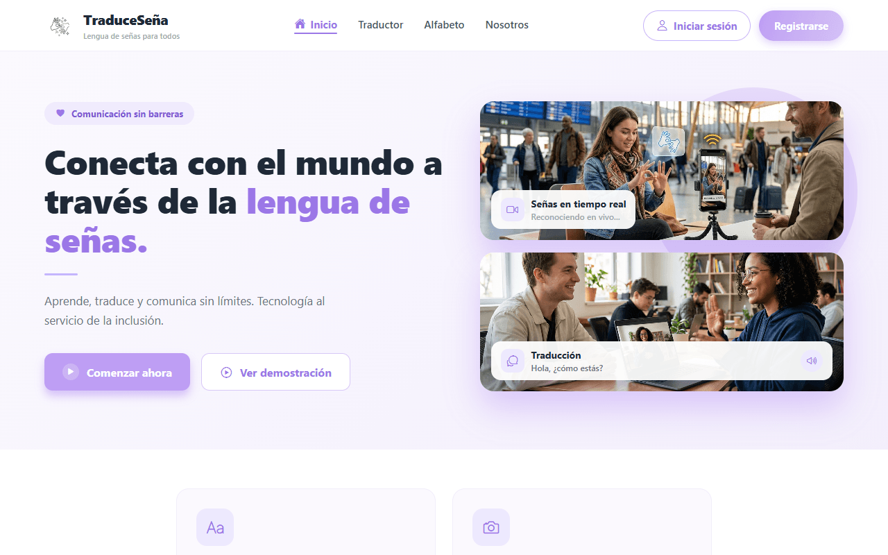
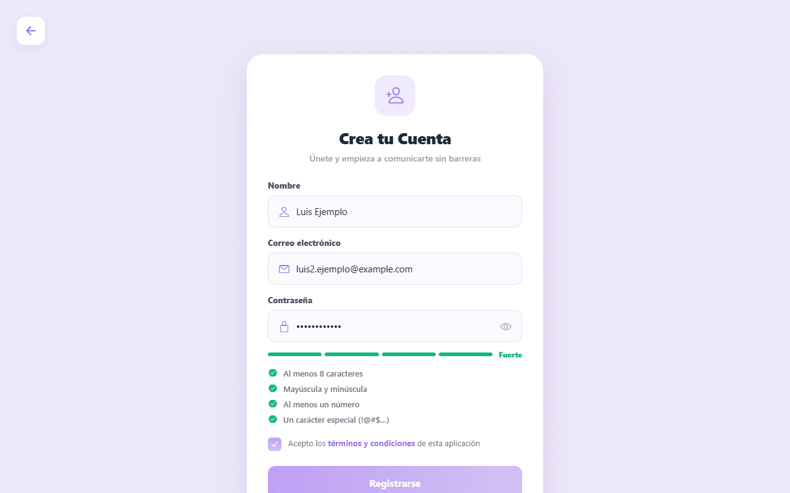
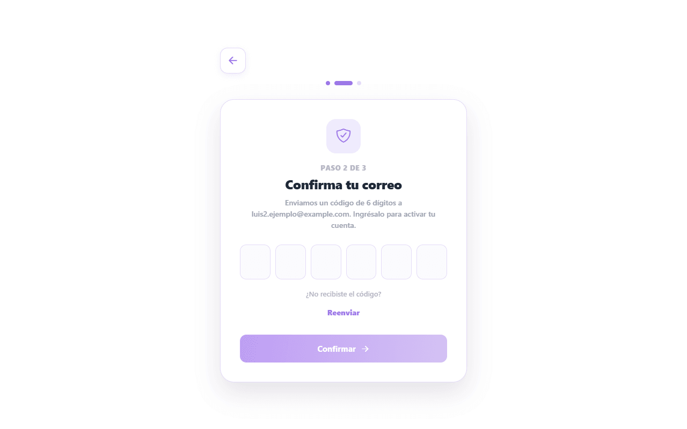
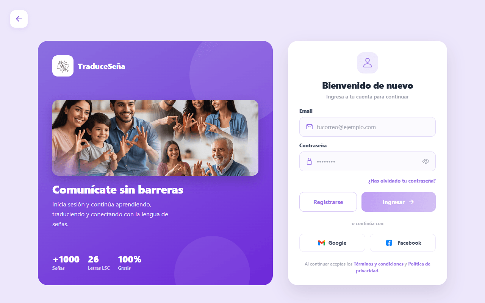
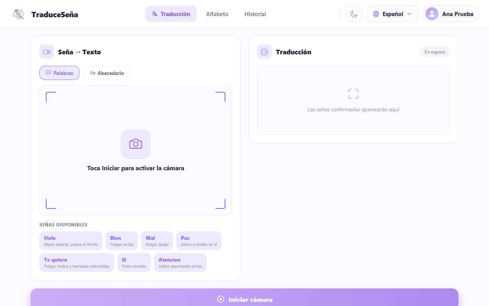
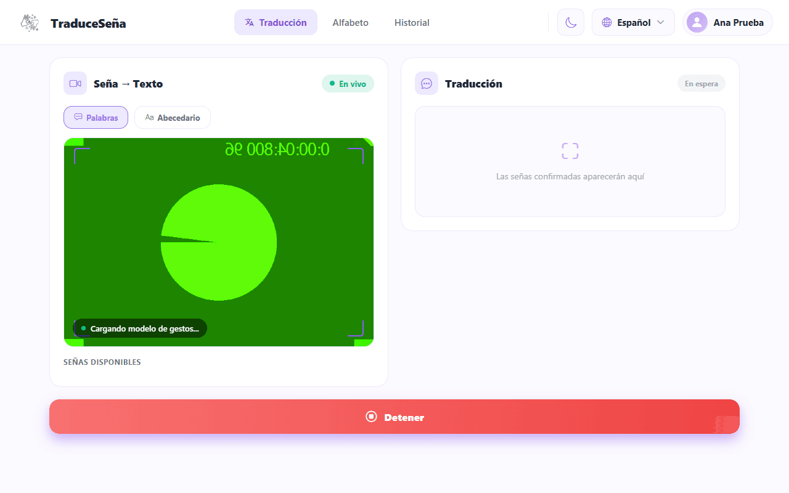
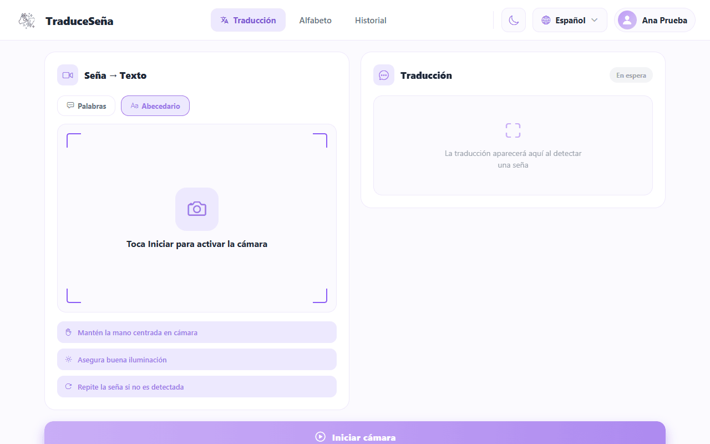
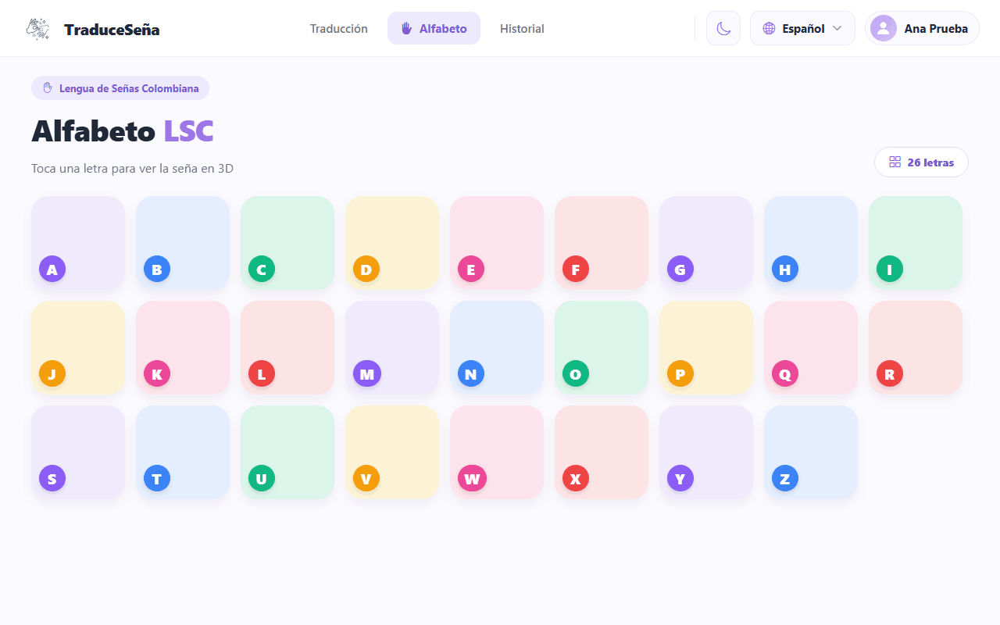
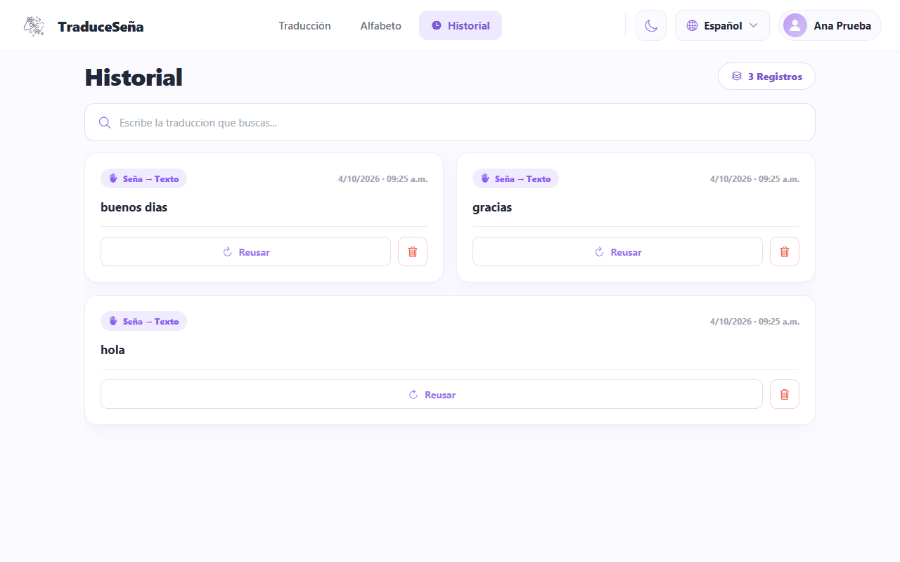
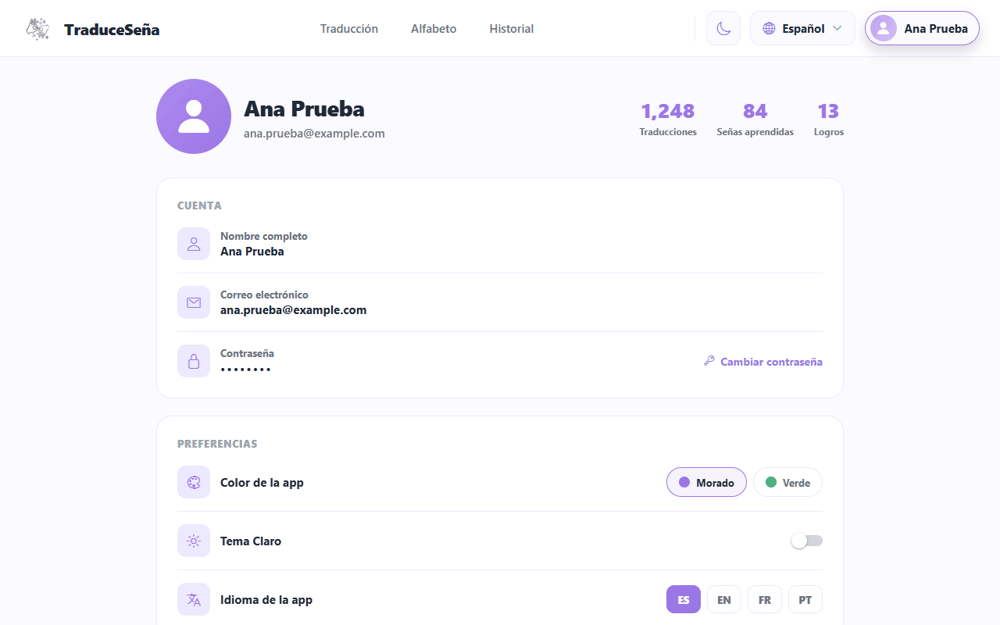

**Traduce Señas: Manual de usuario**

Juan Mauricio Suaza Solórzano

Luis Alejandro Duarte Aldana

Juan Camilo Fierro Esquivel

Instructor: Karol Daniela Correa

4 de noviembre de 2026

## Tabla de contenido

- [1. Objetivo del sistema](#1-objetivo-del-sistema)
- [2. Alcance del sistema](#2-alcance-del-sistema)
- [3. Requisitos](#3-requisitos)
- [4. Ingreso al sistema](#4-ingreso-al-sistema)
   - [4.1 Acceso a la aplicación](#41-acceso-a-la-aplicación)
   - [4.2 Registro](#42-registro)
   - [4.3 Confirmar el correo](#43-confirmar-el-correo)
   - [4.4 Iniciar y cerrar sesión](#44-iniciar-y-cerrar-sesión)
- [5. Funciones del rol usuario](#5-funciones-del-rol-usuario)
   - [5.1 Traducir señas a texto](#51-traducir-señas-a-texto)
   - [5.2 Escuchar y copiar el resultado](#52-escuchar-y-copiar-el-resultado)
   - [5.3 Alfabeto](#53-alfabeto)
   - [5.4 Historial](#54-historial)
   - [5.5 Perfil](#55-perfil)
   - [5.6 Retos diarios y medallas](#56-retos-diarios-y-medallas)
- [6. Limitaciones conocidas](#6-limitaciones-conocidas)
- [7. Tus datos y tu privacidad](#7-tus-datos-y-tu-privacidad)
- [8. Si algo falla](#8-si-algo-falla)
- [9. Glosario mínimo](#9-glosario-mínimo)
- [Referencias](#referencias)

## 1. Objetivo del sistema

Las imágenes de este manual son capturas reales de la aplicación, con datos ficticios.

Traduce Señas es una aplicación (web y, en parte, móvil) que usa la cámara para reconocer **Lengua de Señas Colombiana (LSC)** y mostrar lo que entiende como **texto**. Ese texto también se puede **escuchar con voz**.

## 2. Alcance del sistema

Lo que hace hoy:

- Reconoce señas con la cámara y las convierte en **texto**.
- Lee el texto en **voz alta**.
- Guarda lo traducido en un **historial** que puedes consultar y borrar.
- Te propone un **reto diario** de traducción y te da **puntos** y **medallas**.

Lo que **no** hace (no está en esta versión):

- No convierte texto o voz en señas. Tampoco hay avatar 3D que haga las señas.
- No sustituye a un **intérprete certificado**. Puede equivocarse. Para temas importantes (salud, trámites legales, educación formal) usa un intérprete.
- Solo conoce un vocabulario limitado: unas 54 palabras y el abecedario (ver sección 6).

## 3. Requisitos

**Tabla 1**

*Requisitos*

| Necesitas | Detalle |
|-----------|---------|
| Un dispositivo con cámara | Computador con webcam o celular. |
| Un navegador reciente o la app del celular | La traducción con la cámara funciona en la versión web. En el celular, el modo **Palabras** se abre dentro de la app y necesita internet. |
| Internet | La app descarga de internet las herramientas de reconocimiento (MediaPipe; Zhang et al., 2020) al abrir la cámara. |
| Permiso de cámara | La primera vez el navegador o el teléfono te lo pide. Debes aceptarlo. |
| Buena luz | Luz de frente o desde arriba; evita ventanas o lámparas detrás de ti. |
| Buen encuadre | Que se vean tus manos completas y que haya espacio a los lados. |
| Un correo electrónico | Para crear la cuenta y confirmarla con un código. |

## 4. Ingreso al sistema

### 4.1 Acceso a la aplicación

1. Abre la dirección que te dio quien administra la aplicación. En una instalación local normal es `http://localhost:8081` con la web de desarrollo, o la dirección pública de la aplicación (ver el Manual de instalación).
2. Verás la página de inicio con las opciones **Registrarse** e **Iniciar sesión**. En la web también hay páginas de presentación (Nosotros, demostración del traductor y del alfabeto).

**Figura 1**

*Página de inicio de la aplicación*

### 4.2 Registro

1. En la página de inicio pulsa **Registrarse**.
2. En **Crea tu Cuenta** escribe tu nombre completo, tu correo y una contraseña.
3. La contraseña debe tener **mínimo 8 caracteres** y cumplir al menos **tres** de estos cuatro tipos: mayúsculas, minúsculas, números y símbolos. El indicador de seguridad te dice si es Débil, Media o Fuerte. Para que sea Fuerte necesita 12 caracteres o más y los cuatro tipos.
4. Marca **Acepto los términos y condiciones**. Sin esto no puedes continuar.
5. Pulsa **Registrarse**.

**Figura 2**

*Pantalla Crea tu Cuenta, con datos ficticios*

Si el correo ya tiene una cuenta verás "Este correo ya tiene una cuenta".

### 4.3 Confirmar el correo

Tu cuenta nace **inactiva** hasta que confirmes el correo.

1. Revisa tu correo (y la carpeta de spam). Te llega un **código de 6 dígitos**.
2. En la pantalla **Confirma tu correo** escribe los 6 dígitos y pulsa **Confirmar**.
3. Cuando salga "Correo confirmado, inicia sesión", ya puedes entrar.

**Figura 3**

*Pantalla Confirma tu correo*

Cosas que debes saber:

- El código **caduca a los 15 minutos**.
- Tienes un máximo de **5 intentos** con cada código. Si te equivocas muchas veces tienes que pedir otro.
- Para pedir otro código usa **Reenviar**. Hay que esperar **60 segundos** entre un envío y el siguiente, y se permiten **5 envíos por hora**.
- Si cierras la página antes de confirmar, al volver verás "Inicia sesión para terminar de confirmar tu correo".
- Si al registrarte aparece "No pudimos enviar el código, pide uno nuevo", la cuenta sí se creó: pide el código con **Reenviar**.

### 4.4 Iniciar y cerrar sesión

1. Pulsa **Iniciar sesión**.
2. Escribe tu correo y tu contraseña y pulsa **Ingresar**.

**Figura 4**

*Pantalla Iniciar sesión*

Mensajes posibles:

**Tabla 2**

*Iniciar y cerrar sesión*

| Mensaje | Qué significa |
|---------|---------------|
| "Correo o contraseña incorrectos" | Revisa lo escrito. |
| "Confirma tu correo para continuar" | Falta el código del paso 4.3. |
| "Tu cuenta está bloqueada. Contacta al soporte." | Un administrador bloqueó la cuenta. |
| "No se pudo conectar con el servidor..." | Revisa tu internet o avisa al administrador. |
| "Tu sesión expiró. Inicia sesión de nuevo." | La sesión tiene una duración fija y no se renueva sola: vuelve a entrar. |

> **Google y Facebook.** Estos botones funcionan cuando la aplicación tiene configurado ese acceso. Si un botón aparece desactivado o avisa de que no está configurado, entra con correo y contraseña. Con Google, si la cuenta es nueva, la app te pide aceptar los términos antes de crearla.

Para **cerrar sesión**: ve al **botón con tu nombre**, arriba a la derecha, y pulsa **Cerrar sesión**.

## 5. Funciones del rol usuario

### 5.1 Traducir señas a texto

Después de iniciar sesión verás la barra inferior (o superior en pantallas anchas) con las pestañas **Traducción**, **Alfabeto** e **Historial**, y el **botón con tu nombre** (**Perfil**), arriba a la derecha.

> Si tu cuenta es de administración verás otras pestañas (Estadística y Admin) y no las de traducción. Eso lo explica el Manual del administrador.

La pantalla **Traducción** tiene dos modos, que eliges con dos botones:

- **Palabras**: reconoce palabras completas de LSC. Es el modo que aparece por defecto. En la web usa la cámara del computador; en el celular se abre dentro de la app y necesita internet.
- **Abecedario**: reconoce letras (deletreo). **Solo funciona en la versión web.** En el celular verás el aviso "En el móvil el reconocimiento de señas aún no está disponible. Usa la versión web para traducir con la cámara".

**Figura 5**

*Pantalla Traducción, modo Palabras*

#### 5.1.1 Modo Palabras

1. Elige **Palabras**.
2. Pulsa **Iniciar cámara**. Si el navegador o el teléfono pide permiso, acéptalo.
3. Espera a que termine "Cargando modelo de gestos..." (la primera vez tarda más).
4. Colócate frente a la cámara, con las manos a la vista. Verás "Muestra una seña a la cámara".
5. Haz la seña **completa, de forma clara y tranquila**. La pantalla indica "Señando…", "Analizando…".
6. Cuando la app está segura, la palabra aparece en **Señas confirmadas**. Cada seña confirmada se **guarda sola en el historial**.
7. Pulsa **Detener** cuando termines.

**Figura 6**

*Cámara activa; la imagen de la cámara es simulada*

Consejos de la propia app: mantén la mano centrada en la cámara, asegura buena iluminación y repite la seña si no es detectada.

Si ves "Confianza baja, repite la seña" o "No se pudo reconocer", repite la seña con más calma. Si ves "No detecto manos en cuadro", acércate o centra las manos.

#### 5.1.2 Modo Abecedario

1. Elige **Abecedario** y pulsa **Iniciar cámara**. Este modo funciona en la versión web.
2. Haz la letra frente a la cámara y mantenla un momento.
3. Las letras reconocidas se van sumando en **Texto reconocido**.
4. Usa **Espacio** para separar palabras, **Borrar** para quitar la última letra y **Limpiar** para empezar de nuevo (la papelera borra las señas confirmadas del modo Palabras).
5. Pulsa **Detener** cuando termines.

**Figura 7**

*Modo Abecedario seleccionado*

Cuando la app muestra "Confianza", es qué tan segura está de lo que leyó: más alto es mejor.

### 5.2 Escuchar y copiar el resultado

- Pulsa el **icono del altavoz** (debajo del resultado) para que el dispositivo lea el texto en voz alta. La voz usa el idioma que elegiste en el Perfil.
- Pulsa el **icono de copiar** para llevar el texto al portapapeles. Verás "Texto copiado al portapapeles".

### 5.3 Alfabeto

La pestaña **Alfabeto** muestra las letras. Toca una letra para ver su descripción y la seña. Sirve para practicar antes de usar el modo Abecedario.

**Figura 8**

*Alfabeto LSC*

### 5.4 Historial

La pestaña **Historial** lista tus traducciones guardadas (hasta las últimas 100).

**Figura 9**

*Historial con traducciones de ejemplo*

1. Escribe en el buscador ("Escribe la traduccion que buscas...") para filtrar.
2. Para **borrar** una, pulsa el **icono de la papelera** en ese registro y confirma "¿Deseas eliminar este registro del historial?".
3. Si todavía no hiciste traducciones verás "Sin traducciones".

Al pulsar **Reusar** en un registro aparece "Reusar traducción": por ahora solo muestra un aviso con el texto; no vuelve a traducir.

El borrado quita el registro de tu historial (la app lo marca como borrado).

El historial se muestra agrupado por sesiones: cada tarjeta reúne las traducciones que hiciste en una misma sesión. Además, las traducciones se borran solas a los 30 días de guardadas, así que el historial solo conserva el último mes.

### 5.5 Perfil

En **Perfil** puedes:

**Tabla 3**

*Perfil*

| Opción | Qué hace |
|--------|----------|
| **Tema** (Claro / Oscuro) | Cambia los colores de la app. |
| **Idioma de la app** | Español, inglés, francés o portugués. |
| **Cambiar contraseña** | Cambia tu contraseña. Te pide la actual. Si tu cuenta se creó con Google y no tiene contraseña, la app te envía un código al correo para crear una. |
| **Términos y condiciones** / **Política de privacidad** | Los textos legales de la app. Ver el aviso de la sección 7. |
| **Logros** | Medallas con tu progreso, incluidas las que se ganan con puntos de reto (ver 5.6). |
| **Cerrar sesión** | Sale de tu cuenta. |
| **Eliminar cuenta** | Borra tu cuenta y tus datos. Ver el aviso siguiente. |

**Figura 10**

*Perfil de una cuenta ficticia; las cifras de la parte superior son valores de ejemplo*

> **Eliminar cuenta borra tu cuenta de forma definitiva.** La app te pedirá tu contraseña. Si la cuenta se creó con Google y no tiene contraseña, te enviará un código al correo y te pedirá ese código. Se borran tu cuenta, tu historial y tu progreso. Si eres el único administrador, la app no te deja borrar la cuenta.

### 5.6 Retos diarios y medallas

Cada día la app te propone un reto de traducción: guardar 1, 3, 5 u 8 traducciones. Todos los usuarios ven el mismo reto del día, y cambia a medianoche (hora de Colombia).

- En el **Perfil** verás una tarjeta con tu progreso del día. Se actualiza cada vez que guardas una traducción; solo cuentan las traducciones guardadas.
- Al completar el reto ganas puntos (5, 10, 15 o 25, según la meta) y aparece un aviso en pantalla. Los puntos se cuentan una sola vez.
- El Perfil muestra el total de tus puntos de reto.
- Con los puntos de reto acumulados desbloqueas **medallas** en **Logros**. Cuando desbloqueas una, aparece un aviso.
- Si cierras un aviso, tus puntos y tu reto completado se guardan igual.

## 6. Limitaciones conocidas

- **Vocabulario corto.** El modelo de palabras conoce 54 palabras, más el abecedario. Lo demás no lo reconoce.
- **Cámara y luz.** El modelo aprendió de personas grabadas en un estudio. Con otra cámara, otra distancia o poca luz puede fallar aunque hagas bien la seña.
- **Puede equivocarse.** Siempre revisa el texto. No uses la app como única fuente en situaciones importantes.
- **Abecedario solo en la web.** En el celular el modo Abecedario no reconoce señas con la cámara. El modo Palabras en el celular necesita internet.
- **Una sola dirección.** Solo de seña a texto o voz.
- **Estadísticas:** solo las ve el personal administrador.

## 7. Tus datos y tu privacidad

- La app pide la cámara solo para reconocer señas. El reconocimiento se procesa en tu dispositivo, dentro del navegador o de la app.
- Se guardan tus datos de cuenta (nombre, correo, contraseña protegida), tu historial de traducciones y tu progreso de retos y logros. Las traducciones se borran solas a los 30 días de guardadas.
- La normativa colombiana (Ley 1581 de 2012 y Decreto 1377 de 2013) te da derecho a conocer, corregir y pedir la supresión de tus datos. Puedes hacerlo tú mismo desde **Perfil**, con **Eliminar cuenta**. El borrado es definitivo.
- Los textos de privacidad que muestra la app no se han verificado contra el funcionamiento real de esta versión; este manual no repite sus afirmaciones.

## 8. Si algo falla

**Tabla 4**

*Si algo falla*

| Problema | Qué hacer |
|----------|-----------|
| La cámara no enciende | Acepta el permiso de cámara en el navegador (icono del candado junto a la dirección) o en el teléfono. Cierra otras aplicaciones que usen la cámara. |
| "Cargando modelo..." no termina | Revisa tu internet y recarga la página. |
| No reconoce la seña | Más luz, manos centradas, repite con calma. Aléjate o acércate un poco. |
| No llega el código al correo | Mira spam; espera 60 s y usa **Reenviar**. Máximo 5 por hora. |
| "Código incorrecto o caducado" | Pide un código nuevo y úsalo antes de 15 minutos. |
| "Tu sesión expiró" | Inicia sesión otra vez. |
| El botón de Google o Facebook no hace nada | Ese acceso no está configurado en la app. Entra con correo y contraseña. |
| La app no abre | Avisa al administrador: puede que el servicio esté apagado. |

## 9. Glosario mínimo

**Tabla 5**

*Glosario mínimo*

| Palabra | Significado sencillo |
|---------|----------------------|
| **LSC** | Lengua de Señas Colombiana. |
| **Seña** | Un gesto con las manos que significa una palabra o letra. |
| **Abecedario / dactilología** | Deletrear con las manos, letra por letra. |
| **Confianza** | Qué tan segura está la app de lo que reconoció. |
| **Historial** | Lista de tus traducciones guardadas. |
| **Sesión** | El tiempo en que estás dentro de tu cuenta. Tiene una duración fija y no se renueva sola. |
| **Intérprete certificado** | Profesional acreditado en LSC. Esta app no lo reemplaza. |

## Referencias

Decreto 1377 de 2013. Por el cual se reglamenta parcialmente la Ley 1581 de 2012. 27 de junio de 2013.

Ley 1581 de 2012. Por la cual se dictan disposiciones generales para la protección de datos personales. 17 de octubre de 2012. D.O. No. 48587.

Zhang, F., Bazarevsky, V., Vakunov, A., Tkachenka, A., Sung, G., Chang, C.-L., y Grundmann, M. (2020). *MediaPipe Hands: On-device real-time hand tracking* [Preprint]. arXiv. https://doi.org/10.48550/arXiv.2006.10214
