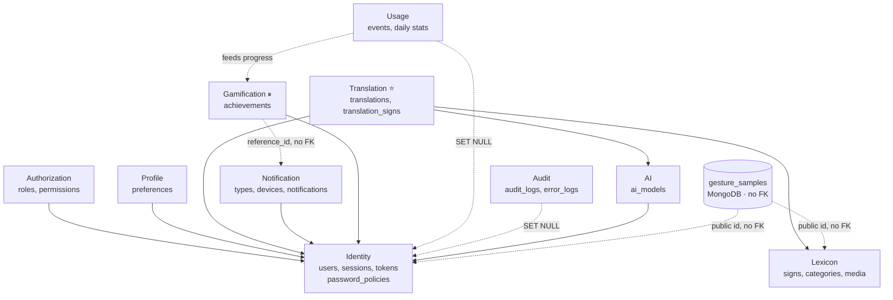
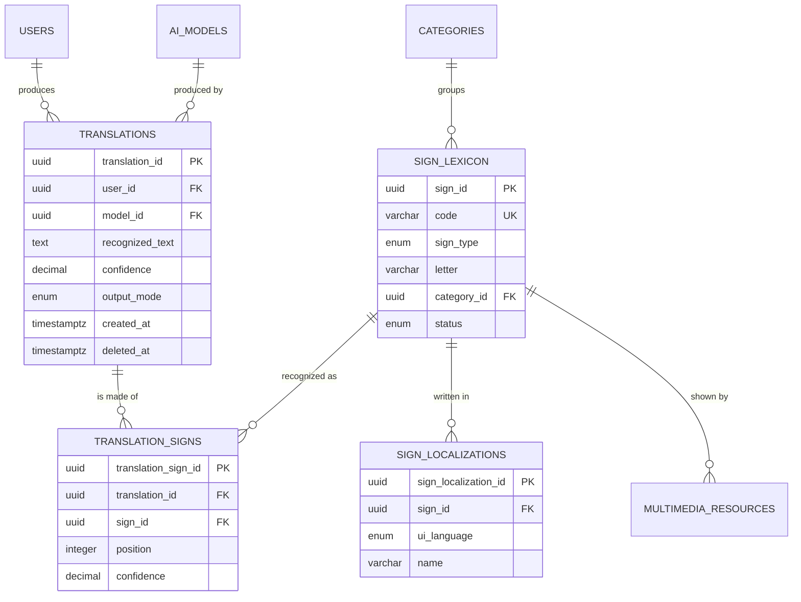
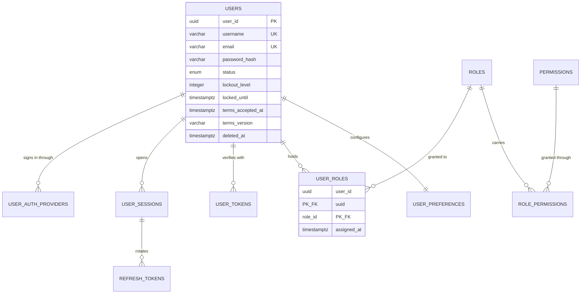

# Data Model — Overview

> The map of the whole model: which engine stores what, which domain owns which tables, and where to
> find the detail. **The per-table DDL lives in [`domains/`](domains/), one file per domain.**

**Version:** v0.3 · **Last updated:** 2026-09-10 · **Maintainer:** Juan Mauricio Suaza Solórzano
**Source of record:** `traduce_senas.dbml` — model **v9**: 29 tables, 10 domains, 21 enum types
**Depends on:** `02-domain/entities-and-rules.md` (entities → tables) · `04-requirements/traceability-matrix.md` (FR → tables)

---

## Read this first

**Traduce Señas is a microservices architecture with a database per service.** Five domain services
(iam, recognition, lexicon, analytics, profile) sit behind an API Gateway, and each owns the domains
listed in [`README.md`](README.md). The rule:

> **Each service owns its tables, and no service reads another service's tables. There are no foreign
> keys across services; cross-service references are logical IDs.**

The boundary is enforced by the network (REST through the gateway, events over RabbitMQ) and by a
separate PostgreSQL database per service. The schema-per-domain layout below is the logical model; at
deployment each group of schemas lives in the database of its owning service.

**These documents are a baseline, faithful to the model of record including where it disagrees with
`02-domain/`.** Those disagreements are listed in [`open-items.md`](open-items.md) rather than silently
resolved: reversing a design decision belongs to the team, not to a documentation pass.

---

## 0. Implemented today vs this reference model

> **Read this before the rest.** Sections 1–6 describe the **reference model** (DBML v9). The code
> implements a smaller model. This table is the implemented one, taken from the migrations in
> `backendTS/services/*/db/` and checked against the production databases on 2026-10-23.

| Service | Database | Tables that exist | Primary keys |
|---------|----------|-------------------|--------------|
| iam | `iam` | `users`, `roles`, `permissions`, `user_roles`, `role_permissions`, `user_tokens`, `outbox_events` | `SERIAL` |
| recognition | `recognition` + MongoDB | `translations`, `sign_templates`, `erased_users` · collection `gesture_samples` | `SERIAL` |
| lexicon | `lexicon` | `categories`, `sign_lexicon`, `sign_localizations`, `multimedia_resource` | `SERIAL` |
| analytics | `analytics` | `usage_event`, `erased_users` | `BIGSERIAL` |
| profile | `profile` | `user_profiles`, `user_preferences`, `notification_types`, `notifications`, `achievements`, `user_achievements`, `achievement_activity`, `achievement_translation_receipts`, `processed_events`, `erased_users` | `UUID` |

**Legacy tables still present in `iam`:** `role`, `user_role` and `password_reset_token`, created by
`000_users.sql` and replaced by `roles`, `user_roles` and `user_tokens`. No code reads them (only the
account erasure deletes from `user_role` if it exists). In production they hold 2, 0 and 0 rows. They
should be dropped when the migrations are unified (H-02).

**In the reference model but not implemented:** `user_auth_providers`, `user_sessions`,
`refresh_tokens`, `password_policies`, `translation_signs`, `ai_models`, `user_devices`,
`usage_daily_stats`, `session_daily_stats`, `audit_logs`, `error_logs`. Sessions are a single JWT
with no refresh token ([ADR-002](../05-architecture/decisions/records/ADR-002-jwt-authentication.md)).

**Implemented but not in the reference model:** `outbox_events`, `sign_templates`, `erased_users`,
`user_profiles`, `processed_events` and the achievement activity tables.

---

## 1. Storage decisions

| Store | Engine | What lives there | Justification |
|-------|--------|------------------|---------------|
| **Main database** | PostgreSQL 15+ | 28 tables across 10 domains | Almost every rule in `02-domain/` is a relational constraint: unique email (INV-001), one active model (INV-022), one localization per sign and language (INV-020), permissions only through roles (INV-016). Postgres enforces them in the engine. It also gives `jsonb` for the audit before/after values, native `ENUM` types, `inet`, `timestamptz`, partial unique indexes, and `gen_random_uuid()` without an extension from 13 onwards |
| **Sample store** | MongoDB 7 | `gesture_samples` — one collection, **no foreign keys** | A training sample's metadata changes every time the recognition pipeline changes: today landmarks and a storage path, tomorrow frame rate, hand count, capture device, extractor version. In the relational schema each of those is a migration. This is the one part of the system whose schema is genuinely unstable, and it is the one part that is not relational |
| **Object storage** | S3-compatible bucket / filesystem | Videos, images, animations, `.tflite` model artifacts | Binary content never goes in the database. Tables keep a URI (`multimedia_resources.uri`, `ai_models.storage_reference`, `gesture_samples.storage_reference`) |

**RabbitMQ yes, Redis no.** Domain events travel between services over RabbitMQ (topic exchange
`traduce.events`). Sessions are a JWT (the reference model adds a `refresh_tokens` row in iam-service, not implemented — see § 0); adding Redis would be
infrastructure with no requirement behind it — the same gold-plating test the traceability matrix
applies to tables.

**The cost of the MongoDB split, stated plainly:** `sign_id`, `recorded_by` and `validated_by` in
`gesture_samples` are **public identifiers**, not references the database enforces. Nothing prevents a
sample pointing at a sign that no longer exists; consistency is the application's job. The benefit is
that the sample schema evolves without touching the PostgreSQL databases, and that the collection can be moved,
dumped or destroyed as a unit — which matters for a dataset governed by Law 1581.

---

## 2. Schema map

Ten logical domains: 28 relational tables plus one MongoDB collection. The domains match the
`TableGroup` blocks in the DBML and the bounded contexts in `02-domain/domain-map.md`.

| # | Domain | Schema | Tables | Bounded Context | Type |
|---|--------|--------|--------|-----------------|------|
| 1 | [**Identity**](domains/01-identity.md) | `identity` | `users`, `user_auth_providers`, `user_sessions`, `refresh_tokens`, `user_tokens`, `password_policies` | Identity & Access | Generic |
| 2 | [**Authorization**](domains/02-authorization.md) | `authz` | `roles`, `permissions`, `user_roles`, `role_permissions` | Identity & Access | Generic |
| 3 | [**Profile**](domains/03-profile.md) | `profile` | `user_preferences` | Profile & Preferences | Supporting |
| 4 | [**Lexicon**](domains/04-lexicon.md) | `lexicon` | `categories`, `sign_lexicon`, `sign_localizations`, `multimedia_resources` | Learning & Lexicon | Supporting |
| 5 | [**Translation**](domains/05-translation.md) | `translation` | `translations`, `translation_signs` | Recognition & Translation | ⭐ Core |
| 6 | [**AI**](domains/06-ai.md) | `ai` + MongoDB | `ai_models` · `gesture_samples` | Recognition & Translation · Consent & Personal Data | ⭐ Core / Critical supporting |
| 7 | [**Notification**](domains/07-notification.md) | `notification` | `notification_types`, `user_devices`, `notifications` | Notifications | Supporting |
| 8 | [**Usage**](domains/08-usage.md) | `usage` | `usage_events`, `usage_daily_stats`, `session_daily_stats` | Usage Analytics | Supporting |
| 9 | [**Gamification**](domains/09-gamification.md) ⏸ | `gamification` | `achievements`, `user_achievements` | Gamification | ⏸ Pending RF8 |
| 10 | [**Audit**](domains/10-audit.md) | `audit` | `audit_logs`, `error_logs` | — cross-cutting | Technical service |

> **`password_policies` is in Identity, not in a `Configuration` domain of its own (changed in v9).**
> The test for a cross-cutting service — `02-domain/domain-map.md` § 2.9 — is whether it serves *every*
> context equally. `audit_logs` and `error_logs` pass it: any domain writes to them. `password_policies`
> fails it: it is read by one flow, in one context, and by nothing else. It was grouped with them because
> it *looked* like configuration, which is a statement about the shape of the data, not about who owns
> it. The full reasoning, and what the move costs, is in [`domains/01-identity.md`](domains/01-identity.md)
> and [`domains/11-configuration.md`](domains/11-configuration.md).

> **`ai_models` and `gesture_samples` share a domain but not a context.** The DBML groups them under
> `AI` because both are about the recognition model. In the domain map the trained model belongs to the
> Core and the samples belong to Consent & Personal Data, because the rules that govern a sample are
> consent rules, not recognition rules. Both groupings are right for what they are for — one is a
> diagram, the other is a boundary.

### Physical layout: one schema per domain

Two options existed. **Option 2 is adopted**, and all the DDL in [`domains/`](domains/) is written for it:

1. One `public` schema with table prefixes by convention — simplest, what most ORMs assume.
2. **One PostgreSQL schema per domain** (`identity.users`, `lexicon.sign_lexicon`, …) — makes the module
   boundary visible in the database, and lets a `GRANT` per schema catch a cross-module query at runtime
   instead of at review.

`02-domain/domain-map.md` already writes persistence as `identity` schema, `lexicon` schema and so on,
so this keeps the two documents in agreement. If the team prefers option 1, one line changes per table
and everything else stands.

---

## 3. Where to find what

| Question | Document |
|----------|----------|
| What does this table look like, and what does each column mean? | [`domains/`](domains/) — one file per domain, with DDL, data dictionary and modeling decisions |
| What naming, key and timestamp rules apply? What are the 21 enums? | [`modeling-conventions.md`](modeling-conventions.md) |
| What does the database enforce that the diagram does not show? | [`constraints.md`](constraints.md) |
| Which parts are denormalized, and what does that cost? | [`normalization-assessment.md`](normalization-assessment.md) |
| How does the schema change without breaking a running system? | [`migration-strategy.md`](migration-strategy.md) |
| What happens to a user's data when they ask to be deleted? | [`data-lifecycle.md`](data-lifecycle.md) |
| Where does this model still contradict the rest of the documentation? | [`open-items.md`](open-items.md) |

---

## 4. Cross-domain relationships

Every domain except Lexicon references `identity.users`. That is the **Shared Kernel** — the `UserId`
value object — and it is shared on purpose. Note that `identity.password_policies` references nothing at
all: it is placed by who reads it, not by what it joins to.

**Solid arrows are foreign keys. Dotted arrows are references the database does not enforce** — either
`ON DELETE SET NULL` relationships where the fact outlives the person, or polymorphic references with no
foreign key at all. The dotted line from Gamification to Notification is what makes the provisional
context removable: if RF8 is rejected, nothing breaks.

---

## 5. Entity-relationship diagrams

Full diagram: `traduce_senas.dbml` rendered in dbdiagram.io, where the `TableGroup` colors match the
domains in § 2. Below are the two subsets worth reading on their own.

**Core — Translation and Lexicon:**

**Identity and Authorization:**

**`gesture_samples` appears in no ER diagram with a relationship line, deliberately** — it has none.
Drawing one would suggest a foreign key the model does not have and does not want.

---

## 6. The state of this model, honestly

Eleven findings from the data side (**DATA-01 … DATA-11**), plus the data-layer consequence of the nine
**ALIGN** and eight **GAP** items already tracked. All of them are in
[`open-items.md`](open-items.md). The four with no decision attached:

| Item | What | Why now |
|------|------|---------|
| **DATA-11** | Write `migrations/002_constraints.sql` — its full content is [`constraints.md`](constraints.md) | Until it exists the database accepts `confidence = 9.5`, two active AI models and two password policies in force. **A constraint that lives only in a comment is a comment** |
| **DATA-07** | Add the `set_updated_at()` trigger to the six tables with an `updated_at` | The column currently never changes after insert — it is a creation timestamp with a misleading name |
| **DATA-06** | Implement the anonymization routine for deleted accounts, **including the MongoDB side** | A soft-deleted `users` row still holds name, email and username in clear, and gesture samples are not reached by any cascade. Under Law 1581 that is the gap between a compliant deletion and a nominal one |
| **DATA-02** | Give `sign_lexicon.created_by` / `updated_by` a foreign key, or document them as external identifiers | Their note describes `ON DELETE SET NULL` behaviour that nothing implements |

**Blocking, and not ours to settle:** ALIGN-01 (the Core aggregate root has no table) and ALIGN-02 (are
samples anonymous or identified?). Both are design reversals that belong to the team.

---

## 7. Change log

| Version | Date | Change | Author |
|---------|------|--------|--------|
| v0.1 | 2026-09-10 | Generic microservices scaffold replaced with the real model. `traduce_senas_v8.dbml` converted to PostgreSQL DDL, plus the MongoDB collection with its validator. Added conventions, the 21-enum catalog, the constraints migration in full, the normalization assessment, the migration strategy, the Law 1581 lifecycle, two ER diagrams and eleven findings | Juan Mauricio Suaza Solórzano |
| v0.2 | 2026-09-10 | **Split by domain.** The single document became this overview plus eleven files in `domains/` and six cross-cutting documents. No content lost; the cross-domain diagram in § 4 and the per-domain open-item tables are new | Juan Mauricio Suaza Solórzano |
| v0.4 | 2026-10-23 | New § 0: the implemented model per service, legacy tables in iam, and what exists only in the reference model (audit finding H-05) | Luis Alejandro Duarte Aldana |
| v0.3 | 2026-09-10 | **Model v9 — `password_policies` moved from `Configuration` to `Identity`**, and the `Configuration` domain dissolved: eleven domains become ten. The DBML was updated accordingly, and three long-standing items closed with it — DATA-01 (the model file is now `traduce_senas.dbml`, with the version in the header so no pointer goes stale again), GAP-03 (`password_reset_tokens` → `user_tokens`) and GAP-04 (RF2 does persist, as `SECTION_VIEW`). Permission `config.manage` renamed `security.policy.manage`. New: DATA-12 | Juan Mauricio Suaza Solórzano |

---

## Correlations

| Fed by… | Feeds… |
|---------|--------|
| `02-domain/entities-and-rules.md` — entities and invariants INV-001…INV-027 | `07-api/contracts/openapi/` — what each endpoint exposes |
| `02-domain/domain-map.md` — bounded contexts become schemas | `08-uml/` — ER and class diagrams |
| `04-requirements/traceability-matrix.md` § 3 — the FR → tables check | `11-quality/` — one test per invariant |
| `05-architecture/` — engine and deployment decisions | `10-devops/local-setup.md` — running migrations locally |
| `00-governance/security-policy.md` — encryption at rest, secret handling | `13-operations/observability.md` — log retention (DATA-10) |
