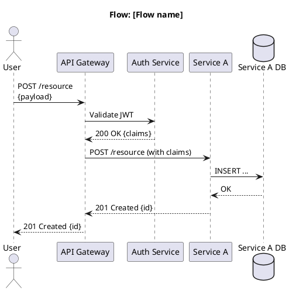
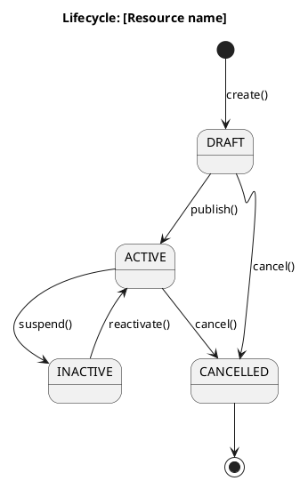
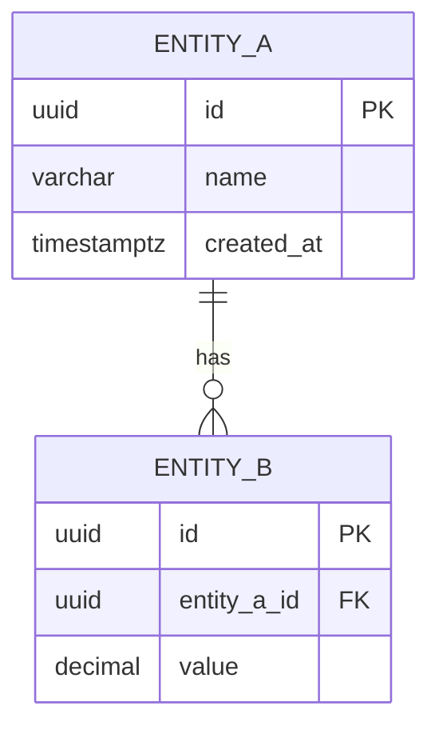

# Diagram Index

> **What to fill in here:** The registry of all system diagrams.
> Diagrams go in `08-uml/diagrams/source/` as PlantUML or Mermaid files.
> Exported renders go in `08-uml/diagrams/exports/` (there is no `rendered/` folder).

---

## When to create a diagram?

```
✓ When the flow involves 3+ services or actors
✓ When the architecture needs to be communicated to a non-technical stakeholder
✓ When data modeling is complex (ER diagram)
✓ When a bug took more than 2 hours to understand (retroactive sequence diagram)

✗ For simple 2-element flows — code describes them better
✗ To "document for documentation's sake" — an outdated diagram is worse than none
```

---

## File naming

```
[c4-level]-[descriptive-name].[puml|mmd]

Examples of the convention (these files do not exist):
  c1-system-context.puml
  c2-container-diagram.puml
  c3-auth-service.puml
  seq-create-order.puml
  erd-orders-service.mmd
  state-order-lifecycle.puml
```

---

## Diagram registry

### Architecture diagrams (C4)

No C4 diagram exists yet. The C4 rows of the earlier template were removed because their files do not exist.

### Sequence diagrams

No sequence diagram exists yet. The earlier placeholder rows (login, main flow, error flow) were removed because their files do not exist.

### State diagrams

No state diagram exists yet. The earlier placeholder row (order lifecycle) was removed because its file does not exist.

### ER diagrams (data)

No ER diagram exists yet. The earlier placeholder rows (orders and auth, Mermaid) were removed because their files do not exist.

### Class diagrams (Traduce Señas)

All sources are based on `backendTS@497feef` (`origin/develop`, 2026-10-05; generated 2026-10-06). They replace the previous set based on `backendTS@c142c80`. Renders: `diagrams/exports/<name>.svg`. Review, changes and comparison with the original team diagram: [`class-diagram-review.md`](class-diagram-review.md).

| ID | Name | Tool | Source file | Description |
|----|------|------|-------------|-------------|
| CL-01 | Backend classes by pattern (main) | PlantUML | [`source/class-backend-patterns.puml`](diagrams/source/class-backend-patterns.puml) | Same package structure as the original diagram (Singleton, Factory Method, Observer, Command, Domain). `<<implementado>>` = exists in code; `<<propuesta>>` = pattern with no code yet |
| CL-02 | Backend overview | PlantUML | [`source/class-backend-overview.puml`](diagrams/source/class-backend-overview.puml) | One package per domain (iam, auth, users, translations, analytics, ia), shared, and the lexicon-service microservice; names only. **Outdated:** it draws the single-process backend (`497feef`, port 3000, `src/domains/*`), which does not match the current services. Pending rewrite |
| CL-03 | Domain auth | PlantUML | [`source/class-backend-auth.puml`](diagrams/source/class-backend-auth.puml) | Entities, domain service, errors, ports, use cases, adapters, routes and module of auth |
| CL-04 | Domain users | PlantUML | [`source/class-backend-users.puml`](diagrams/source/class-backend-users.puml) | Same detail level for users (profile, stats, password change, account deletion) |
| CL-05 | Domain translations | PlantUML | [`source/class-backend-translations.puml`](diagrams/source/class-backend-translations.puml) | Same detail level for translations (history and stats) |
| CL-06 | Domain ia | PlantUML | [`source/class-backend-ia.puml`](diagrams/source/class-backend-ia.puml) | Same detail level for sign templates (DTW) |
| CL-07 | Shared | PlantUML | [`source/class-backend-shared.puml`](diagrams/source/class-backend-shared.puml) | TokenProvider, JWT adapter, auth middleware, role checker, error handler, pg pool, config |
| CL-08 | Planned entities | PlantUML | [`source/class-backend-planned.puml`](diagrams/source/class-backend-planned.puml) | All `<<planned>>`: 4 tables (`user_auth_providers`, `user_sessions`, `user_devices`, `audit_logs`) equivalent to elements of the old diagram that still have no code. The reference is `06-data/traduce_senas.dbml` (32 tables); only these 4 are drawn |
| CL-09 | Domain iam | PlantUML | [`source/class-backend-iam.puml`](diagrams/source/class-backend-iam.puml) | Roles, permissions and their rules (RBAC) |
| CL-10 | Domain analytics | PlantUML | [`source/class-backend-analytics.puml`](diagrams/source/class-backend-analytics.puml) | Usage events and the section report |
| CL-11 | lexicon-service | PlantUML | [`source/class-lexicon-service.puml`](diagrams/source/class-lexicon-service.puml) | Microservice `services/lexicon-service`: sign catalog, categories, resources, events (RabbitMQ) and its own security |
| CL-12 | profile-service | PlantUML | [`source/class-profile-service.puml`](diagrams/source/class-profile-service.puml) | Microservice `services/profile-service` (2026-10-27): daily challenges, challenge-point medals, achievements, notifications (IN_APP and EMAIL), admin weekly/monthly reports, `Mailer` port, report and email workers. See [ADR-009](../05-architecture/decisions/records/ADR-009-daily-challenges.md), [ADR-010](../05-architecture/decisions/records/ADR-010-challenge-points-medals.md) and ADR-007 |

**Check of 2026-11-04.** The class names of `class-profile-service.puml` and the `ADMIN_REPORTS_*` variables were confirmed against `backend/services/profile-service` (v1.4.0); the variable prefix in its notes was corrected. `class-backend-overview.puml` is outdated (see CL-02). CL-03 to CL-10 were not re-read in this check.

**Update of 2026-10-27.** The code now lives in `backend/services/*` (iam, recognition, analytics, lexicon, profile, gateway). CL-03 to CL-10 still describe the single-process backend of `497feef` (paths `src/domains/*`) and have not been re-read against the services; the class names remain a useful guide, but the paths and the later changes (outbox, social login, account deletion codes, 30-day translation retention) are not drawn. Re-check is pending (see [`class-diagram-review.md`](class-diagram-review.md), section 6).

**Exports pending regeneration** (the `.puml` changed on 2026-10-27 but the SVG in `diagrams/exports/` is still the old one; no local PlantUML was available):

| Source | Export | Status |
|--------|--------|--------|
| `class-profile-service.puml` | `class-profile-service.svg` | Pending render: there is no SVG yet. It needs PlantUML, which was not available for the last review |
| `class-backend-planned.puml` | `class-backend-planned.svg` | Outdated: pending render (notifications and user_preferences are no longer planned) |
| `class-backend-overview.puml` | `class-backend-overview.svg` | Outdated source as well (see CL-02): pending rewrite and render |
| `class-backend-patterns.puml` | `class-backend-patterns.svg` | Outdated: regenerate (notes on notifications and subscribers) |

### Use case diagrams (Traduce Señas)

| ID | Name | Tool | File | Description |
|----|------|------|------|-------------|
| UC-01 | Use cases | Unknown (PDF export only, no source) | [`exports/use-cases.pdf`](diagrams/exports/use-cases.pdf) | Imported 2026-10-03 from `github.com/tadeo77789/TraduceSe-as` (`Diagramas/casos de uso.pdf`). Not yet checked against the MVP scope (sign → text/voice only). **Pending update (2026-10-27):** it does not include daily challenges, challenge-point medals, achievement/challenge notices or admin reports by email. The PDF has no source, so it must be redrawn by whoever owns it |

---

## Diagram templates (examples only)

The blocks below use an invented system (Orders, Auth Service). They show the syntax; they are not diagrams of Traduce Señas.

### C4 L1 — Context (PlantUML)

```plantuml
@startuml C4-Context
!include https://raw.githubusercontent.com/plantuml-stdlib/C4-PlantUML/master/C4_Context.puml

title System Context — [System Name]

Person(user, "User", "Description of the user")
Person_Ext(admin, "Administrator", "Manages the system")

System(system, "[System Name]", "Description of what it does")

System_Ext(externalSystem, "[External System]", "Description of the external system")

Rel(user, system, "Uses", "HTTPS")
Rel(admin, system, "Administers", "HTTPS")
Rel(system, externalSystem, "Sends data to", "REST API")

@enduml
```

### Sequence diagram (PlantUML)



### State diagram (PlantUML)



### ER diagram (Mermaid)



---

## Tools and rendering

| Tool | For what | How to use |
|------|---------|------------|
| PlantUML | C4, sequence, state, class diagrams | `plantuml -tsvg file.puml` |
| Mermaid | Simple diagrams in Markdown | Native support on GitHub and GitLab |
| draw.io (diagrams.net) | Complex visual diagrams | Export as XML + image |
| Structurizr | C4 model with DSL | For projects that adopt the C4 DSL |

**Rendering pipeline** (not run in the last review, no PlantUML available):
```bash
# Render all PlantUML diagrams
find 08-uml/diagrams/source -name "*.puml" -exec plantuml -tsvg -o ../exports {} \;

# Or with Docker (without installing PlantUML locally)
docker run --rm -v $(pwd):/data ghcr.io/plantuml/plantuml:latest \
  -tsvg -o /data/08-uml/diagrams/exports /data/08-uml/diagrams/source/*.puml
```

---

## Correlations

- Architecture view → `05-architecture/overview.md`
- Domain bounded contexts → `02-domain/domain-map.md`
- ER models per service → `09-microservices/services/NN/data-model.md`
