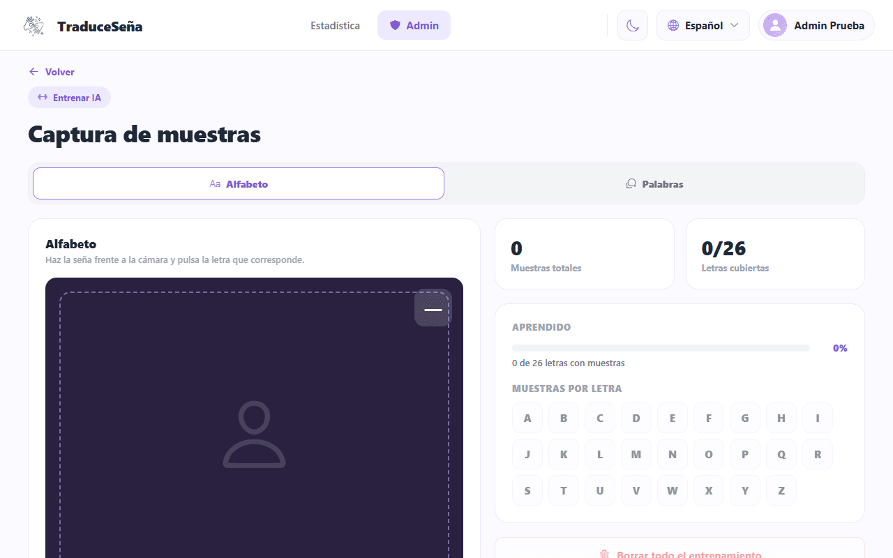

# Administrator Manual

> **Version:** 1.1 · **Date:** 2026-10-27 (section 4.5 and notifications switch updated) · **Audience:** people who manage roles, training and statistics
> **Based on:** Docs `cc30cd7` · Backend `origin/develop` `b29a2fa` · Frontend `origin/develop` `06e7f39`
> **Adapted from:** the English administrator manual v1.4 (2026-10-07), re-checked against the code. Where the
> older manual and the code disagree, this document follows the code.
> **Notation:** `path@branch` means "file `path` on that branch" of Backend or Frontend.
> **Status:** draft written by an agent; human review pending.

## 1. Purpose

This manual is for the person who looks after the system: grants permissions, trains the recognition, reads the
statistics and handles accounts. You do not need to be a developer, but you need to use a terminal and, for some
tasks, run a simple SQL statement.

Installation and architecture are not repeated here:

- Installation: [10-devops/local-setup.md](../10-devops/local-setup.md) and the Backend `README.md@origin/develop`
  (see also [technical-onboarding.md](technical-onboarding.md#day-1--setup)).
- Architecture and services: [05-architecture/](../05-architecture/README.md), [service catalog](../09-microservices/service-catalog.md).
- Incidents and monitoring: [13-operations/](../13-operations/README.md).

Screenshots show the app in Spanish, with fictitious data, from an earlier build.

In the examples, `<token>`, `<email>`, `<userId>`, `<roleName>` and similar are placeholders. Never paste a real
token or password into a document or a chat.

## 2. Roles and permissions

### 2.1 The three roles

Every account has one or more **roles**. At sign-up every person receives **USER**. The other roles are granted by
an administrator.

| Role | For whom | Permissions |
|------|----------|-------------|
| **USER** | Anyone who uses the app | `translation.create`, `translation.read.own`, `translation.delete.own`, `lexicon.read`, `profile.manage.own` |
| **LINGUIST** | Sign language expert who helps with vocabulary | Those of USER plus `samples.capture`, `samples.validate`, `lexicon.write` |
| **ADMIN** | System administration | All 13 permissions: the above plus `users.manage`, `stats.read`, `models.manage`, `notifications.manage`, `security.policy.manage` |

Sources: permission names in `packages/shared/src/security/permissions.ts@origin/develop`; roles and the
permissions of each role in `services/iam-service/db/003_iam_roles_permissions.sql@origin/develop`.

The three base roles cannot be deleted, and neither can a role that is assigned to someone.

Roles and permissions are written **inside the session token (JWT)** when the person signs in. The token lasts
1 day (`DEFAULT_JWT_EXPIRES_IN = '1d'`, `packages/shared/src/config/load_config.ts@origin/develop`).

> **Changes are not immediate.** After you grant a role the person must sign out and sign in again. After you
> **remove** a role (or block an account) the old token **keeps its permissions until it expires**: recognition,
> analytics and lexicon only validate the token and do not ask iam again. Inside iam, sign-in and password recovery check
> `users.status`, and `/api/iam/*` and `/api/users/*` read the database. To cut every session at once, rotate
> `JWT_SECRET` (it closes all sessions, see section 7).

### 2.2 How the services check access

Two mechanisms are used, both from `@traduce/shared` (`packages/shared/src/http/`):

- `requirePermission(<permission>)`: checks the permission list in the token.
- `requireRole('ADMIN')`: checks the role name in the token.

| Area | Route (through the gateway) | Who can call it |
|------|-----------------------------|-----------------|
| IAM | `/api/iam/*` | Signed-in; the use cases require `users.manage` (except `GET /api/iam/me/access`) |
| User statistics | `GET /api/users/stats` | `stats.read` |
| Translation statistics | `GET /api/translations/stats` | `stats.read` |
| Section report | `GET /api/analytics/reports/sections` | `stats.read` |
| Other analytics reports | `GET /api/analytics/summary`, `/top-signs`, `/daily` | Role `ADMIN` |
| Record a usage event | `POST /api/analytics/events` | Any signed-in user |
| Sign templates | `GET /api/sign-templates` | Public |
| Sign templates | `POST` and `DELETE /api/sign-templates` | `models.manage` |
| Gesture samples | `POST` and `GET /api/samples` | Role `ADMIN` (biometric data) |
| Lexicon catalog | `GET /api/lexicon`, `/search`, `/alphabet`, `/categories`, `/:code` | Public |
| Lexicon catalog edits | `POST`, `PATCH`, `PUT`, `DELETE` under `/api/lexicon`, `/api/lexicon/admin/*` | Role `ADMIN` |

Sources: `services/*/src/**/routes.ts@origin/develop`.

### 2.3 What each profile sees in the app

After signing in the app asks the server which permissions the account has (`GET /api/iam/me/access`) and
chooses the tabs (`src/app/providers/AccessContext.tsx@origin/develop` of Frontend):

| If the account has... | Tabs shown |
|-----------------------|------------|
| `users.manage` (ADMIN) | **Statistics** (only with `stats.read`), **Admin** (with `users.manage` or `models.manage`) and **Profile**. **No** Translation, Alphabet or History. |
| No `users.manage` (USER, LINGUIST) | **Translation**, **Alphabet**, **History** and **Profile** |

Important:

- An administrator **does not see the Translation tab**. To test translation use a USER account.
- The `samples.*` and `lexicon.write` permissions of LINGUIST change nothing on screen: the frontend only uses
  `users.manage`, `stats.read`, `models.manage` and `notifications.manage`.
- If the app cannot load the permissions it shows a warning and stays **without** permissions, for safety.
- In **Profile**, the notifications switch is shown only to accounts with `notifications.manage` (ADMIN). It is saved
  in profile-service (`PATCH /api/profile/preferences`) and it decides whether you receive the reports by e-mail
  (section 4.5). It is on by default.

## 3. Creating the first administrator

There is no screen or route to create the first ADMIN. It is done **once**, in the identity database.

1. The person must have **signed up and confirmed their e-mail**.
2. Open a PostgreSQL console in the iam database. With Docker Compose, from the Backend folder (service
   `postgres-iam`, database `iam`, user `postgres`; `docker-compose.yml@origin/develop`):
   ```bash
   docker compose exec postgres-iam psql -U postgres -d iam
   ```
3. Run this, replacing `<email>` with the person's e-mail in lower case:
   ```sql
   INSERT INTO public.user_roles (user_id, role_id)
   SELECT u.user_id, r.role_id
   FROM public.users u, public.roles r
   WHERE u.email = '<email>' AND r.name = 'ADMIN'
   ON CONFLICT (user_id, role_id) DO NOTHING;
   ```
4. The person must **sign out and sign in again**.

The statement also appears, commented out, at the end of `services/iam-service/db/003_iam_roles_permissions.sql@origin/develop`.
If it inserts nothing, the e-mail does not exist: check how it is written. E-mails are stored in lower case.

## 4. Functions of the administrator role

### 4.1 Managing other people's roles

There is **no screen** for this. It is done with the `/api/iam` API using the token of an ADMIN account.
Routes from `services/iam-service/src/iam/adapters/inbound/http/routes.ts@origin/develop`:

| Action | Route |
|--------|-------|
| View roles and their permissions | `GET /api/iam/roles` |
| Give a role to a person | `POST /api/iam/users/<userId>/roles` with body `{"roleName":"<roleName>"}` |
| Remove a role from a person | `DELETE /api/iam/users/<userId>/roles/<roleName>` |
| Delete a role nobody uses | `DELETE /api/iam/roles/<roleId>` |
| View my roles and permissions | `GET /api/iam/me/access` |

Example with `curl` (the gateway is the only entry point; replace `<gateway>` with the address of your gateway
as given in the installation documents):

1. Sign in to get a token (it is in the response):
   ```bash
   curl -X POST <gateway>/api/auth/login -H "Content-Type: application/json" -d '{"email":"<email>","password":"<password>"}'
   ```
2. Give the role:
   ```bash
   curl -X POST <gateway>/api/iam/users/<userId>/roles -H "Authorization: Bearer <token>" -H "Content-Type: application/json" -d '{"roleName":"LINGUIST"}'
   ```
3. There is no search route to find someone's `<userId>`. Look it up in the iam database:
   ```sql
   SELECT user_id, name, email, status FROM public.users WHERE email = '<email>';
   ```

Rules the system enforces:

| Rule | Response |
|------|----------|
| The **last ADMIN** cannot be removed | 409 `LAST_ADMIN` |
| A person cannot be left **without any role** | 409 `ROLE_REQUIRED` |
| The base roles are not deleted | 409 `ROLE_PROTECTED` |
| A role assigned to someone is not deleted | 409 `ROLE_IN_USE` |
| Malformed data (for example a `userId` that is not a number) | 400 `VALIDATION_ERROR` |
| Without the `users.manage` permission | 403 `PERMISSION_ERROR` |
| Role or user does not exist | 404 `NOT_FOUND` |

Routes and responses: [07-api/contracts/openapi/iam-service.yaml](../07-api/contracts/openapi/iam-service.yaml)
(**Known issue:** that contract does not list `/api/iam/*`, `GET /api/users/stats`, `/api/auth/verify-email` or
`/api/auth/resend-verification`; the code is the source of truth);
operation: [09-microservices/services/02-iam-service/runbook.md](../09-microservices/services/02-iam-service/runbook.md).

### 4.2 Admin panel (Admin tab)

The **Admin** tab opens the **Admin panel** (`adminDashboardTitle` in `en.ts@origin/develop`). It shows
(`src/feature/Admin/pages/AdminDashboardScreen.tsx@origin/develop`):

- **A status badge:** "Word templates on this device" or "No word templates on this device".
- **Two counters:** "Recorded words" (words with at least one sample) and "Total samples". The panel does **not**
  show coverage per letter.
- **System:** app version, platform, active language, vision provider and the admin user.
- **Quick actions:** **Train the AI** (training screen) and **Mis repeticiones (modelo)** (model samples screen).
  That second label is hard-coded in Spanish in the code and is not translated.

There is no screenshot of this panel: the one from the earlier build no longer matches the screen.

#### 4.2.1 Training ("Train the AI" screen)

Used to teach signs to the app. It has two tabs: **Alphabet** and **Words**
(`AdminTrainingScreen.tsx@origin/develop`).


*Train the AI, Alphabet tab.*

1. Go to **Admin** > **Train the AI**.
2. In **Alphabet**: make the sign in front of the camera and tap the correct letter. The sample is saved.
3. In **Words**: type the word, tap record and perform the complete sign. Record several takes of the same word;
   the screen shows the progress of takes.
4. **Upload to server** sends this device's word templates to the server (`POST /api/sign-templates`, needs
   `models.manage`).
5. **Download from server** fetches the server templates and **replaces** the local ones.
6. **Clear all training** asks for a double confirmation and cannot be undone.

Every user downloads the server templates when opening the translation screen.

#### 4.2.2 Model samples ("Mis repeticiones (modelo)" button)

The word model learned from people recorded in a studio, with another camera and other light. This screen
(`ModelSamplesScreen.tsx@origin/develop`, reached from the Spanish-only button "Mis repeticiones (modelo)") records **your own** repetitions to readjust it to your camera.

1. Go to **Admin** > **Mis repeticiones (modelo)**.
2. Turn on the camera, choose a sign, perform it completely and stop: each stop saves a repetition. The goal is 10
   repetitions per sign.
3. You can download what was recorded or delete the repetitions of a sign.

These repetitions are kept on the device. No frontend call to `/api/samples` was found in
`api.config.ts@origin/develop`, so the screen does not send them to the recognition-service.

#### 4.2.3 Samples and templates on the server

- **Sign templates** (`sign_templates`): stored by recognition-service, distributed with `GET /api/sign-templates`
  (public), created and deleted with `models.manage`.
- **Gesture samples** (`/api/samples`, ADMIN role): the API exists in recognition-service, stored in MongoDB when
  `MONGO_URL` is set and in memory otherwise (`README.md@origin/develop`). It is **not used by any current screen**.
- Operation, backups and incidents: [09-microservices/services/03-recognition-service/runbook.md](../09-microservices/services/03-recognition-service/runbook.md).
- Data protection of samples: see section 6.

#### 4.2.4 Sign catalog (lexicon)

The lexicon-service exposes administrator routes to manage signs, categories, localizations and media under
`/api/lexicon` (role ADMIN). **No screen in the current frontend uses them** (the app only reads `/api/lexicon`,
`/search` and `/alphabet`). Use the API with an ADMIN token; contract:
[07-api/contracts/openapi/lexicon-service.yaml](../07-api/contracts/openapi/lexicon-service.yaml); operation:
[09-microservices/services/04-lexicon-service/runbook.md](../09-microservices/services/04-lexicon-service/runbook.md).

### 4.3 Statistics (Statistics tab)

The **Statistics** tab appears to accounts with `stats.read`. It loads three sources
(`src/feature/Stats/services/stats.service.ts@origin/develop`):

| Data | Route | Service |
|------|-------|---------|
| Translations (totals, active users, daily, weekly, monthly) | `GET /api/translations/stats` | recognition-service |
| Users (total, active accounts) | `GET /api/users/stats` | iam-service |
| Visits per section | `GET /api/analytics/reports/sections` | analytics-service |

The app records a section visit (`POST /api/analytics/events`, `SECTION_VIEW` for TRANSLATION, ALPHABET, HISTORY)
every time a signed-in user opens one of those sections; failures are ignored silently.

> **Known issue (found by reading the code, not tested end to end):** `GET /api/analytics/reports/sections`
> requires `from` and `to` (`YYYY-MM-DD`); without them the service answers 400 `VALIDATION_ERROR`
> (`parseDateRange` in `services/analytics-service/src/domain/rules.ts@origin/develop`). The frontend calls the
> route without parameters (`stats.service.ts@origin/develop`). Because the three requests are awaited together,
> the Statistics screen may fail to load. Report it to the technical team before relying on this screen.
> The OpenAPI contract also differs from the code: it documents `/api/analytics/sections`, the code serves
> `/api/analytics/reports/sections`.

Reports return only totals, never personal data. Operation:
[09-microservices/services/05-analytics-service/runbook.md](../09-microservices/services/05-analytics-service/runbook.md).

### 4.4 User accounts

The status of each account is in `users.status` (iam database): `ACTIVE`, `INACTIVE` (e-mail not yet
confirmed) or `BLOCKED`.

- **A person does not receive the code:** ask them to use **Resend**. If the e-mail is never sent (the mail
  account `EMAIL_USER` / `EMAIL_PASS` is not configured in the Backend `.env`), activate the account by hand after
  verifying the person's identity:
  ```sql
  UPDATE public.users SET status = 'ACTIVE' WHERE email = '<email>';
  ```
- **Block an account:** `UPDATE public.users SET status = 'BLOCKED' WHERE email = '<email>';`. The person will see
  that the account is blocked the next time they sign in. **It does not end sessions already open**: their token
  keeps working for the services that only validate the token until it expires (up to 1 day). To cut everything
  immediately, rotate `JWT_SECRET` (it closes **all** sessions).
- **Forgotten password:** the app has the full flow (request code, enter code, new password), and the server sends
  the code by e-mail if the mail account is configured. Without the mail account the person cannot recover the
  password by themselves; consult the technical team.
- **Delete account:** Profile has a **Delete account** option (password required), but it **likely fails in the
  Docker deployment** (see the Known issue in section 6). Do not rely on it.

### 4.5 Weekly and monthly reports by e-mail

profile-service sends the administrators a summary of how the app is being used. The decision is recorded in
[ADR-007](../05-architecture/decisions/records/ADR-007-email-notifications.md); this section only says how to use it.

**Who receives them.** Every ADMIN account that has the **Notifications** switch on in Profile (on by default) and
has a profile. The list of administrators is asked to iam; if iam does not answer, the report goes only to the
administrators that profile-service has already seen using the app. If you turn the switch off, you stop receiving
the e-mail and the in-app notice. The e-mail is sent in the language you chose in Profile (Spanish, English, French or
Portuguese). There is nothing else to enable per person.

**What is sent and when** (Colombian time, from 08:00; if the service was down it can still send during the window
shown, after that the report is dropped so old reports are not sent late):

| Report | Covers | Window |
|--------|--------|--------|
| Weekly summary | The last closed week | Monday, until Tuesday 23:59 |
| Monthly summary | The last closed month | Day 1, until day 3 at 23:59 |
| Model reminder | Words and templates currently registered | Wednesday, until Thursday 23:59 |

**What the e-mail contains.** A short text without personal data, built from the totals of the period:

- Weekly: days with activity out of the days of the week (and the best day), the number of translations of the
  week with the change against the previous week, and the most and least visited sections.
- Monthly: translations of the month with the change against the previous month, the closed weeks, and the sections.
  A record month gets its own title.
- Model reminder: how many words and templates are registered.
- The title gives the tone (good, bad or neutral trend; a change of 10 % or more counts). The e-mail has the
  TraduceSeñas logo, a button (in Spanish "Ir a mirar") that opens the Admin panel of the web, and a footer saying you
  receive it because notifications are on. If analytics does not answer, the summary is sent without the sections line.

> Screenshot pending: example weekly e-mail.

**How it is turned on in the installation** (Backend `docker-compose.yml`, service `profile-service`):

| Variable | Use |
|----------|-----|
| `EMAIL_USER`, `EMAIL_PASS` | Mail account (Gmail), the same one iam uses. Without them the e-mails stay **pending** and the service warns at start. |
| `APP_URL` | Address opened by the e-mail button. Default `https://traducesenas.tech`. Must start with `http://` or `https://`. |
| `ADMIN_REPORTS_ENABLED` | `false` turns off the reports. On by default. |
| `ADMIN_REPORTS_TICK_MS` | How often the service checks if a report is due. Default 15 minutes (minimum 1 minute). |

The mail worker looks for pending e-mails every minute and sends them in batches of 20. An e-mail is cancelled if the
person has no e-mail address or has switched notifications off, and marked failed if the mail server refuses it.
A period is sent only once even if the service restarts or runs twice.

The same reports appear as in-app notices of the profile-service. The database change that creates these tables is
`008_admin_reports.sql` (see [technical-onboarding.md](technical-onboarding.md)); in an existing database it must be
applied by hand.

## 5. Periodic tasks

| When | Task |
|------|------|
| Every day | Open the gateway health check (`GET /health` on the gateway): `"status":"ok"` means every service answers; `"degraded"` lists which one is down. Check that you can sign in. |
| Every week | Back up the databases. There is one PostgreSQL per service (`postgres-iam`, `postgres-recognition`, `postgres-lexicon`, `postgres-analytics`, `postgres-profile`) and one MongoDB. Example: `docker compose exec -T postgres-iam pg_dump -U postgres iam > backup-iam.sql`. Keep the files off the computer. |
| When someone joins or leaves | Review their roles (4.1). Remove ADMIN from anyone who no longer needs it, always leaving at least one. |
| When words are added | Train and upload templates (4.2.1). |
| When someone asks for help | Unconfirmed or blocked accounts: see 4.4. |
| When updating the code | Rebuild the images and restart. SQL migrations are applied by Docker **only when a database volume is created for the first time**; for an existing database they must be applied by hand with `psql` (see the FAQ in [technical-onboarding.md](technical-onboarding.md#how-do-i-add-a-database-migration)). |

Incident handling and monitoring: [13-operations/incident-management.md](../13-operations/incident-management.md),
[13-operations/observability.md](../13-operations/observability.md). Per-service runbooks:
[api-gateway](../09-microservices/services/01-api-gateway/runbook.md),
[iam-service](../09-microservices/services/02-iam-service/runbook.md),
[recognition-service](../09-microservices/services/03-recognition-service/runbook.md),
[lexicon-service](../09-microservices/services/04-lexicon-service/runbook.md),
[analytics-service](../09-microservices/services/05-analytics-service/runbook.md),
[profile-service](../09-microservices/services/06-profile-service/runbook.md).
No monitoring or alerting system is deployed today; the runbooks assume Docker Compose.

## 6. Personal data and Law 1581

The project must comply with **Law 1581 of 2012** and **Decree 1377 of 2013** (express and revocable
authorization; the right to know, correct and delete data).

Real status in this version:

- **Known issue: Delete account likely fails in the Docker deployment** (found by code review, **not tested**;
  needs a Backend fix). The app has the option (Profile > Delete account, `DELETE /api/users/me`, password
  required), but `erase` in
  `services/iam-service/src/users/adapters/outbound/postgres/account_repository.ts@origin/develop` runs
  `DELETE FROM public.translations` and `UPDATE public.usage_events` inside the **iam** database. Those tables
  belong to recognition and analytics, and `docker-compose.yml@origin/develop` only creates the identity tables in
  `postgres-iam` (000, 003, 005, 006). The query would fail, the transaction would roll back and the person would
  probably get a server error and keep the account. This matters for the **right to deletion (supresión)** of
  Law 1581 of 2012: do **not** tell users that their account can be deleted from the app. Handle each deletion
  request manually with the team, in every database that holds the person's data. In addition, the use case does
  not emit a `UserDeleted` event yet (`delete_account.ts@origin/develop`), so other services would not be told
  even if the deletion worked.
- The translation history "deletion" in the app marks the record as deleted; check
  [03-recognition-service data model](../09-microservices/services/03-recognition-service/data-model.md) before
  stating that it is erased.
- The reference data model has an open item about gesture samples and the identity of the person who produces
  them (ALIGN-02 in [06-data/open-items.md](../06-data/open-items.md)); regulation requires samples to be unlinked
  from identity. Review it with the team.
- The privacy texts shown by the app have not been checked against the real system. Ask for a legal review before
  using the app with minors or with real data.
- Passwords are stored hashed, and verification codes are hashed as well.
- **Usage records are linked to the user.** Each time a signed-in person opens Translation, Alphabet or History the
  app sends an event with their user id (`recordEvent` in `analytics_controller.ts` and `trackSectionView` in
  `stats.service.ts@origin/develop`). Reports return only totals, but the events themselves are stored with the user.
- **E-mail and name are copied to other services.** When an account is created, iam publishes `UserRegistered`
  with `userId`, `email` and `name` (`publish_registered.ts@origin/develop`) for the other services. Profile stores
  the e-mail and name; analytics keeps only the user id. Any deletion or correction request must cover those copies too.

## 7. Known security risks

| Risk | What it means | What to do meanwhile |
|------|---------------|----------------------|
| **Session secret (`JWT_SECRET`)** | Sessions are JWT tokens; whoever knows the secret can forge sessions, even administrator ones. | Use a long secret value (32+ characters); never store it in the repository or share it; change it if it leaks (all sessions are closed). |
| **Revoked roles and blocked accounts stay active until the token expires** | Permissions travel in the JWT (1 day). Recognition, analytics and lexicon validate only the token. | Rotate `JWT_SECRET` to close every session at once; otherwise wait up to 1 day. |
| **Password strength differs by path** | Change password (signed in): the server enforces the full rule (at least 8 characters, upper case, lower case, number, symbol, at most 72 bytes; `ensureNewPasswordIsValid` in `users/domain/service.ts@origin/develop`). Password reset with a code: the server only checks at least 8 characters (`reset_password.ts`). Sign-up: the server only checks at most 72 bytes (`dto/auth_request.ts`); the full rule is applied only by the sign-up screen. | Accounts created through the API can have weak passwords; ask the technical team to enforce the full rule in sign-up and reset. |
| **Gateway rate limits** | The gateway applies a general rate limit and a stricter limit to login, forgot-password, verify-code and reset-password (`app.ts@origin/develop` of api-gateway). Limits are configurable through environment variables. | Review the values for your installation. |
| **Verification and recovery codes** | Generated with a cryptographic generator; expire after 15 minutes; 5 attempts; 60 s between sends and 5 sends per hour. | Nothing to do; informational. |
| **Biometric samples** | Gesture samples are biometric data. The `/api/samples` API is limited to ADMIN. | Share ADMIN only with trusted people. |
| **Delete account likely fails** | See section 6 (code review, not tested). | Handle each deletion request manually. |
| **No CI, no staging** | Changes are not verified by an automatic pipeline. | Ask developers to run `npm run build` and `npm test` before merging. |
| **Statistics screen** | May fail to load (see 4.3). | Do not base decisions on it until it is fixed. |

## 8. What the system does not do

- It does not translate from text or speech to signs, and it has no 3D avatar.
- It does not replace a certified interpreter.
- Camera recognition works only in the web version.
- The Google and Facebook sign-in buttons do not work.
- It does not send push notifications to the phone (ADR-007 discarded them): administrators receive the reports
  by e-mail (section 4.5). Users see on-screen notices of achievements and daily challenges, which are not e-mailed.

## Known issues of this manual

| # | Issue |
|---|-------|
| 1 | Frontend port `:3000` vs gateway `:8080`, and the frontend nginx pointing to `backend:3000` and `lexicon:3003`: see [technical-onboarding.md](technical-onboarding.md#known-issues). The app cannot reach the gateway out of the box until it is fixed. |
| 2 | Statistics section report called without `from` and `to` (section 4.3). |
| 3 | The OpenAPI contract of analytics-service documents a path that differs from the code (section 4.3). |
| 4 | **The contracts in `07-api` do not reflect `develop`; the code is the source of truth.** `iam-service.yaml` lacks `/api/iam/*`, `/api/users/stats`, `/api/auth/verify-email` and `/resend-verification`; `recognition-service.yaml` lacks `/api/translations/stats` and `/api/translations/me/stats`. |
| 5 | **Delete account likely fails in the Docker deployment** (section 6; code review, not tested; needs a Backend fix). |
| 6 | Revoking roles or blocking accounts is not immediate (sections 2.1 and 4.4). |
| 7 | The frontend image's nginx proxies to hosts that do not exist in the Backend compose (see the technical onboarding known issues). |
