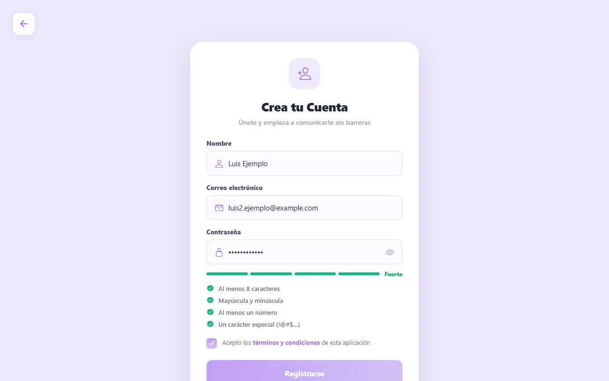
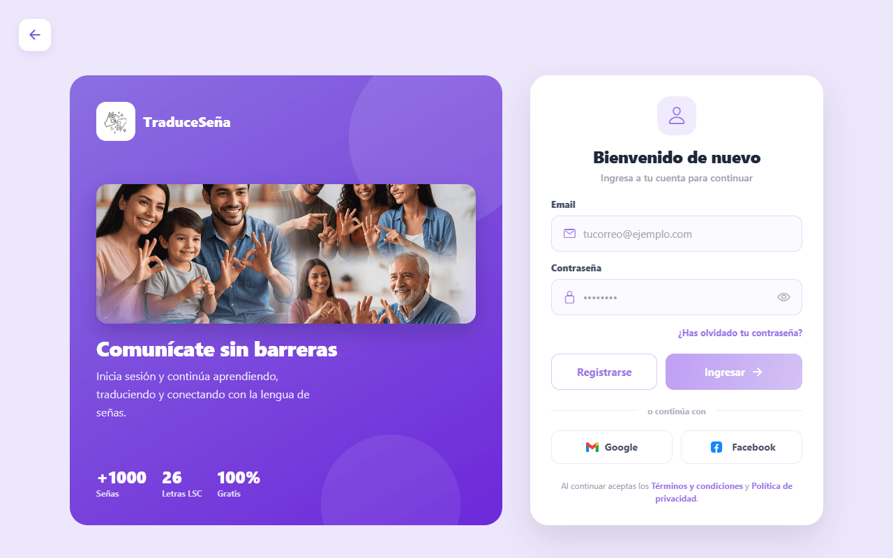
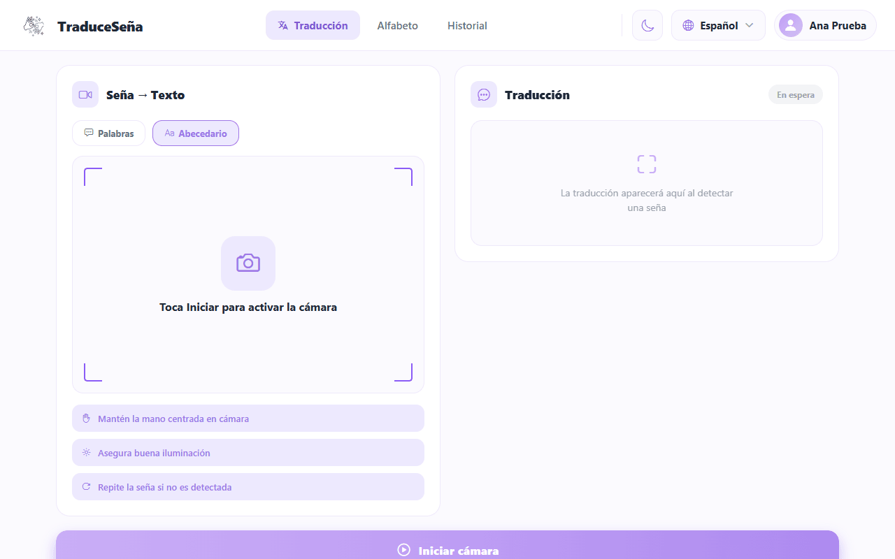
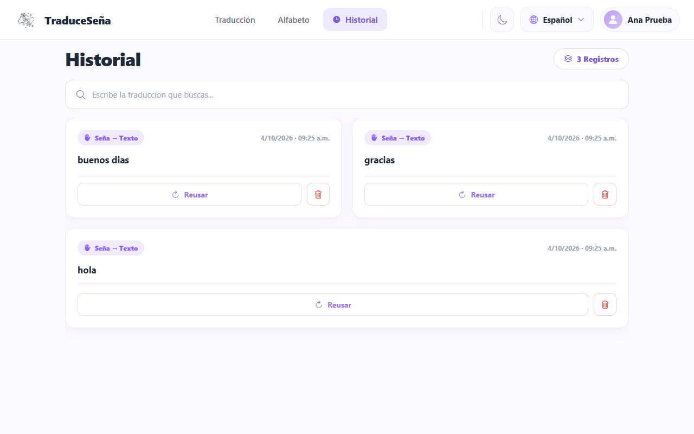

# User Manual

> **Version:** 1.1 · **Date:** 2026-10-27 · **Audience:** people who use the app to translate signs
> **Based on:** Docs `cc30cd7` · Backend `origin/develop` `b29a2fa` · Frontend `origin/develop` `06e7f39`
> **Update 2026-10-27:** sections 4.1, 5.4, 5.5 and the new 5.6 and 5.7 were re-read against Frontend
> `develop` (version 1.2.0) and profile-service: daily challenges, challenge-point medals, achievement and
> challenge notices, History grouped by session, one address per screen. The rest of the manual still
> reflects the earlier build.
> **Adapted from:** the Spanish user manual v1.2 (2026-10-05). Every screen was re-checked against
> `src/feature/*/pages/*` and `src/app/routes/*` of Frontend `origin/develop`, and against
> [12-ux-ui/navigation-map.md](../12-ux-ui/navigation-map.md).
> **Status:** draft written by an agent; human review pending.

## 1. What the system does

Traduce Señas is an app (web, and only partly mobile) that uses the camera to recognize **Colombian Sign Language
(LSC)** and show what it understands as **text**. You can also **listen** to that text read aloud.

Screenshots in this manual show the app in Spanish, with fictitious data, from an earlier build of the
interface. Names between quotation marks are the labels of the English interface; the app also offers Spanish,
French and Portuguese.

## 2. Scope

What it does today:

- Recognizes signs with the camera and turns them into **text**.
- Reads the text **aloud**.
- Saves what was translated in a **history** you can search and delete from.

What it does **not** do (outside the MVP, see [01-context/scope.md](../01-context/scope.md)):

- It does not turn text or voice into signs, and there is no 3D avatar that signs.
- It does not replace a **certified interpreter**. It can be wrong. For important matters (health, legal
  procedures, formal education) use an interpreter.
- It only knows a limited vocabulary: the alphabet and the words listed on the translation screen ("Available signs").

## 3. What you need

| You need | Detail |
|----------|--------|
| A device with a camera | A computer with a webcam, or a phone. |
| A recent web browser | **Camera recognition only works in the web version.** On a phone the app shows a notice: "Sign recognition is not available on mobile yet. Use the web version to translate with the camera." |
| Internet | The app downloads the recognition tools (MediaPipe) when you open the camera. |
| Camera permission | The browser asks the first time. You must accept. |
| Good light | Light from the front or above; avoid windows or lamps behind you. |
| Good framing | Both hands fully visible, with room on the sides. |
| An e-mail address | To create the account and confirm it with a code. |

The address where the app is opened is given by the person who administers it. This manual does not assume one.

## 4. Signing in

### 4.1 Opening the app

The web version starts on a landing page with the options to sign up or sign in, plus public pages (About us,
translator demo, alphabet demo). On a phone the app opens directly on the sign-in screen.

*Landing page (earlier build, Spanish interface).*

On the web every screen has its **own address** (for example `/login`, `/registro`, `/traducir`, `/abecedario`,
`/historial`, `/perfil`, `/seguridad` for changing the password, `/restablecer` for the new password). The address
bar changes as you move, the browser **Back** button returns to the previous screen instead of leaving the site, and
you can bookmark a screen. If you open an address that needs a session without being signed in, the app shows the
initial screen. On a phone the app does not use addresses.

### 4.2 Creating an account

1. Choose **Sign up**.
2. In **Create your Account** enter your full name, your e-mail and a password.
3. The screen asks for a password of at least 8 characters that combines upper case, lower case, numbers and a
   symbol, and shows a strength indicator. **Only the screen applies this full rule at sign-up**; the server only
   rejects passwords longer than 72 bytes. When you later change your password from Profile, the server enforces the
   full rule; when you reset a forgotten password, the server only requires at least 8 characters. Choose a strong
   password in every case.
4. Tick **I accept the terms and conditions** (you cannot continue without it).
5. Press **Sign up**.

*Create your Account, with fictitious data.*

If the e-mail already has an account you will see "This email already has an account".

### 4.3 Confirming your e-mail

Your account stays **inactive** until you confirm your e-mail.

1. Look in your inbox (and spam folder) for a **6-digit code**.
2. On **Confirm your email** type the 6 digits and press **Confirm**.
3. When you see the success message, you can sign in.

*Confirm your email.*

Things to know (limits set by the server, `services/iam-service/src/auth/domain/service.ts@origin/develop`):

- The code **expires after 15 minutes**.
- You get at most **5 attempts** per code.
- To get another code use **Resend**. Wait **60 seconds** between sends; at most **5 sends per hour**.
- If you see "We couldn't send the code, request a new one", the account was created: ask for the code with **Resend**.
- The e-mail is only sent if the administrator configured the mail account. If no code ever arrives, see section 8.
- The app keeps your password **in memory only** for up to **30 minutes** to finish the confirmation. If the time runs
  out or you reload the page, you will see "Sign in to finish confirming your email": sign in again and continue.

### 4.4 Signing in and signing out

1. Open the sign-in screen.
2. Type your e-mail and password and press **Sign in**.

*Sign in.*

The figures on the left panel of the sign-in screen ("+1000 Señas", "26 Letras LSC", "100% Gratis") are fixed
marketing text in the screen code (`LoginScreen.tsx@origin/develop`). They do **not** describe the real vocabulary
of the app (see section 6).

Possible messages:

| Message | What it means |
|---------|---------------|
| Incorrect email or password | Check what you typed. |
| Confirm your email to continue | The code from section 4.3 is missing. |
| Your account is blocked. Contact support. | An administrator blocked the account. |
| Could not reach the server. Check your connection and try again. | Check your internet or tell the administrator. |
| Your session has expired. Please sign in again. | Sign in again. |

> **Google and Facebook (to verify):** this manual said these buttons did not work. The 2026-10-27 code review shows
> that the web app now has Google and Facebook login hooks and the server has `google_login` and `facebook_login`, but
> the flow was **not tested** for this update and depends on the administrator's setup. If it fails, use e-mail and password.

To **sign out**, open **Profile** and press **Sign out**.

### 4.5 Forgot your password

1. On the sign-in screen press **Forgot your password?**
2. Enter your e-mail and press **Send code**.
3. Enter the 6-digit code, then choose a new password.

The server answers the same way whether or not the account exists, so you will not be told if the e-mail is
unknown. The code follows the same limits as section 4.3. The code is only delivered if the administrator has
configured the mail account; if no e-mail arrives, ask the administrator for help.

## 5. What a user can do

After signing in you see tabs: **Translation**, **Alphabet** and **History**, plus **Profile**.

> If your account has the administrator permission, you see **Statistics** and **Admin** instead of the
> translation tabs. That is explained in the [administrator manual](admin-manual.md).

### 5.1 Translating signs to text

The **Translation** screen has two modes, chosen with two buttons:

- **Words**: recognizes whole LSC words. It is the default mode. Web only.
- **Alphabet**: recognizes letters (finger spelling).

*Translation screen, Words mode.*

#### Words mode

1. Choose **Words**.
2. Press **Start camera**. If the browser asks for permission, accept.
3. Wait while the gesture model loads (the first time takes longer).
4. Stand in front of the camera with your hands visible.
5. Make the **complete sign, clearly and calmly**. The screen shows its progress ("signing", "analyzing").
6. When the app is sure, the word appears among the confirmed signs. **Each confirmed sign is saved to your
   history automatically.**
7. Press **Stop** when you finish.

*Active camera; the camera image is simulated.*

Tips shown by the app: keep your hand centered in the camera, ensure good lighting, repeat the sign if it is
not detected. If you see a low-confidence or "not recognized" message, repeat the sign more slowly. If you
see that no hands are detected, move closer or center your hands.

#### Alphabet mode

1. Choose **Alphabet** and press **Start camera**.
2. Make the letter in front of the camera and hold it for a moment.
3. Recognized letters are added to the recognized text.
4. Use the space, delete and clear controls to separate words, remove the last letter or start over.
5. Press **Stop** when you finish. **When you press Stop, the recognized text is also saved to your history.**

*Alphabet mode selected.*

The confidence value is how sure the app is about what it read: higher is better.

### 5.2 Listening to and copying the result

- Press the **speaker icon** (**Listen**) to have the device read the text aloud.
- Press the **copy icon** to put the text on the clipboard.

### 5.3 Alphabet

The **Alphabet** tab shows the LSC letters. Select a letter to see its sign. It is useful for practicing before
using the Alphabet mode. The letters are loaded from the server when it is available. If the server cannot be
reached, the app shows the message "Could not load the alphabet from the server. Only the letters are shown,
without images."; in that case you only get the letters, without the sign images.

*LSC alphabet.*

### 5.4 History

The **History** tab lists your saved translations (the latest 100). Translations made in the same sitting are
grouped: you see **one card per session**, with the date, the start and end time and the words joined in one text.
A card with several words shows "N words" and **Show words**; pressing it opens the detail with each word.
The screen reminds you that "Translations are kept for 30 days and then deleted."

*History with example translations (earlier build, one row per translation).*

> Screenshot pending: History with session cards.

1. Type in the search box to filter.
2. To **delete**, press the **trash icon** on the card and confirm. On a session card the message says "Do you want
   to delete this session? Its N words will be deleted." and all its words are deleted. If any word cannot be
   deleted, the app tells you and keeps that word on screen.
3. If you have not translated anything yet you will see "No translations".

The **Reuse** button on a record only shows a message with the text ("Translate again?"). It does **not**
translate again yet.

### 5.5 Profile

| Option | What it does |
|--------|--------------|
| **Theme** (Light / Dark) | Changes the colors of the app. |
| **App language** | Spanish, English, French or Portuguese. |
| **Change password** | You enter your current password and a new one. If the current password is wrong the app says so. |
| **Terms and conditions** / **Privacy policy** | The legal texts of the app. See section 7. |
| **Achievements** | Medals (bronze, silver, gold) with your progress, grouped by category. Some are still marked "Coming soon". See section 5.6. |
| **Sign out** | Leaves your account. |
| **Delete account** | Asks for your password. **Known issue: it likely fails in the Docker deployment.** See section 7. |

At the top of the Profile screen you see **four indicators** that adapt to the screen width (in a row on a wide
screen, in a grid on a phone): **Translations**, **Distinct texts**, **Available achievements** (how many you have
unlocked) and **Challenge points** (the total you have earned with daily challenges). They come from the server. If
the challenge points cannot be loaded you see "Could not load your challenge points." with a **Retry** button.
Administrators do not see achievements or challenge points.

> Screenshot pending: Profile with the four indicators.

> **Notifications switch.** If your account has permission to manage notifications, Profile shows a
> **Notifications** switch. It is saved on the server. When it is off you still earn challenge points and medals, but
> you get no on-screen notices (section 5.7).

### 5.6 Daily challenges and medals

Every day you get **one challenge**, shown in the **Daily challenge** card on the **Translation** screen (not for
administrators). The challenge asks you to save a number of translations that day: **1, 3, 5 or 8**, worth
**5, 10, 15 or 25 points**. The challenge changes every day, and the day is counted with Colombian time.

The card shows:

- The name ("Saved translations: N") and the rule: "Save and confirm N translations today. Each saved translation
  counts once; a sentence is not counted by word."
- A progress bar and the text "X of N translations".
- The points: "P points on completion" while it is pending, and "P points awarded" once you finish.
- The state: **In progress** or **Completed**.

The card refreshes by itself each time one of your translations is saved. If it cannot be loaded you see "Could not
load the challenge." and a **Retry** button; if there is no challenge you see "No active challenges today."
The texts are available in Spanish, English, French and Portuguese.

> Screenshot pending: Daily challenge card on the Translation screen.

**Medals for challenge points.** The points of completed challenges add up (the **Challenge points** indicator of
Profile). The medals of the **Achievements** catalogue that depend on those points unlock on their own when your total
reaches their goal. Each medal has a level (bronze, silver or gold). Points
are granted once per challenge: finishing the same challenge again does not add more.

### 5.7 Notices

When you complete a challenge or unlock a medal, a **notice** appears at the top of the screen for a few seconds:
"Daily challenge completed!" with "P points granted", or "Unlocked" with the name of the medal. Several notices
wait in a queue and appear one after another; the **×** button closes one. Notices only appear if the
**Notifications** switch of Profile is on and the app is open and connected; they do not repeat events from before
you opened the app. The same notice is also saved in your notifications list as read once it has been shown.

## 6. Known limitations

- **Short vocabulary.** The app only recognizes the alphabet and the words listed under "Available signs".
- **Camera and light.** The model learned from people recorded under certain conditions. With another camera,
  distance or low light it can fail even if your sign is right.
- **It can be wrong.** Always check the text. Do not use the app as the only source in important situations.
- **Recognition only on the web.** On a phone, camera recognition is not available yet.
- **One direction only.** Sign to text or voice.
- **Google and Facebook sign-in:** not verified in this update (see section 4.4).
- **Reuse in History:** only shows a message.
- **Delete account:** likely fails (see section 7).
- **Statistics:** only administrators see the usage statistics.

## 7. Your data and privacy

- The app asks for the camera only to recognize signs. Recognition is processed in your browser.
- The app stores your account data (name, e-mail, protected password) and your translation history.
- The app also records **usage events**: each time you open Translation, Alphabet or History, an event linked to your
  user is sent to the analytics service. Reports show only totals.
- When you create an account, your **e-mail and name are copied to the profile service**; analytics keeps only your user id.
- Colombian law (Law 1581 of 2012 and Decree 1377 of 2013) gives you the right to know, correct and ask for the
  deletion of your data.
- **Known issue: Delete account likely fails in the Docker deployment** (found by reading the Backend code, not
  tested; it needs a Backend fix). The deletion runs queries on tables that do not exist in the identity database,
  so you would probably see an error and keep your account. The **right to deletion** of Law 1581 of 2012 therefore
  cannot be assumed to work from the app: ask the person who administers the app to handle your request manually,
  including data kept by other services such as your translation history.
- The legal texts shown by the app (Terms, Privacy policy) have not been checked against how this version works;
  this manual does not repeat their claims.

## 8. If something fails

| Problem | What to do |
|---------|------------|
| The camera does not turn on | Accept the camera permission in the browser (padlock icon next to the address). Close other apps that use the camera. |
| The model keeps loading | Check your internet and reload the page. |
| The sign is not recognized | More light, hands centered, repeat calmly. Move a bit closer or further. |
| The code does not arrive by e-mail | Check spam; wait 60 s and use **Resend** (at most 5 per hour). If it never arrives, the administrator may not have set up the mail account. |
| "Incorrect or expired code. Request a new one." | Ask for a new code and use it within 15 minutes. |
| "Your session has expired. Please sign in again." | Sign in again. |
| The app does not open or says it cannot reach the server | Tell the administrator: the service may be stopped. |

## 9. Short glossary

| Word | Simple meaning |
|------|----------------|
| **LSC** | Colombian Sign Language. |
| **Sign** | A gesture with the hands that means a word or a letter. |
| **Alphabet / finger spelling** | Spelling with the hands, letter by letter. |
| **Confidence** | How sure the app is about what it recognized. |
| **History** | The list of your saved translations. |
| **Session** | The time you are inside your account. |
| **Certified interpreter** | A professional accredited in LSC. This app does not replace one. |
